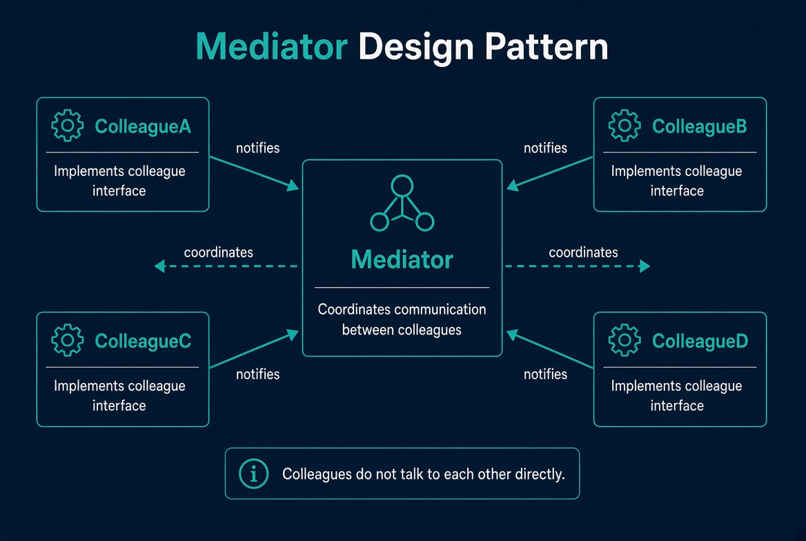
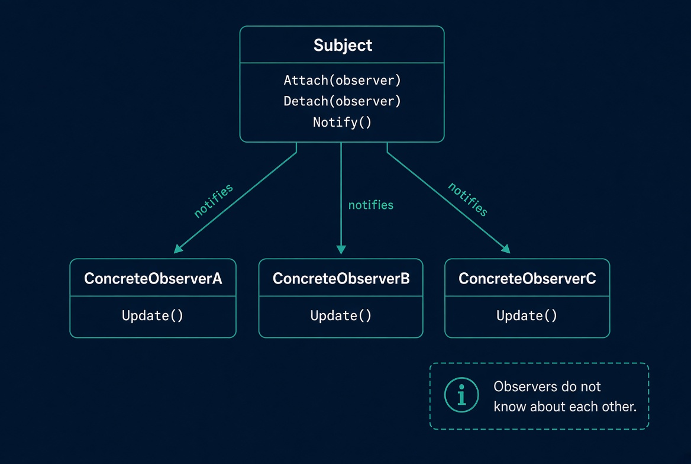
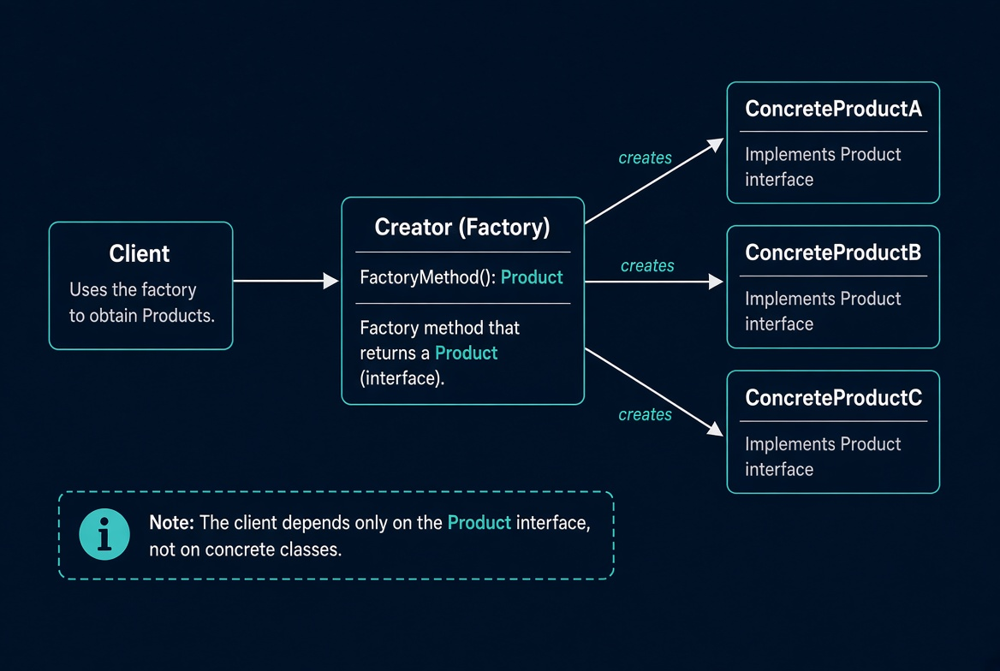
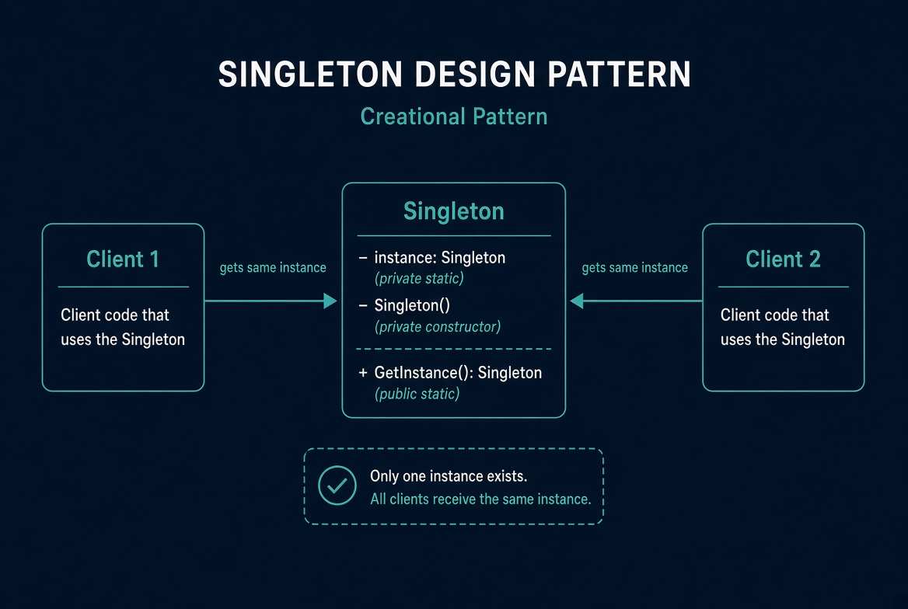
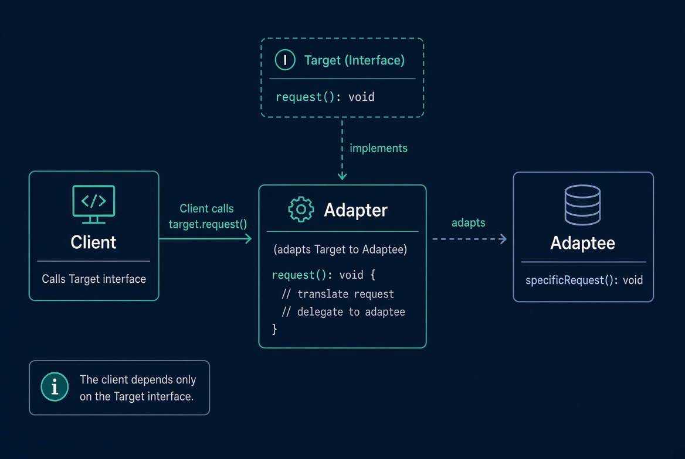

# Architecture patterns: background reference

General patterns that relate to REA's design. For REA itself, see [the REA guide](./rea-guide.md).

## Contents

1. [Event sourcing](#event-sourcing)
2. [CQRS (and how it compares to event sourcing)](#cqrs-and-how-it-compares-to-event-sourcing)
   - [Implementation patterns](#implementation-patterns)
   - [CQRS vs. event sourcing](#cqrs-vs-event-sourcing)
   - [When to use CQRS, event sourcing, or both](#when-to-use-cqrs-event-sourcing-or-both)
   - [Command handlers](#command-handlers)
   - [Mediator pattern](#mediator-pattern)
3. [Observer pattern](#observer-pattern)
4. [Factory pattern](#factory-pattern)
5. [Singleton pattern](#singleton-pattern)
6. [Adapter pattern](#adapter-pattern)
7. [When to use which](#when-to-use-which)

## Event sourcing

Event sourcing stores the sequence of state-changing events as the source of truth and derives current state by replaying them (a left fold over the stream):

```
CRUD:            UPDATE accounts SET balance = 42.50 WHERE id = 1;
Event sourcing:  AccountOpened {id:1, owner:"Alice"}
                 MoneyDeposited {id:1, amount:100.00}
                 MoneyWithdrawn {id:1, amount:57.50}
```

**Aggregate example:**

```csharp
public class Order
{
    private readonly List<IDomainEvent> _events = new();

    public static Order Place(string customerId, IEnumerable<OrderItem> items)
    {
        var order = new Order();
        order.Apply(new OrderPlaced(Guid.NewGuid(), customerId, items.ToList()));
        return order;
    }

    public void Apply(IDomainEvent @event)
    {
        // Mutate internal state from the event
        // Simplified: real code separates recording a new event from applying an event during replay
        _events.Add(@event);
    }

    public IReadOnlyList<IDomainEvent> UncommittedEvents => _events;
}
```

- **Properties:** immutable, append-only events; full history retained; current state is a projection, and many read models can come from one stream; often paired with CQRS (writes to the event store, reads from optimized projections).
- **Benefits:** complete audit trail, "state at time T" queries, debugging by replay, projections that evolve independently of the write model.
- **Costs:** more complexity (event store, projections, eventual consistency, event versioning), replay cost that grows with the stream (mitigated by snapshots), careful schema evolution or upcasting, and poor fit for plain CRUD with no audit needs.
- **Good fit:** strong audit or compliance needs, reconstructing past states, multiple consumers needing different views, complex domain logic.

**Relation to REA.** Both treat an append-only, immutable record as the source of truth and derive projections from it: REA's Evidence and unknown revisions play the role of the event stream, and the obligation ledger is a derived projection. The difference is emphasis: event sourcing is organized around domain events, while REA focuses on the cryptographic identity of each record.

## CQRS (and how it compares to event sourcing)

CQRS (Command Query Responsibility Segregation) separates the model and path for **commands** (writes that change state and enforce invariants) from **queries** (reads shaped for consumers). Event sourcing is a persistence strategy; CQRS is a separation of read and write models. They're independent: use either, both, or neither. They're often combined because an event log makes it natural to build several read models through projections.

### Implementation patterns

| Pattern                  | Description                                                                                                                  | Consistency              | Complexity | Fits when                                                                    |
| ------------------------ | ---------------------------------------------------------------------------------------------------------------------------- | ------------------------ | ---------- | ---------------------------------------------------------------------------- |
| Logical separation only  | Same database and tables; separate command and query code paths, DTOs, handlers                                              | Strong                   | Low        | Complex domain logic, similar read/write shapes                              |
| Materialized or DB views | Normalized write tables; read model is a view or denormalized table in the same DB                                           | Strong or near-real-time | Low–medium | Expensive joins or different read shapes, one database                       |
| Separate read store      | Write side keeps current state (or CDC/outbox); a projector maintains a denormalized store (Redis, MongoDB, OpenSearch, SQL) | Eventual                 | Medium     | Read and write load or shapes differ a lot; full history not needed          |
| CQRS + event sourcing    | Write side appends events; projections subscribe and maintain read models; aggregates rebuilt by replay                      | Eventual (write to read) | High       | Audit, temporal queries, multiple evolving read models, event-driven domains |

Building blocks: **commands** (validated intent), **queries** (pure reads), **projections** (events or change data into read models, sync or async), **snapshots** (avoid replaying long streams), and **outbox / CDC** (reliable publishing without a pure event store).

### CQRS vs. event sourcing

| Aspect           | CQRS alone                                          | Event sourcing                                              | Both                             |
| ---------------- | --------------------------------------------------- | ----------------------------------------------------------- | -------------------------------- |
| Source of truth  | Current state                                       | Immutable event log                                         | Immutable event log              |
| Read model       | Separate projection of current state                | Optional (querying the log directly is usually impractical) | Projections from the stream      |
| History / audit  | Manual or extra tables                              | Built-in                                                    | Built-in                         |
| Temporal queries | Limited                                             | Native ("state at time T")                                  | Native                           |
| Replay / rebuild | No (limited via CDC)                                | Yes                                                         | Yes                              |
| Consistency      | Strong on write; eventual on read if separate store | Aggregate-level                                             | Eventual between write and read  |
| Schema evolution | Traditional migrations                              | Event versioning / upcasting                                | Versioning + projection rebuilds |
| Complexity       | Low–medium                                          | Medium–high                                                 | High                             |
| Best for         | Different read/write scaling or shapes              | Audit, history, event-driven domains                        | Both needs at once               |

### When to use CQRS, event sourcing, or both

- **CQRS without event sourcing:** read and write patterns diverge but you don't need immutable history; views or a denormalized store are often enough.
- **Event sourcing:** history is a first-class requirement (finance, compliance, order lifecycles, workflows).
- **Both:** you truly need independent read models _and_ an event log; the most powerful and most over-applied option.

Most systems need neither. Start with a well-modeled write side and ordinary queries; add a read model only when one model hurts performance or clarity, and event sourcing only when history itself is required.

**Relation to REA.** REA loosely mirrors the combined shape: tools that analyze or update unknowns act like commands appending immutable records, while summaries, paged views, comparisons, and the obligation ledger are read-side projections rebuilt from the bundle.

### Command handlers

A command handler is the application-layer entry point for a state-changing use case. It receives a command (usually via a command bus or mediator), loads the relevant aggregate(s) from the write store, invokes domain logic that enforces invariants, persists the result (save state or append events), and optionally publishes events or returns a result such as a new ID. Keep it thin: rules belong in the aggregate or domain services.

```csharp
public class PlaceOrderHandler : ICommandHandler<PlaceOrder>
{
    private readonly IOrderRepository _orders;
    public PlaceOrderHandler(IOrderRepository orders) => _orders = orders;

    public async Task Handle(PlaceOrder command)
    {
        var order = Order.Place(command.CustomerId, command.Items);
        await _orders.Save(order);
    }
}
```

With event sourcing, the handler rebuilds the aggregate by replay, calls a method that produces new events, and appends them:

```csharp
public void Handle(MarkSeatsAsReserved command)
{
    var order = repository.Get(command.OrderId);
    order.MarkSeatsAsReserved(command.Seats);
    repository.Save(order, command.Id.ToString());
}
```

| Validation layer               | Checks                                       | Lives in                                                                     |
| ------------------------------ | -------------------------------------------- | ---------------------------------------------------------------------------- |
| Structural / input             | Required fields, formats, ranges             | Before the handler (API model, validator, pipeline)                          |
| State-dependent business rules | "Does this aggregate allow this transition?" | Aggregate methods or domain services                                         |
| Cross-aggregate / set-based    | Uniqueness, existence of related entities    | Domain service, separate aggregate, or (carefully) a query that may be stale |

Rejection inside the handler or aggregate (concurrency conflicts, invariant violations) is expected.

**Common patterns:** one handler per command; a mediator or command bus for routing (MediatR in .NET); pipeline behaviors for logging, validation, transactions, and outbox; thin handlers with rich aggregates; domain services for rules that span aggregates or need external data.

**Avoid:** read-model queries for decisions that need strong consistency, non-trivial business rules in the handler, sprawling handlers with many unrelated dependencies, and publishing integration events before the write is durable (use a transactional outbox).

With or without event sourcing the job is the same: the handler coordinates, and the domain model decides what's valid.

### Mediator pattern



A behavioral pattern that replaces many-to-many references with many-to-one: objects (colleagues) talk through a central mediator instead of calling each other directly.

```
Without:  A→B  A→C  B→C  B→D  C→D
With:     A → Mediator ← B
          C → Mediator ← D
```

Roles: the **Mediator** defines the communication interface, the **Concrete Mediator** holds the colleagues and the coordination logic, and **Colleagues** know only the mediator.

```csharp
public interface IMediator { void Notify(object sender, string eventName); }

public class ConcreteMediator : IMediator
{
    public ComponentA A { get; set; }
    public ComponentB B { get; set; }

    public void Notify(object sender, string eventName)
    {
        if (eventName == "AChanged") B.ReactToA();
        else if (eventName == "BChanged") A.ReactToB();
    }
}
```

- **Benefits:** loose coupling, interaction rules in one place, collaboration changes often touch only the mediator, simpler colleagues.
- **Drawbacks:** the mediator can become a god object, it can hide the communication flow, and overuse adds indirection.

**In CQRS** the mediator usually appears as the command/query bus: an endpoint dispatches a request, the mediator routes it to its handler, and handlers stay independent of transport and of each other. Libraries like MediatR (.NET) give a single `Send`/`Publish` entry point, resolve handlers by type, and wrap requests in pipeline behaviors (validation, logging, transactions). Here the colleagues are handlers and the mediator mostly routes and applies cross-cutting steps rather than coordinating business logic.

**Command-bus implementation** (DI-resolved handler):

```csharp
public interface IMediator
{
    Task Send<TCommand>(TCommand command) where TCommand : ICommand;
}

public class Mediator : IMediator
{
    private readonly IServiceProvider _services;
    public Mediator(IServiceProvider services) => _services = services;

    public async Task Send<TCommand>(TCommand command) where TCommand : ICommand
    {
        var handler = _services.GetRequiredService<ICommandHandler<TCommand>>();
        await handler.Handle(command);
    }
}
```

- **Useful when:** many objects collaborate and direct references would form a dense graph, you want one place to intercept or decorate requests, or you're building a command/query bus.
- **Less useful when:** interactions are simple and few, or the mediator would end up holding domain logic that belongs in the domain model or application services.

## Observer pattern

A behavioral pattern where a **subject** keeps a list of **observers** and notifies them automatically when its state changes, without knowing their concrete types: a one-to-many dependency.



- **Subject**: holds the observer list; `Attach`, `Detach`, `Notify`.
- **Observer**: the notification interface (`Update()`).
- **Concrete subject**: holds the state of interest and calls `Notify()` when it changes.
- **Concrete observer**: implements the update logic, either keeping a reference to the subject or receiving the data in the notification. Observers don't reference each other; they depend only on the subject (or the data it pushes), so the one-to-many dependency can be extended at runtime.

```csharp
public interface IObserver { void Update(string state); }

public class Subject
{
    private readonly List<IObserver> _observers = new();
    private string _state;

    public void Attach(IObserver observer) => _observers.Add(observer);
    public void Detach(IObserver observer) => _observers.Remove(observer);

    public void SetState(string state) { _state = state; Notify(); }

    private void Notify()
    {
        foreach (var observer in _observers) observer.Update(_state);
    }
}
```

- **Benefits:** loose coupling, open/closed (add observers without changing the subject), attach and detach at runtime.
- **Drawbacks:** notification order usually isn't guaranteed, a slow or failing observer can disrupt the rest, strong references can leak memory without careful detachment, and cascading updates are hard to reason about.

**Variants:** push vs. pull of changed data; language events and delegates (C# events, JS callbacks); **publish–subscribe**, which decouples further through a channel or broker and is often async and distributed, whereas classic observer is in-process and direct; and reactive streams with composition operators.

**Relation to CQRS and event sourcing.** The event store or bus is the subject; projections, process managers, and integration handlers are observers that update read models or trigger side effects when events are appended. Classic observer is synchronous and tightly scoped, while event-sourced projections are usually asynchronous, durable, and rebuildable by replay.

- **Useful when:** one object's change must trigger reactions in several independent objects, the set of interested parties isn't fixed at design time, or you want to avoid hard-coded call chains.
- **Less useful when:** there are only one or two fixed collaborators, or you need strong ordering, transactions, or guaranteed delivery across processes (use a broker or outbox).

## Factory pattern

A creational pattern where a client gets objects through a factory method instead of constructing concrete classes itself.



- **Client**: requests a product from the factory without knowing the concrete class.
- **Creator (Factory)**: defines the factory method that returns a `Product`.
- **Concrete products**: the specific objects the factory can create, each implementing `Product`.

The client depends only on the abstract `Product` interface, not on the concrete implementations.

**Intent.** Create objects without naming their exact class: client code works with the abstract product, and subclasses override a factory method to decide which concrete class to instantiate (a "virtual constructor").

**Structure.** **Product** (interface or abstract class), **ConcreteProduct** (implementations), **Creator** (declares `FactoryMethod()` returning `Product`, and may hold core logic that uses it), and **ConcreteCreator** (overrides the factory method to return a specific product).

**How it works.** The client calls the creator; the creator (or its subclass) runs the factory method; it returns a concrete product typed as `Product`; the client uses it only through the abstract interface.

```csharp
// Product
public abstract class Document { public abstract void Open(); }

// Concrete products
public class PdfDocument : Document { public override void Open() { /* ... */ } }
public class WordDocument : Document { public override void Open() { /* ... */ } }

// Creator
public abstract class Application
{
    public abstract Document CreateDocument(); // factory method

    public void OpenDocument()
    {
        Document doc = CreateDocument();
        doc.Open();
    }
}

// Concrete creators
public class PdfApplication : Application
{
    public override Document CreateDocument() => new PdfDocument();
}

public class WordApplication : Application
{
    public override Document CreateDocument() => new WordDocument();
}
```

- **Benefits:** loose coupling to the abstract product, extensibility through new concrete creators without touching client code, and creation logic isolated from use.
- **Trade-offs:** more classes and indirection than a constructor call; heavy when creation is trivial or there's only one product type.

| Pattern          | Who decides the concrete type                              | Typical use                                                            |
| ---------------- | ---------------------------------------------------------- | ---------------------------------------------------------------------- |
| Simple factory   | One factory class (often a switch or if)                   | One place that creates several related objects                         |
| Factory method   | A subclass overriding the factory method                   | Frameworks or hierarchies where each subclass knows its product        |
| Abstract factory | A family of factories creating families of related objects | Related products that must stay consistent (e.g., UI toolkit families) |

### Example: REA provider factory (illustrative)

Illustrative C# sketch of the idea; REA itself is a TypeScript/Node package, so this isn't its actual code.

```csharp
// Product: the provider-neutral contract
public interface IBinaryAnalysisProvider
{
    string ProviderId { get; }
    Task<Evidence> AnalyzeAsync(string artifactPath, AnalysisOptions options);
}

// Concrete products
public class GhidraProvider : IBinaryAnalysisProvider
{
    public string ProviderId => "ghidra";
    public Task<Evidence> AnalyzeAsync(string artifactPath, AnalysisOptions options)
        => throw new NotImplementedException(); // Ghidra-specific analysis and Evidence construction
}

public class IdaProvider : IBinaryAnalysisProvider
{
    public string ProviderId => "ida";
    public Task<Evidence> AnalyzeAsync(string artifactPath, AnalysisOptions options)
        => throw new NotImplementedException(); // IDA-specific analysis and Evidence construction
}

// Creator
public abstract class ProviderFactory
{
    public abstract IBinaryAnalysisProvider CreateProvider(); // factory method

    public async Task<Evidence> Analyze(string artifactPath, AnalysisOptions options)
    {
        var provider = CreateProvider();
        return await provider.AnalyzeAsync(artifactPath, options);
    }
}

// Concrete creators
public class GhidraProviderFactory : ProviderFactory
{
    public override IBinaryAnalysisProvider CreateProvider() => new GhidraProvider();
}

public class IdaProviderFactory : ProviderFactory
{
    public override IBinaryAnalysisProvider CreateProvider() => new IdaProvider();
}
```

Client code and higher-level services depend only on `IBinaryAnalysisProvider` and `ProviderFactory`. Choosing Ghidra or IDA means choosing a concrete factory; everything else stays provider-neutral.

- **Pros:** client and domain code never depend on a concrete adapter; new providers need only a new product and factory, with no client changes; creation logic stays isolated from the analysis pipeline; and it fits REA's provider-neutral contract, so one Evidence-producing workflow runs against different backends.
- **Cons:** extra classes even when selection is simple; the factory hierarchy must stay in sync with available providers, and a missing or misconfigured factory fails only at creation time; overkill with a single provider; and it doesn't decide _which_ factory to use at runtime, which still needs config, DI, or a simple factory on top.

## Singleton pattern

A creational pattern where one class controls its own instantiation so only a single instance exists. The constructor is private to prevent outside creation, and clients get the same instance through a static access point (typically `GetInstance()`).



- **`instance`** (private static): holds the one instance.
- **`Singleton()`** (private constructor): blocks external `new`.
- **`GetInstance()`** (public static): returns the shared instance, creating it on first use.

### Example: provider registry (illustrative)

This sketch uses eager initialization (a static field exposed through an `Instance` property), while the diagram shows lazy creation in `GetInstance()`.

```csharp
public sealed class ProviderRegistry
{
    private static readonly ProviderRegistry _instance = new();
    private readonly Dictionary<string, IBinaryAnalysisProvider> _providers = new();

    // Private constructor prevents external instantiation
    private ProviderRegistry() { }

    public static ProviderRegistry Instance => _instance;

    public void Register(IBinaryAnalysisProvider provider)
        => _providers[provider.ProviderId] = provider;

    public IBinaryAnalysisProvider Get(string providerId)
        => _providers.TryGetValue(providerId, out var p)
            ? p
            : throw new KeyNotFoundException(providerId);
}
```

Clients get the same registry through `ProviderRegistry.Instance`; the private constructor and static field guarantee one instance. Like the factory example, this is a C# sketch, not REA's TypeScript code.

- **Pros:** exactly one instance of a shared resource (registry, configuration, connection pool, logger); a well-known access point without threading the object through every constructor; lazy or eager initialization controlled in one place; a good fit for process-wide caches or registries whose providers are fixed for the process lifetime.
- **Cons:** global mutable state makes tests interfere with each other; dependencies are hidden because callers don't declare them; heavy unsynchronized mutation can become a concurrency bottleneck; a DI container or explicit context object is often clearer; and it's hard to replace or configure per environment or test.

## Adapter pattern

A structural pattern where an **adapter** wraps an existing **adaptee** and presents it through the **target** interface the client expects. The client depends only on the target interface; the adapter translates calls into the adaptee's native API. Useful when integrating an existing class or third-party library whose interface doesn't match the one the client needs.



- **Target**: the interface the client uses (`request()`).
- **Adapter**: implements `Target`, translates each request, and delegates to the adaptee.
- **Adaptee**: the existing class with an incompatible API (`specificRequest()`).
- **Client**: calls `target.request()` and never sees the adaptee.

### Example: third-party disassembler adapter (illustrative)

Illustrative C# sketch of the idea; REA itself is a TypeScript/Node package, so this isn't its actual code. It uses the same `IBinaryAnalysisProvider` interface as the [factory example](#example-rea-provider-factory-illustrative), for a different purpose: the factory chooses and creates a provider, while the adapter translates a third-party API into that interface.

```csharp
// Target: the interface the rest of REA expects
public interface IBinaryAnalysisProvider
{
    string ProviderId { get; }
    Task<Evidence> AnalyzeAsync(string artifactPath, AnalysisOptions options);
}

// Adaptee: existing third-party library with its own API
public class ThirdPartyDisassembler
{
    public AnalysisResult Run(string path, DisassemblerOptions opts)
        => throw new NotImplementedException(); // native third-party call
}

// Adapter
public class DisassemblerAdapter : IBinaryAnalysisProvider
{
    private readonly ThirdPartyDisassembler _disassembler = new();

    public string ProviderId => "third-party-disassembler";

    public Task<Evidence> AnalyzeAsync(string artifactPath, AnalysisOptions options)
    {
        var nativeOpts = MapToNativeOptions(options);
        var result = _disassembler.Run(artifactPath, nativeOpts);
        return Task.FromResult(MapToEvidence(result));
    }

    // MapToNativeOptions and MapToEvidence are shown below
}
```

Client code depends only on `IBinaryAnalysisProvider`. The adapter owns the translation between REA's contract and the third-party library's native types.

### Mapping logic in the adapter

The adapter's job is to translate between two different models:

1. **Inbound:** REA's `AnalysisOptions` → the third-party library's `DisassemblerOptions`.
2. **Outbound:** the third-party library's `AnalysisResult` → REA's `Evidence`.

**Inbound mapping (`MapToNativeOptions`)**

```csharp
private static DisassemblerOptions MapToNativeOptions(AnalysisOptions options)
{
    return new DisassemblerOptions
    {
        // Direct renames
        OutputFormat = options.PreferredFormat switch
        {
            "pseudocode" => NativeFormat.PseudoC,
            "assembly"   => NativeFormat.Asm,
            _            => NativeFormat.Default
        },

        // Value transformations
        TimeoutMs = options.Timeout?.TotalMilliseconds ?? 30_000,
        IncludeXrefs = options.DetailLevel >= DetailLevel.Full,

        // Defaults the third-party library requires but REA does not expose
        ArchitectureHint = options.Architecture ?? "auto"
    };
}
```

- Renames fields (`PreferredFormat` → `OutputFormat`).
- Converts units or enums (`TimeSpan` → milliseconds, string format → native enum).
- Supplies required values the adaptee needs but the Target interface does not express.
- Drops or ignores options the adaptee does not support.

**Outbound mapping (`MapToEvidence`)**

```csharp
private static Evidence MapToEvidence(AnalysisResult result)
{
    return new Evidence
    {
        // Structural reshape
        NormalizedResult = new
        {
            functions = result.Functions.Select(f => new
            {
                name = f.Name,
                address = f.StartAddress,
                pseudocode = f.Decompiled
            }).ToList(),
            strings = result.StringReferences
        },

        // Confidence and limitations derived from the adaptee's status
        Confidence = result.Success ? 0.8 : 0.3,
        Limitations = result.Warnings.Select(w => w.Message).ToList(),

        // Provenance
        Producer = "third-party-disassembler",
        RawResult = result.RawOutput   // keep original for audit
    };
}
```

- Reshapes the adaptee's result into the Evidence shape the rest of REA expects.
- Translates success or failure into a confidence score and limitation list.
- Preserves the raw output so the Evidence remains auditable.
- Does not leak third-party types outside the adapter.

**Why the mapping lives in the adapter**

- Callers of `IBinaryAnalysisProvider` never see `DisassemblerOptions` or `AnalysisResult`.
- All conversion rules are in one place; if the third-party library changes, only the adapter is updated.
- The adapter can add defaults, drop unsupported options, or surface warnings as Evidence limitations without changing the Target interface.

The two private methods are the entire translation surface. Everything else in the adapter is orchestration: call the adaptee, then map the result.

### Pros and cons

- **Pros:** lets existing or third-party code be used through an interface the rest of the system already expects; isolates mapping and translation logic in one place; keeps client code independent of the adaptee's concrete API; makes it easier to swap the underlying implementation later without changing callers.
- **Cons:** adds a class and mapping code even when the translation is small; the adapter can become a dumping ground for conversion logic if the two models diverge significantly; runtime failures in the adaptee still surface through the adapter, so the adaptee's error modes still need handling; overkill when a simple static helper or direct call would suffice.

## When to use which

| Pattern        | Use when                                                                                            | Avoid when                                                                                                                          |
| -------------- | --------------------------------------------------------------------------------------------------- | ----------------------------------------------------------------------------------------------------------------------------------- |
| Event sourcing | Audit trail, temporal queries, or rebuildable projections                                           | History is irrelevant and complexity is unwanted                                                                                    |
| CQRS           | Read and write shapes or scale differ significantly                                                 | Simple CRUD                                                                                                                         |
| Mediator       | Many collaborators, or a command/query bus                                                          | Direct, simple interactions                                                                                                         |
| Observer       | Multiple independent reactions to a state change                                                    | Simple, fixed call chains                                                                                                           |
| Factory method | Interchangeable products (e.g., providers)                                                          | A single concrete type with no extension expected                                                                                   |
| Singleton      | One shared instance of a process-wide resource is required and reduced test isolation is acceptable | Multiple independent instances are needed, or the object has non-trivial lifecycle or testability requirements                      |
| Adapter        | An existing class or third-party API must be used through an interface the client already expects   | The adaptee's interface already matches the client's needs, or a simple wrapper function would be clearer than a full adapter class |
