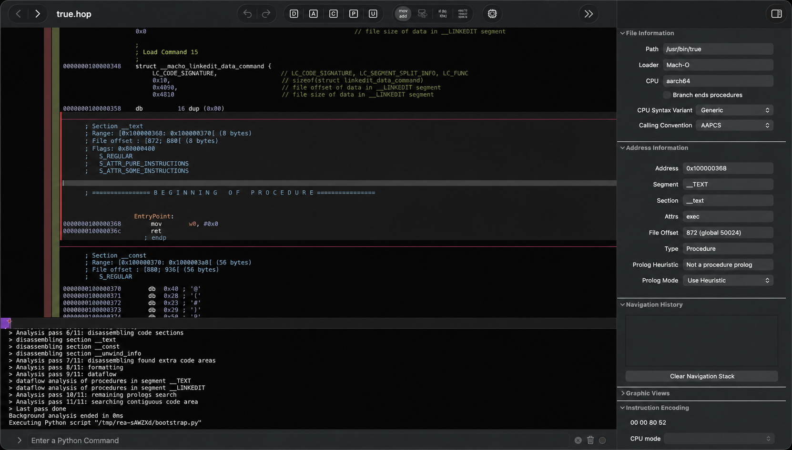
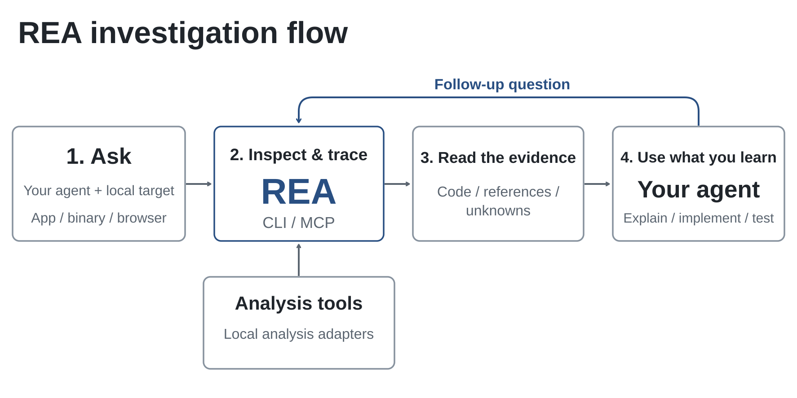
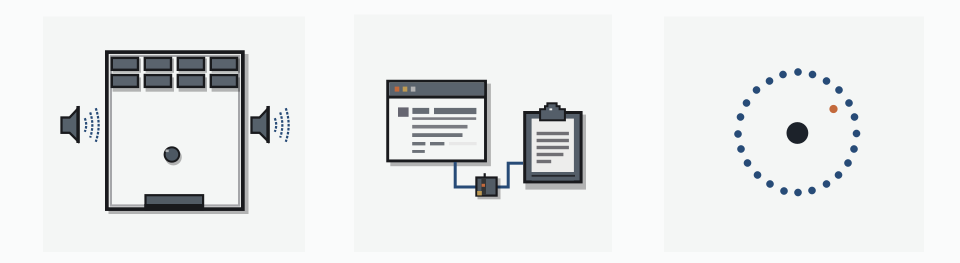

<div align="center">

[English](../../README.md) · [简体中文](README_zh.md) · [繁體中文](README_zh-TW.md) · [日本語](README_ja.md) · [한국어](README_ko.md) · [Türkçe](README_tr.md) · [Русский](README_ru.md) · [Tiếng Việt](README_vi.md) · [ไทย](README_th.md) · [Deutsch](README_de.md) · [Español](README_es.md) · [Français](README_fr.md) · [Українська](README_uk.md) · [Polski](README_pl.md) · [Português (Brasil)](README_pt-BR.md) · [العربية](README_ar.md) · [فارسی](README_fa.md) · [Bahasa Indonesia](README_id.md) · [Italiano](README_it.md)
· [Ελληνικά](README_el.md) · [മലയാളം](README_ml.md) · [Roman Urdu](README_ur-Latn.md) · [Română](README_ro.md) · **Български**

# REA: Reverse Engineer Anything

### Един MCP сървър за обратно инженерство на бинарни файлове, приложения и поведение по време на изпълнение.

**Харесва ви функция в някое приложение? Разберете как работи, чак до ниво бинарен код.**

[](https://www.npmjs.com/package/rea-agents)
[](../reference/mcp-contracts.md#generated-catalog)
[](#current-status)
[](https://skills.sh/morluto/rea/reverse-engineer-anything)
[](../../LICENSE)
[](https://discord.gg/GkcryMnJDM)

<a href="https://trendshift.io/repositories/82054?utm_source=repository-badge&amp;utm_medium=badge&amp;utm_campaign=badge-repository-82054" target="_blank" rel="noopener noreferrer"></a>

**[Уебсайт](https://rea.tools/) · [Ръководства](https://rea.tools/guides/) · [Примери](https://rea.tools/showcase/)**

<a href="https://discord.com/invite/GkcryMnJDM"></a>

[Бърз старт](#бърз-старт) · [Как работи REA](#как-работи-rea) · [Какво можете да анализирате](#какво-можете-да-анализирате) · [Примери](#примери) · [Създаване на RL среди](#build-rl-environments) · [Често задавани въпроси](#често-задавани-въпроси) · [Документация](#документация)

<code>npx rea-agents setup</code>

</div>

> [!IMPORTANT]
> Изтегляйте REA от [morluto/rea](https://github.com/morluto/rea),
> [rea.tools](https://rea.tools/) или [npm пакета rea-agents](https://www.npmjs.com/package/rea-agents).
> Следвайте връзките за инсталиране и издания от тези официални източници. Подобно
> име на хранилище или копиран README не доказва, че дадено изтегляне е официално.

<div align="center">

<br />



<br /><br />

<table aria-label="Общността на REA">
<tr>
<td align="center" width="360">
  <a href="https://discord.gg/GkcryMnJDM">
    <br />
    <strong>Присъединете се към общността за обратно инженерство</strong>
  </a><br />
  <sub>Discord · Въпроси и отговори · Покажете какво сте направили</sub>
</td>
</tr>
</table>

<br />

</div>

---

Видели сте функция в приложение и искате същата във вашия продукт? Помолете агента си да я проучи с REA. Той може да изследва приложението без изходния му код, да обясни как работи функцията, да покаже доказателствата и да изгради подобна версия за вашия проект.

REA свързва агента ви с инструменти за изследване на нативни бинарни файлове, JavaScript и Electron приложения, .NET асемблита и уебсайтове. Същите инструменти можете да използвате и от терминала. Анализът се извършва локално, а резултатите включват доказателствата и ограниченията зад всеки извод.

Настройката регистрира REA в агента ви и инсталира съответните инструкции за работния процес. Нативният анализ може да използва вече инсталиран Hopper, Ghidra, IDA или Kuna; по желание настройката може да инсталира Hopper след ваше одобрение. Статичният анализ на JavaScript не изисква двигател за нативен анализ.

> **[Посетете уебсайта на REA](https://rea.tools/)** за инструкции за настройка, илюстрирани ръководства и реални казуси.

## Бърз старт

В Linux стартирането на Ghidra, JADX и инструментите за фърмуер, както и
статичният анализ на JavaScript/Electron, изискват съвместима с procps команда
`ps` в `PATH` на REA за проверките кой процес на кого принадлежи. Стъпките за
отстраняване на проблема са в `docs/getting-started/installation.md`, в раздела
„Linux owned-process prerequisite“.

### Настройте агента си

След като имате инсталирани Node.js и npm, изпълнете:

```bash
npx rea-agents setup
```

Изберете агентите си, прегледайте предложените промени и ги одобрете. Настройката
добавя MCP сървъра на REA и съответните инструкции за работния процес, като прави
резервни копия на съществуващата конфигурация. След това рестартирайте агента.
Настройката записва директно избраната среда за изпълнение и входния скрипт на
REA. Ако сте получили REA чрез инструмент за изпълнение на пакети (package
runner), не изтривайте записа му в кеша. Изтегляйте пакета от доверена
директория извън целевия проект. Подробности за инсталирането и отстраняването на
проблеми има в ръководството за настройка по-долу.

Настройката поддържа Claude Code, Codex, Cursor, Gemini CLI, Grok Build и
[други агенти](../getting-started/installation.md#supported-agents). Вижте
[инсталиране и настройка](../getting-started/installation.md) за конфигуриране на
доставчици на анализ, ръчна регистрация на MCP и инсталиране на плъгина за
Claude Code/Codex.

По подразбиране MCP използва компактни входни схеми, за да заема по-малко от
контекста. Задайте `REA_MCP_INPUT_SCHEMA_PROFILE=full` в MCP регистрацията си,
когато са ви нужни пълните описания на полетата и подробностите за вложената
валидация. И двата профила запазват пълния набор от инструменти и каноничната
валидация на сървъра. Вижте „Compact input schema profile“ в ръководството за MCP
договорите.

По подразбиране се обявяват пълните изходни схеми. Ако клиентът ви ограничава
размера на цялата рамка `tools/list`, задайте
`REA_MCP_OUTPUT_SCHEMA_PROFILE=compact`, за да ограничите всяка обявена изходна
схема, или `off`, за да пропуснете изходните схеми изцяло. И двете настройки
запазват каноничната валидация от страна на сървъра и пълните структурирани
резултати. Вижте „Output schemas“ в ръководството за MCP договорите.

### Попитайте агента си

```text
Разбери как работи търсенето в приложението Notes, покажи ми доказателствата и
изгради подобна функция за моя проект.
```

Заменете Notes с целевото си приложение и функцията, която искате да разберете.

### Използвайте терминала

Изследвайте директорията на разархивирано JavaScript/Electron приложение или ASAR
архив:

```bash
npx -y rea-agents@latest analyze-javascript-application /absolute/path/to/app --json
```

Резултатът включва модули, импорти, границите на Electron и доказателствата за
тях. Заменете пътя с вашата цел, например `"D:/apps/example"` в Windows.

За да инсталирате командата `rea` за редовна употреба:

```bash
npm install --global rea-agents
rea --help
```

За нативен анализ първо конфигурирайте доставчик на анализ. Вижте
[ръководството за CLI и Evidence](../getting-started/cli.md) за нативните
команди, избора на доставчик, моментните снимки (snapshots) и скриптирането.

### Обновяване на REA

REA се променя бързо и новите издания често съдържат поправки на грешки.
Поддържайте инсталацията си актуална.

За CLI, инсталиран с `npm install --global` или `bun add --global`:

```bash
rea update
```

`rea --update` е псевдоним на същия проверен процес и приема същите глобални
флагове за изхода. Използвайте `rea update`, когато го комбинирате с други опции
на командата.

Командите за обновяване запазват общо най-много 4 MiB от stdout и stderr. Твърде
големите отговори с метаданни се отхвърлят след приключване на командата;
подробните (verbose) инсталации продължават с ограничена диагностика. Изходът за
напредъка, предназначен за хора, се съобразява с обратното налягане
(backpressure) на терминала и изчаква изпратените записи да завършат.

Глобалните обновявания чрез Bun изискват Bun 1.2.17 или по-нова версия. При
по-стара версия първо обновете Bun ръчно и след това изпълнете `rea update`.

За да опресните регистрациите в агентите и умението (skill), изпълнете командата
за настройка, която обновяването отпечатва.

Ако използвате `npx`, обновете настройката на агента си с:

```bash
npx rea-agents@latest setup
```

Прегледайте промените от настройката и рестартирайте агента. За еднократни CLI
команди използвайте `npx rea-agents@latest`, последвано от командата. С Bun
използвайте `bunx rea-agents@latest` вместо `npx rea-agents@latest`.

## Как работи REA

Агентът ви извиква REA чрез MCP, за да изследва целта и да проследи съответния
код. REA връща констатации заедно с доказателствата за тях. Агентът ги използва,
за да задава допълнителни въпроси, да обяснява поведението или да напише и тества
реализация. CLI командите използват същите работни процеси.



[Отворете фигурата в пълен размер](../../website/public/assets/figures/rea-investigation-flow.svg).

<a id="current-status"></a>

## Какво можете да анализирате

REA изисква Node.js 22.x (>=22.23.4), 24.x (>=24.22.1) или 26.12.1+, както и
npm. Допълнителните инструменти и поддържаните операционни системи зависят от
целта:

| Цел                             | Какво връща REA                                                                                                           | Изисквания и ръководство                                                                                                                                               |
| ------------------------------- | ------------------------------------------------------------------------------------------------------------------------- | ---------------------------------------------------------------------------------------------------------------------------------------------------------------------- |
| Инсталирани настолни приложения | Кандидати за среда за изпълнение, поддържащи файлове, маркери на компоненти и следващи проверки                           | Вградена ограничена проверка на директории и заглавни части; [настолни приложения](../desktop-applications.md)                                                         |
| Нативни бинарни файлове         | Псевдокод, асемблер, низове, символи, извиквания и препратки                                                              | Hopper, Ghidra, IDA или Kuna; [нативен анализ](../guides/native/native-investigation.md)                                                                               |
| Структура на ELF (офлайн)       | Секции, сегменти, оригинални символи/релокации и кандидати за статични защитни механизми                                  | Предоставен от вас pwntools на Linux x64; [диагностика на бинарни файлове](../guides/native/binary-diagnostics.md)                                                     |
| Go бинарни файлове              | Вградена версия на компилатора, модули, замени и настройки на компилацията                                                | Вградена статична проверка на ELF/PE/thin Mach-O; не изисква инсталиран Go                                                                                             |
| GPU кодови обекти               | CUDA/HIP цели, избрани параметри и ресурси на ядрата, запазен PTX текст                                                   | Вградена статична проверка на ELF/PE/fatbin/CUBIN/PTX; [GPU кодови обекти](../gpu-code-objects.md)                                                                     |
| Файлове на модели               | Метаданни на GGUF / safetensors, декларации на тензори и изчислени общи стойности                                         | Вградена проверка на заглавните части; по желание хеш на целия файл; [файлове на модели](../model-artifacts.md)                                                        |
| IL2CPP метаданни                | Образи на асемблита от Unity global-metadata.dat, имена на типове и методи и диапазони на индекси                         | Вградено статично декодиране на версии 24, 27, 29, 31 и 39; не изисква Unity                                                                                           |
| Unity Addressables              | Catalog keys, locations, dependencies, bundle hash/CRC                                                                    | Static inspection; [Unity Addressables](../unity-addressables.md)                                                                                                      |
| Godot PCK                       | Опис и извличане на архива, оригинални данни от заглавната част и директорията и идентичност на избрано съдържание        | Вградена статична поддръжка на формати 2, 3 и 4; не изисква Godot                                                                                                      |
| Rust бинарни файлове            | Вградени от cargo-auditable имена на crate-ове, версии, източници и връзки между зависимостите                            | Вградена статична проверка на ELF/PE/thin Mach-O; [Rust бинарни файлове](../rust-binaries.md)                                                                          |
| PE сертификати                  | Записи Authenticode WIN_CERTIFICATE и полета за самоличност на подписващия от PKCS#7/X.509                                | Вградена статична проверка на PE; [PE сертификати](../pe-certificates.md)                                                                                              |
| PE импорти                      | Имена на импортирани и отложено зареждани (delay-load) DLL библиотеки, ординали, IAT RVA адреси и pefile хеш на импортите | Вградена статична проверка на PE; [PE импорти](../pe-imports.md)                                                                                                       |
| Windows преки пътища            | Цел, аргументи, работна директория и данни от Shell Link                                                                  | Вградена статична проверка на LNK; [Windows преки пътища](../guides/native/windows-shortcut.md)                                                                        |
| ELF бележки                     | Собственици и типове на PT_NOTE/SHT_NOTE, полета GNU build-id и ABI-tag                                                   | Вградена статична проверка на ELF; [ELF бележки](../elf-notes.md)                                                                                                      |
| Защита на бинарни файлове       | PIE, NX, RELRO, CFG и свързаните с тях флагове в заглавните части на ELF, PE и Mach-O                                     | Вградена статична проверка на заглавните части; [защита на бинарни файлове](../binary-hardening.md)                                                                    |
| Сривове на Apple (IPS)          | Метаданни от .ips, нишки, образи, регистри и документирани класове сривове                                                | Вградена статична проверка на JSON; [Apple IPS](../apple-ips.md)                                                                                                       |
| Модули на ядрото на Linux       | Ключове от .modinfo, CRC стойности от __versions, наличие на this_module и подпис в края на файла                         | Вградена статична проверка на ELF; [модули на ядрото](../kernel-modules.md)                                                                                            |
| Erlang BEAM                     | IFF блокове (chunks), атоми, експорти, импорти, ламбди и заглавната част Code                                             | Вградена статична проверка на BEAM; [Erlang BEAM](../erlang-beam.md)                                                                                                   |
| WASM артефакти                  | Валидация, секции, точни WAT форми на импортите/експортите и декодиран WAT                                                | Предоставен от вас WABT 1.0.42; `inspect_wasm_artifact`                                                                                                                |
| EVM байткод                     | Селектори на функции, отмествания в байтове, изведени аргументи и променливост (mutability)                               | Локален raw/hex носител на Linux x64; [ръководство за офлайн EVM](../guides/evm/evm-bytecode.md)                                                                       |
| SQLite бази данни               | Таблици, колони, индекси, изгледи, тригери и избрани редове от обикновени таблици                                         | Локална моментна снимка на базата/WAL; Node.js 24.x >=24.15 или 26+ с нативни ограничения на SQLite                                                                    |
| Записани сривове в Linux        | Сурови бележки, регистри/сигнали на всяка записана нишка и по желание кандидати за съпоставяне с файлове в паметта        | Предоставен от вас pwntools на Linux x64; по желание GDB/pwndbg; [записани сривове](../guides/native/recorded-crashes.md)                                              |
| JavaScript / Electron           | Модули, импорти, source maps, маршрути, IPC и връзки с нативни добавки                                                    | Node.js и npm; Linux: съвместима с procps команда `ps`; [анализ на приложения](../guides/javascript/javascript-application-workflows.md)                               |
| Уебсайтове                      | Структура на страниците, скриптове, мрежови наблюдения и заявени екранни снимки                                           | Браузър от семейството на Chrome; [анализ в браузъра](../guides/web/browser-observation.md)                                                                            |
| Запазени мрежови записи         | Заявки, отговори, открити полезни данни (payloads) и местоположения в изходния код                                        | HAR или Fiddler Everywhere SAZ; mitmdump на Linux за нативен mitmproxy; [ръководство за мрежови записи](../guides/web/web-network-captures.md)                         |
| .NET асемблита                  | Метаданни, CIL инструкции, декларирани нативни зависимости и сравнения между компилации                                   | Няма (само статичен анализ); [ръководство за управляван код](../guides/managed/managed-code-analysis.md)                                                               |
| Android APK файлове             | Декларации в манифеста, класове, декомпилирани методи и препратки                                                         | JADX без графичен интерфейс и пълен JDK на Linux/macOS/Windows x64; [ръководство за Android](../guides/android/android-analysis.md)                                    |
| Подписи на APK                  | Подписващи v1/v2/v3/v3.1, отпечатъци на сертификати, ротация на ключове и вътрешна съгласуваност на хешовете              | Няма (само статичен анализ); `inspect_apk_signature`                                                                                                                   |
| Android устройства              | Устройства, пакети, процеси, логове, дъмпове, екранни снимки и прехвърляне на APK/файлове                                 | Предоставен от вас adb (емулатор или физическо устройство); [ръководство за ADB](../guides/android/adb-device-analysis.md)                                             |
| JEB проекти                     | Единици на проекта от двигателя на JEB, хешове на артефакти и псевдокод на типове/методи                                  | Стартиран от вас JEB клиент, който обслужва MCP и е избран чрез REA_JEB_MCP_URL; [ръководство за JEB](../providers/jeb-analysis.md)                                    |
| Android ресурси                 | Декодиран манифест, таблици с низове, локали и данни за версията                                                          | Предоставен от вас стартер за Apktool; [ръководство за ресурси](../guides/android/apktool-resource-analysis.md)                                                        |
| Flutter приложения              | Хеш на Dart snapshot, хешове на библиотеките за всяко ABI и произход на компилацията на двигателя                         | Няма (статичен анализ на APK); [ръководство за Flutter](../guides/android/flutter-analysis.md)                                                                         |
| Фърмуер                         | Региони, резултати от извличането и предаване към нативен анализ                                                          | Binwalk / Unblob на Linux; [ръководство за фърмуер](../guides/firmware/firmware-analysis.md)                                                                           |
| Записани пакети                 | Избрани полета, повтарящи се стойности, филтри и правила decode-as                                                        | Linux: TShark 4.x + prlimit; [ръководство за записи](../guides/data/packet-captures.md)                                                                                |
| Обобщения на пакети             | Крайни точки, DNS, TLS SNI, разпределение по протоколи и HTTP заявки                                                      | Предоставени от вас tshark и capinfos (проверено на Linux); [ръководство за pcap](../guides/data/pcap-analysis.md)                                                     |
| Записани логически сигнали      | Анотации от декодерите, диапазони от семпли и диагностика                                                                 | Linux: sigrok-cli 0.7.2 + prlimit; [записи на сигнали](../guides/signals/signal-recordings.md)                                                                         |
| Пакети и ресурси                | Описи на файлове, хешове, plist файлове, устройство на Apple пакети (bundles) и извлечени ресурси                         | [Ръководство за артефакти и JavaScript](../guides/javascript/javascript-artifact-reconstruction.md), [Apple приложения](../guides/apple/apple-application-analysis.md) |
| Поведение на процеси            | Изход в терминала, взаимодействия, наблюдения на изхода от процеса и на файловата система и сравнения между изпълнения    | Linux/macOS с нативен PTY; [запис на процеси](../guides/runtime/process-capture.md)                                                                                    |
| PyInstaller изпълними файлове   | Членове на CArchive, версия на Python, входни скриптове и извлечен байткод                                                | Няма (само статичен анализ); [пакетирани Python приложения](../python-packaged-applications.md)                                                                        |
| Изпълними файлове на Deno       | Виртуални файлове, входна точка, опции и размер на npm снимката                                                           | Няма (само статичен анализ); [изпълними файлове на Deno](../deno-standalone.md)                                                                                        |

Статичната проверка на JavaScript и .NET чете предоставените файлове, без да
стартира приложението. Записът по време на изпълнение стартира избраната цел или
взаимодейства с нея с правата на вашия потребител; всяко ръководство за анализ по
време на изпълнение описва какво точно прави.

За офлайн проверка на нативни бинарни файлове REA поддържа и предоставени от вас
GNU objdump и Rizin. Вижте
[ръководството за инструменти за обратно инженерство](../reverse-engineering-tools.md)
за настройка на доставчиците, CLI командите и ограниченията на Evidence. REA не
инсталира и не обновява нито един от двата доставчика.

<a id="choosing-a-deep-analysis-provider"></a>

Поддържаните нативни формати и операционни системи зависят от доставчика. Вижте
[настройката на Hopper и Ghidra](../getting-started/installation.md#hopper),
[ръководството за IDA](../providers/ida-provider.md) (включително незадължителен
нативен MCP мост), [ръководството за декомпилатора Kuna](../kuna-provider.md) и
[експерименталната поддръжка на Ghidra за Windows](../providers/windows-ghidra-p0.md).
Ghidra поддържа и [анализ на 16-битов DOS код](../providers/ghidra-dos.md). За
големи бинарни файлове увеличете времето за стартиране на доставчика с
`REA_GHIDRA_STARTUP_TIMEOUT_MS` или `REA_HOPPER_STARTUP_TIMEOUT_MS`. За избора
на доставчик вижте [ръководството за CLI](../getting-started/cli.md#choose-a-provider).
Проверете [наличността в изданията](../getting-started/installation.md#released-package-and-main)
за функции, добавени след последното издание в npm.

## Примери

<a href="https://rea.tools/showcase/">
  <picture>
    <source media="(prefers-color-scheme: dark)" srcset="../assets/rea-showcases-dark.svg" />
    
  </picture>
</a>

### DX-Ball: реконструиране на изчислението на звуковата панорама

Проследете извикване на звук до помощната функция, която превръща позицията в
панорама, изследвайте инструкциите и превърнете непълния псевдокод в C.
Реконструкцията минава 3 205 тестови случая спрямо оригиналния x86 код и
възпроизвежда всичките 63 байта на компилираната функция.

[Прочетете казуса](https://rea.tools/showcase/dx-ball/) ·
[Хранилище с реконструкцията](https://github.com/N0zoM1z0/dx-ball)

### Notion: проследяване на моста за клипборда в Electron

Открийте API-то за клипборда в renderer процеса, проследете го през preload
скрипта и IPC до главния процес и изследвайте формата за форматирано съдържание
в клипборда.

[Прочетете казуса](https://rea.tools/showcase/notion/)

### TH04: възстановяване на изчислението на пръстена от куршуми в DOS

Изследвайте 16-битовите инструкции на оригиналната игра за PC-98, възстановете
изчисленията на фиксираните и насочените ъгли и сравнете реконструирания C++ код
с изхода на историческия компилатор.

[Прочетете казуса](https://rea.tools/showcase/th04/) ·
[Хранилище с реконструкцията](https://github.com/N0zoM1z0/th04)

### Създавайте RL среди с REA

Запишете сесия в уеб приложение, превърнете неговото API в инструменти и експортирайте среда, която AI агент може да използва. Стартирайте я с AgentEnv, след което добавете задачи и проверки за награда за RL обучение или оценка.

[Прочетете ръководството](https://rea.tools/guides/rl-environments/) ·
[Гледайте видеото](https://x.com/reatools/status/2112574822584918075?s=20)

Ако сте използвали REA за нещо интересно, ще се радваме да го видим. Споделете
случая си в [issue](https://github.com/morluto/rea/issues) или
[pull request](https://github.com/morluto/rea/pulls), като включите целта,
въпроса си, как ви помогна REA и какво открихте.

<a id="build-rl-environments"></a>

## Създаване на RL среди

Дайте на AI агент локална среда, в която да упражнява задачи като намиране на issue или създаване на папка, без да стартира оригиналното приложение. Използвайте я за обучение с подсилване (reinforcement learning, RL) или за да проверите колко добре агентът изпълнява задачи.

REA превръща записаните API заявки и отговори в инструменти, които агентът може да извиква. Средата използва записаните данни и поддържа промени само когато записът потвърждава ефекта им.

След като REA е настроен в агента ви, заменете примерния URL адрес и задачите с папки по-долу със свои:

```text
Използвай REA, за да изградиш RL среда от тестовото ми уеб приложение на
http://127.0.0.1:3000.
Обхвани извеждането на списък, създаването, преименуването и изтриването на
папки. Можеш да създаваш и премахваш тестови папки. Не променяй съществуващите
данни.
Запази я в папка с име my-env. Провери кои операции работят и ми кажи как да я
стартирам.
```

<details>
<summary>Използвайте командния ред вместо това</summary>

Използвайте тези команди, ако вече имате файл със записаните от браузъра заявки и отговори на приложението. За да стартирате резултата, са нужни и AgentEnv, и Docker.

```sh
rea environment-build ./session.har ./my-env --name my-env --json
agent-env run ./my-env
```

</details>

REA експортира готова за стартиране среда с базов тест, който проверява дали тя стартира и отговаря. Използвайте я с вашата RL рамка, за да зададете целите на задачите, да добавите проверки за награда и да стартирате обучението.

[Изградете среда](https://rea.tools/guides/rl-environments/) ·
[Справочник за средите](../agent-environments.md) ·
[Гледайте демонстрацията в X](https://x.com/reatools/status/2112574822584918075?s=20)

### Среди за настолни приложения

REA може да създаде среда за Linux настолно приложение: агентът го управлява чрез снимки на екрана, мишка и клавиатура. От кратка заявка агентът инсталира приложението, създава задача, експортира средата и я проверява на нов компютър. За изграждането са необходими Linux на amd64 или arm64, Docker и версията на agentenv, посочена в ръководството.

[Настройка на среди за настолни приложения](../desktop-build-computer.md)

## Често задавани въпроси

<details>
<summary><strong>Кои агенти могат да използват REA?</strong></summary>

Всеки агент, който поддържа локални MCP сървъри. Настройката конфигурира
[поддържаните агенти](../getting-started/installation.md#supported-agents);
другите клиенти могат да използват
[ръчна MCP регистрация](../getting-started/installation.md#mcp-registry).

</details>

<details>
<summary><strong>Нужен ли ми е двигател за нативен анализ?</strong></summary>

Задълбоченият нативен анализ използва Hopper, Ghidra, IDA или Kuna в зависимост
от целта и операцията. Статичната проверка на JavaScript и .NET работи без
двигател за нативен анализ. Настройката може да инсталира Hopper след ваше
одобрение; Ghidra, IDA и Kuna се използват от вече съществуващите ви инсталации.
Вижте [настройката на доставчиците](../getting-started/installation.md#hopper)
за възможностите и поддържаните от тях цели.

</details>

<details>
<summary><strong>Трябва ли първо да стартирам Hopper?</strong></summary>

REA стартира Hopper, когато дадена операция се нуждае от него. В macOS при първо
стартиране може да се появи диалогов прозорец, който ви пита дали да изберете
демо режим, или да активирате лиценза си. Завършете този диалог в същата
потребителска сесия преди първата си CLI/MCP операция или задача, която ще се
изпълнява без надзор. При нужда отворете Hopper ръчно. Вижте
[стартиране и отстраняване на проблеми с Hopper](../getting-started/installation.md#launcher-paths-and-troubleshooting).

</details>

<details>
<summary><strong>Какво прави инсталирането на умението (skill) от skills.sh?</strong></summary>

Умението дава на агента ви инструкции как да провежда изследвания. Използвайте
`npx rea-agents setup`, за да регистрирате MCP сървъра на REA и да инсталирате
съответните инструкции, след което рестартирайте агента. Вижте
[инсталиране само на умението](../getting-started/installation.md#skill-only-installation).

</details>

<details>
<summary><strong>Какъв код връща REA?</strong></summary>

Нативният анализ връща псевдокод и асемблер. Анализът на JavaScript/Electron
възстановява модулите и връзките между тях. Агентът ви използва тези
констатации, за да напише и тества реализация; [примерите](#примери) показват
цялостни разработени случаи.

</details>

<details>
<summary><strong>Качва ли REA приложението ми някъде?</strong></summary>

REA анализира целите локално. Агентът ви получава резултатите от инструментите,
а доставчикът на модела, който агентът използва, има собствена политика за
данните.

</details>

<details>
<summary><strong>Какво да направя, ако попадна на грешка?</strong></summary>

Първо обновете; възможно е скорошно издание вече да я е поправило.

За CLI, инсталиран с `npm install --global` или `bun add --global`:

```bash
rea update
```

За настройка на агента чрез `npx`:

```bash
npx rea-agents@latest setup
```

Ако използвате агент, извършете
[опресняването на настройката](#обновяване-на-rea) и го рестартирайте. Опитайте
отново същата задача. Ако проблемът продължава,
[отворете issue](https://github.com/morluto/rea/issues), като посочите версията
на REA, типа на целта, стъпките за възпроизвеждане и изхода с грешката.

</details>

## Документация

Започнете с [практическите ръководства](https://rea.tools/guides/) на уебсайта.
За точните опции, предварителните изисквания и договорите за резултатите:

- [Инсталиране и настройка](../getting-started/installation.md): регистриране на агенти, конфигуриране на доставчици, обновяване и деинсталиране.
- [Готовност и отстраняване на проблеми](../getting-started/installation.md#check-readiness-for-your-task): диагностика на конкретен агент или двигател за анализ.
- [CLI и Evidence](../getting-started/cli.md): команди, избор на доставчик, моментни снимки, импорт/експорт и изходни статуси.
- [MCP договори](../reference/mcp-contracts.md) и [подсказки за агенти](../getting-started/mcp-prompts.md): резултати от инструментите, сесии и насочвани изследвания.
- [Каталог с инструменти](../reference/mcp-contracts.md#generated-catalog): генериран списък с инструменти, доставчици и CLI команди.
- [Пътна карта](../development/roadmap.md): планирана работа и проследяване на възможностите.

Съобщавайте за уязвимости чрез [SECURITY.md](../../SECURITY.md).

## История на звездите

🎉 **400 000 звезди в GitHub — благодарим ви!**

Благодарим на всички, които използват REA, съобщават за грешки, предлагат нови функции, тестват версии и допринасят с поправки.

<a href="https://www.star-history.com/?repos=morluto%2Frea&amp;type=date">
  <picture>
    <source media="(prefers-color-scheme: dark)" srcset="https://api.star-history.com/chart?repos=morluto/rea&amp;type=date&amp;theme=dark&amp;legend=top-left" />
    <source media="(prefers-color-scheme: light)" srcset="https://api.star-history.com/chart?repos=morluto/rea&amp;type=date" />
    
  </picture>
</a>

## Отказ от отговорност

Вижте [DISCLAIMER.md](../../DISCLAIMER.md) за насоки за отговорна употреба.

Позицията на проекта относно незаконната или неразрешената употреба обхваща
всички версии, канали за разпространение и платформи на REA; всяко копие запазва
приложимите за него лицензи.

REA е предназначен за законни изследвания, обучение, оперативна съвместимост,
съхраняване на софтуер и анализ на софтуер, който притежавате или имате
разрешение да изследвате.

## Принос към проекта

Ще се радваме на помощта ви с REA! [Отворете issue](https://github.com/morluto/rea/issues),
за да съобщите за грешка или да предложите функция, или
[изпратете pull request](https://github.com/morluto/rea/pulls), за да подобрите
кода или документацията.

Вижте [CONTRIBUTING.md](../../CONTRIBUTING.md) за настройка на средата за
разработка и проверките, [тестване](../development/testing.md) за видовете
проверки и [картата на архитектурата](../architecture/architecture.mermaid) за
избрани слоеве и пътища на зависимостите.

## Лиценз

[MIT](../../LICENSE)

Кодът, написан за проекта REA, е лицензиран под MIT. Материалите от трети страни
запазват собствените си лицензи и бележки за авторски права; вижте
[бележките за трети страни](../../THIRD_PARTY_NOTICES.md) за списъка със
зависимости, запазените текстове на лицензите и условията на външните
инструменти.

**Трябва да сте придобили законно търговските инструменти и да имате право да ги
използвате**, включително IDA Pro / декомпилаторите на Hex-Rays, Hopper и JEB,
съгласно приложимите им лицензи. REA не предоставя лиценз, ключ или право на
активиране за нито един инструмент. Пробните и демо версиите остават обект на
условията на производителя, включително ограниченията за брой потребители,
функции, автоматизация и споделяне на резултатите. Кракнати копия, откраднати
ключове, неразрешено споделяне на ключове и заобикаляне на лицензионни
ограничения не са разрешени. Тези насоки не изменят лиценза MIT или лицензите на
трети страни.
