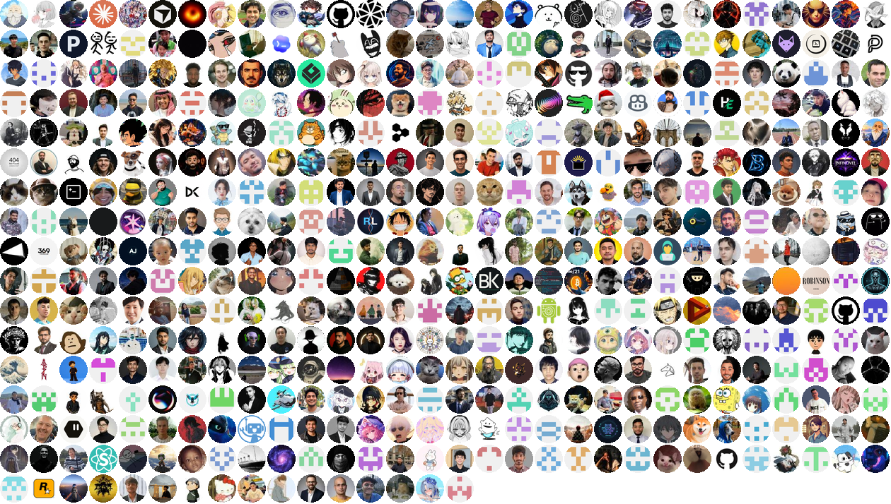

<div align="center">

[English](../../README.md) · [简体中文](README_zh.md) · [繁體中文](README_zh-TW.md) · [日本語](README_ja.md) · [한국어](README_ko.md) · [Türkçe](README_tr.md) · [Русский](README_ru.md) · [Tiếng Việt](README_vi.md) · [ไทย](README_th.md) · [Deutsch](README_de.md) · [Español](README_es.md) · [Français](README_fr.md) · [Українська](README_uk.md) · [Polski](README_pl.md) · [Português (Brasil)](README_pt-BR.md) · [العربية](README_ar.md) · [فارسی](README_fa.md) · [Bahasa Indonesia](README_id.md) · [Italiano](README_it.md)
· [Ελληνικά](README_el.md) · [മലയാളം](README_ml.md) · [Roman Urdu](README_ur-Latn.md) · [Română](README_ro.md) · [Български](README_bg.md) · **বাংলা**

# REA: Reverse Engineer Anything

### বাইনারি, অ্যাপ্লিকেশন এবং runtime আচরণ — সবকিছুর reverse engineering-এর জন্য একটিই MCP।

**পছন্দের কোনো ফিচার দেখলে, সেটি কীভাবে কাজ করে তা বাইনারি পর্যায় পর্যন্ত বুঝে নিন।**

[](https://github.com/morluto/rea/stargazers)
[](https://www.npmjs.com/package/rea-agents)
[](../../LICENSE)
[](https://discord.gg/GkcryMnJDM)
[](https://x.com/reatools)
[](../getting-started/installation.md)
[](https://skills.sh/morluto/rea/reverse-engineer-anything)

**[ওয়েবসাইট](https://rea.tools/bn/) · [গাইড](https://rea.tools/bn/guides/) · [শোকেস](https://rea.tools/bn/showcase/)**

<a href="https://discord.com/invite/GkcryMnJDM"></a>

[দ্রুত শুরু](#দ্রুত-শুরু) · [শোকেস](#শোকেস) · [REA কীভাবে কাজ করে](#rea-কীভাবে-কাজ-করে) · [কী কী বিশ্লেষণ করা যায়](#কী-কী-বিশ্লেষণ-করা-যায়) · [RL এনভায়রনমেন্ট তৈরি করুন](#rl-এনভায়রনমেন্ট-তৈরি-করুন) · [সাধারণ প্রশ্নোত্তর](#সাধারণ-প্রশ্নোত্তর) · [ডকুমেন্টেশন](#ডকুমেন্টেশন)

<code>npx rea-agents setup</code>

</div>

> [!IMPORTANT]
> REA নিন [morluto/rea](https://github.com/morluto/rea),
> [rea.tools](https://rea.tools/), অথবা [rea-agents npm প্যাকেজ](https://www.npmjs.com/package/rea-agents)
> থেকে। ইনস্টলেশন ও রিলিজ লিংক এই অফিসিয়াল সূত্রগুলো থেকেই অনুসরণ করুন। শুধু সাদৃশ্যপূর্ণ
> রিপোজিটরি নাম বা কপি করা README দেখে কোনো ডাউনলোডকে অফিসিয়াল বলা যায় না।

<div align="center">

<br />


<br /><br />

<table aria-label="REA কমিউনিটি">
<tr>
<td align="center" width="360">
  <a href="https://discord.gg/GkcryMnJDM">
    <br />
    <strong>Reverse Engineering কমিউনিটিতে যোগ দিন</strong>
  </a><br />
  <sub>Discord · প্রশ্নোত্তর · Show and Tell</sub>
</td>
</tr>
</table>

<br />

</div>

---

কোনো অ্যাপে এমন একটি ফিচার দেখলেন যা নিজের প্রোডাক্টেও চান? আপনার agent-কে REA দিয়ে সেটি খতিয়ে দেখতে বলুন। সোর্স কোড ছাড়াই সে অ্যাপটি পরীক্ষা করতে পারে, ফিচারটি কীভাবে কাজ করে তা ব্যাখ্যা করতে পারে, প্রমাণ দেখাতে পারে এবং আপনার প্রজেক্টের জন্য একটি সংস্করণ তৈরি করতে পারে।

REA আপনার agent-কে নেটিভ বাইনারি, JavaScript ও Electron অ্যাপ, .NET অ্যাসেম্বলি এবং ওয়েবসাইট পরীক্ষা করার টুলের সাথে যুক্ত করে। একই টুল টার্মিনাল থেকেও ব্যবহার করা যায়। বিশ্লেষণ স্থানীয়ভাবে চলে, আর ফলাফলে প্রতিটি সিদ্ধান্তের পেছনের প্রমাণ ও সীমাবদ্ধতা থাকে।

Setup আপনার agent-এ REA নিবন্ধন করে এবং মানানসই workflow নির্দেশনা ইনস্টল করে। নেটিভ বিশ্লেষণে বিদ্যমান Hopper, Ghidra, IDA বা Kuna ইনস্টলেশন ব্যবহার করা যায়; অনুমোদন নিয়ে setup Hopper ইনস্টলও করে দিতে পারে। Static JavaScript বিশ্লেষণের জন্য কোনো নেটিভ analysis engine লাগে না।

## দ্রুত শুরু

**[rea.tools-এ শুরু করুন](https://rea.tools/bn/get-started/)** — অপারেটিং সিস্টেম, agent এবং analysis provider অনুযায়ী ধাপে ধাপে নির্দেশনা পাবেন।

### আপনার agent যোগ করুন (MCP)

[Node.js ও npm](../reference/supported-targets.md) ইনস্টল থাকলে, যে প্রজেক্ট বিশ্লেষণ করবেন তার বাইরে একটি বিশ্বস্ত ডিরেক্টরি থেকে এটি চালান।

```bash
npx rea-agents setup
```

আপনার agent বেছে নিন, setup পরিকল্পনা দেখে অনুমোদন দিন, তারপর agent রিস্টার্ট করুন।
Setup বিদ্যমান configuration-এর ব্যাকআপ রাখে এবং REA-এর MCP সংযোগ ও
investigation skill যোগ করে। সমর্থিত client, plugin, ম্যানুয়াল নিবন্ধন এবং
সমস্যা সমাধানের জন্য [ইনস্টলেশন গাইড](../getting-started/installation.md) দেখুন।

আপনার agent-কে জিজ্ঞাসা করে দেখুন:

```text
Notes অ্যাপে search কীভাবে কাজ করে তা বুঝে নাও, আমাকে প্রমাণ দেখাও, এবং আমার
প্রজেক্টের জন্য একই রকম একটি ফিচার তৈরি করো।
```

Notes-এর জায়গায় আপনার টার্গেট অ্যাপ এবং যে ফিচারটি বুঝতে চান সেটি বসান।

### টার্মিনাল থেকে REA ব্যবহার করুন (CLI)

Extract করা একটি JavaScript/Electron অ্যাপ ডিরেক্টরি বা ASAR পরীক্ষা করুন:

```bash
npx -y rea-agents@latest analyze-javascript-application /absolute/path/to/app --json
```

ফলাফলে module, import, Electron boundary এবং সেগুলোর প্রমাণ থাকে।
Path-এর জায়গায় আপনার টার্গেট দিন, যেমন Windows-এ `"D:/apps/example"`।

নিয়মিত ব্যবহারের জন্য `rea` কমান্ড ইনস্টল করতে:

```bash
npm install --global rea-agents
rea --help
```

নেটিভ বিশ্লেষণের জন্য আগে একটি provider কনফিগার করুন। নেটিভ কমান্ড, provider
বাছাই, snapshot এবং scripting-এর জন্য [CLI ও Evidence গাইড](../getting-started/cli.md) দেখুন।
Linux-এর পূর্বশর্তের জন্য [ইনস্টলেশন গাইড](../getting-started/installation.md#linux-owned-process-prerequisite) দেখুন।

### REA আপডেট করুন

গ্লোবাল npm বা Bun ইনস্টলেশনের জন্য updater চালিয়ে তার setup নির্দেশনা অনুসরণ করুন।

```bash
rea update
```

`npx` ব্যবহার করলে agent setup হালনাগাদ করতে:

```bash
npx rea-agents@latest setup
```

Setup-এর পরিবর্তনগুলো দেখে agent রিস্টার্ট করুন। Package runner অপশন ও
সমস্যা সমাধানের জন্য [আপডেট ও uninstall নির্দেশনা](../getting-started/installation.md#diagnose-update-and-remove)
দেখুন।

## শোকেস

<a href="https://rea.tools/bn/showcase/">
  <picture>
    <source media="(prefers-color-scheme: dark)" srcset="../assets/rea-showcases-dark.svg" />
    
  </picture>
</a>

<table>
<tbody>
<tr>
<td>
<h3>DX-Ball: একটি sound-pan হিসাব পুনর্গঠন</h3>
<p>x86 নির্দেশনা থেকে একটি position-to-pan helper উদ্ধার করে ৩,২০৫টি আসল-x86 কেস এবং সংকলিত ফাংশনের সব ৬৩ বাইটের সাথে C পুনর্গঠন যাচাই করা।</p>
<a href="https://rea.tools/bn/showcase/dx-ball/">কেস স্টাডি পড়ুন</a> ·
<a href="https://github.com/N0zoM1z0/dx-ball">পুনর্গঠনের রিপোজিটরি</a>
</td>
</tr>
<tr>
<td>
<h3>Notion: Electron clipboard bridge trace করা</h3>
<p>renderer-এর clipboard API preload ও IPC হয়ে main process পর্যন্ত অনুসরণ করে দেখা, Notion কীভাবে সমৃদ্ধ clipboard ডেটা সামলায়।</p>
<a href="https://rea.tools/bn/showcase/notion/">কেস স্টাডি পড়ুন</a>
</td>
</tr>
<tr>
<td>
<h3>TH04: একটি DOS bullet-ring হিসাব উদ্ধার</h3>
<p>PC-98 গেমের ১৬-বিট নির্দেশনা থেকে নির্দিষ্ট ও লক্ষ্য করা কোণের হিসাব উদ্ধার করে পুনর্গঠিত C++-কে ঐতিহাসিক কম্পাইলার আউটপুটের সাথে তুলনা করা।</p>
<a href="https://rea.tools/bn/showcase/th04/">কেস স্টাডি পড়ুন</a> ·
<a href="https://github.com/N0zoM1z0/th04">পুনর্গঠনের রিপোজিটরি</a>
</td>
</tr>
</tbody>
</table>

REA দিয়ে কিছু আকর্ষণীয় কাজ করে থাকলে, আমরা সেটি দেখতে চাই। একটি
[issue](https://github.com/morluto/rea/issues) বা
[pull request](https://github.com/morluto/rea/pulls)-এ আপনার কেস শেয়ার করুন —
টার্গেট, আপনার প্রশ্ন, REA কীভাবে সাহায্য করেছে এবং আপনি কী পেয়েছেন তা লিখুন।

## REA কীভাবে কাজ করে

আপনার agent MCP-এর মাধ্যমে REA ব্যবহার করে টার্গেট পরীক্ষা করে এবং প্রাসঙ্গিক কোড trace করে।
REA যে প্রমাণ ফেরত দেয়, সেগুলো দিয়ে agent পরবর্তী প্রশ্ন করতে, আচরণ ব্যাখ্যা করতে,
অথবা একটি implementation লিখে পরীক্ষা করতে পারে। CLI-ও একই workflow ব্যবহার করে।


[পূর্ণ আকারের ছবি খুলুন](../../website/public/assets/figures/rea-investigation-flow.svg)।

<a id="current-status"></a>

## কী কী বিশ্লেষণ করা যায়

REA নেটিভ বাইনারি, JavaScript ও Electron অ্যাপ, ওয়েবসাইট, .NET
অ্যাসেম্বলি, Android অ্যাপ, firmware এবং রেকর্ড করা runtime ও নেটওয়ার্ক কার্যকলাপ কভার করে।

[সমর্থিত টার্গেট ও প্রয়োজনীয়তা](../reference/supported-targets.md)

<a id="choosing-a-deep-analysis-provider"></a>

নেটিভ ডিকম্পাইলেশনের জন্য এমন একটি provider বেছে নিন যা আপনার টার্গেট ফরম্যাট
ও হোস্ট OS সমর্থন করে। দেখুন [গভীর বিশ্লেষণের provider বাছাই](../reference/supported-targets.md#choosing-a-deep-analysis-provider)।

## RL এনভায়রনমেন্ট তৈরি করুন

রেকর্ড করা একটি ওয়েব সেশন বা Linux ডেস্কটপ অ্যাপ থেকে স্থানীয় একটি
এনভায়রনমেন্ট তৈরি করুন, যাতে কোনো agent একটি কাজ অনুশীলন করে ফলাফল যাচাই করতে পারে।
[REA দিয়ে RL এনভায়রনমেন্ট তৈরি করুন](https://rea.tools/bn/guides/rl-environments/)।

## সাধারণ প্রশ্নোত্তর

<details>
<summary><strong>কোন কোন agent REA ব্যবহার করতে পারে?</strong></summary>

যেকোনো agent যা স্থানীয় MCP সার্ভার সমর্থন করে। Setup
[সমর্থিত agent](../getting-started/installation.md#supported-agents)গুলো কনফিগার করে;
অন্য client [ম্যানুয়াল MCP নিবন্ধন](../getting-started/installation.md#mcp-registry)
ব্যবহার করতে পারে।

</details>

<details>
<summary><strong>আমার কি নেটিভ analysis engine লাগবে?</strong></summary>

গভীর নেটিভ বিশ্লেষণে টার্গেট ও অপারেশন অনুযায়ী Hopper, Ghidra, IDA বা Kuna
ব্যবহার করা হয়। Static JavaScript ও .NET পরীক্ষায় নেটিভ analysis engine লাগে না।
Setup অনুমোদনের পর Hopper ইনস্টল করতে পারে; Ghidra, IDA ও Kuna আপনার
বিদ্যমান ইনস্টলেশন ব্যবহার করে। অপশন ও সমর্থিত টার্গেটের জন্য
[provider setup](../getting-started/installation.md#hopper) দেখুন।

</details>

<details>
<summary><strong>আমাকে কি আগে Hopper চালু করতে হবে?</strong></summary>

কোনো অপারেশনের প্রয়োজন হলে REA Hopper চালু করে। macOS-এ প্রথমবার চালানোর সময়
একটি ডায়ালগ demo মোড বেছে নিতে বা লাইসেন্স অ্যাক্টিভেট করতে বলতে পারে। প্রথম
CLI/MCP অপারেশন বা আনঅ্যাটেন্ডেড কাজের আগে একই ইউজার সেশনে সেই প্রম্পট শেষ করুন।
প্রয়োজন হলে Hopper নিজে খুলুন। দেখুন
[Hopper চালু করা ও সমস্যা সমাধান](../getting-started/installation.md#launcher-paths-and-troubleshooting)।

</details>

<details>
<summary><strong>skills.sh থেকে skill ইনস্টল করলে কী হয়?</strong></summary>

Skill আপনার agent-কে অনুসন্ধানের নির্দেশনা দেয়। `npx rea-agents setup`
চালু করে REA-এর MCP সার্ভার নিবন্ধন করুন এবং মানানসই নির্দেশনা ইনস্টল করুন, তারপর
agent রিস্টার্ট করুন। দেখুন [শুধু skill ইনস্টলেশন](../getting-started/installation.md#skill-only-installation)।

</details>

<details>
<summary><strong>REA কী ধরনের কোড ফেরত দেয়?</strong></summary>

নেটিভ বিশ্লেষণ pseudocode ও assembly ফেরত দেয়। JavaScript/Electron বিশ্লেষণ
module ও সেগুলোর পারস্পরিক সম্পর্ক উদ্ধার করে। আপনার agent এই ফলাফল ব্যবহার করে
একটি implementation লিখে পরীক্ষা করে; [শোকেস](#শোকেস)-এ কাজ করা উদাহরণ আছে।

</details>

<details>
<summary><strong>REA কি আমার অ্যাপ আপলোড করে?</strong></summary>

REA টার্গেট স্থানীয়ভাবে বিশ্লেষণ করে। আপনার agent টুলের ফলাফল পায়, আর তার
model provider-এর নিজস্ব ডেটা নীতি আছে।

</details>

<details>
<summary><strong>কোনো bug পেলে কী করব?</strong></summary>

আগে আপডেট করুন; সাম্প্রতিক রিলিজে হয়তো ইতিমধ্যে ঠিক হয়ে গেছে।

`npm install --global` বা `bun add --global` দিয়ে ইনস্টল করা CLI-এর জন্য:

```bash
rea update
```

`npx` দিয়ে agent setup করা থাকলে:

```bash
npx rea-agents@latest setup
```

Agent ব্যবহার করলে [setup হালনাগাদ](#rea-আপডেট-করুন) শেষ করে সেটি রিস্টার্ট
করুন। একই কাজ আবার চেষ্টা করুন। সমস্যা থাকলে [একটি issue খুলুন](https://github.com/morluto/rea/issues)
এবং REA-এর সংস্করণ, টার্গেটের ধরন, পুনরুৎপাদনের ধাপ ও error আউটপুট দিন।

</details>

## ডকুমেন্টেশন

ওয়েবসাইটের [হাতে-কলমে গাইড](https://rea.tools/bn/guides/) দিয়ে শুরু করুন।
সুনির্দিষ্ট option, পূর্বশর্ত ও result contract-এর জন্য:

- [ইনস্টলেশন ও setup](../getting-started/installation.md): agent নিবন্ধন, provider configuration, আপডেট ও uninstall।
- [প্রস্তুতি যাচাই ও সমস্যা সমাধান](../getting-started/installation.md#check-readiness-for-your-task): একটি agent বা analysis engine-এর সমস্যা নির্ণয়।
- [CLI ও Evidence](../getting-started/cli.md): কমান্ড, provider বাছাই, snapshot, import/export ও exit status।
- [MCP contract](../reference/mcp-contracts.md) ও [agent prompt](../getting-started/mcp-prompts.md): টুলের ফলাফল, session ও নির্দেশিত অনুসন্ধান।
- [টুল ক্যাটালগ](../reference/mcp-contracts.md#generated-catalog): টুল, provider ও CLI কমান্ডের স্বয়ংক্রিয়ভাবে তৈরি তালিকা।

নিরাপত্তা-ত্রুটি (vulnerability) জানাতে [SECURITY.md](../../SECURITY.md) দেখুন।

## কমিউনিটি ও সহায়তা

- **Discord** — ৫০,০০০-এর বেশি reverse engineer ও নির্মাতার উদ্যমী কমিউনিটিতে প্রশ্ন করুন এবং আপনি কী খতিয়ে দেখছেন তা শেয়ার করুন! [](https://discord.gg/GkcryMnJDM)
- **Twitter / X** — আপডেট ও ঘোষণার জন্য [@reatools](https://x.com/reatools) ফলো করুন।
- **মতামত ও ধারণা** — নতুন ফিচার বা কোনো ফাইল ফরম্যাটের সমর্থন চান? [একটি GitHub issue খুলুন](https://github.com/morluto/rea/issues) অথবা [আমাদের Discord-এ যোগ দিন](https://discord.gg/GkcryMnJDM) এবং জানান।

## Star-এর ইতিহাস

🎉 **৪০০,০০০টি GitHub star — ধন্যবাদ!**

REA ব্যবহার, bug রিপোর্ট, ফিচার অনুরোধ, বিল্ড পরীক্ষা এবং সংশোধনে অবদান রাখা সবার প্রতি কৃতজ্ঞতা।

<a href="https://rea.tools/bn/contributors/">
  
</a>

<a href="https://www.star-history.com/?repos=morluto%2Frea&amp;type=date">
  <picture>
    <source media="(prefers-color-scheme: dark)" srcset="https://api.star-history.com/chart?repos=morluto/rea&amp;type=date&amp;theme=dark&amp;legend=top-left" />
    <source media="(prefers-color-scheme: light)" srcset="https://api.star-history.com/chart?repos=morluto/rea&amp;type=date" />
    
  </picture>
</a>

## অবদান রাখুন

REA-তে আপনার সাহায্য আমরা চাই! bug জানাতে বা ফিচার প্রস্তাব করতে
[একটি issue খুলুন](https://github.com/morluto/rea/issues), অথবা কোড বা ডকুমেন্টেশন উন্নত করতে
[একটি pull request পাঠান](https://github.com/morluto/rea/pulls)।

ডেভেলপমেন্ট সেটআপ ও চেকের জন্য [CONTRIBUTING.md](../../CONTRIBUTING.md) দেখুন। যাচাইয়ের lane-এর জন্য
[টেস্টিং গাইড](../development/testing.md) দেখুন।

## দায়মুক্তি

দায়িত্বশীল ব্যবহারের নির্দেশনার জন্য [DISCLAIMER.md](../../DISCLAIMER.md) দেখুন।

অবৈধ বা অননুমোদিত ব্যবহার বিষয়ে প্রজেক্টের অবস্থান REA-এর সব সংস্করণ,
বিতরণ চ্যানেল ও প্ল্যাটফর্মের ক্ষেত্রে প্রযোজ্য; প্রতিটি কপিতে তার প্রযোজ্য লাইসেন্সই থাকে।

REA বৈধ গবেষণা, শিক্ষা, আন্তঃকার্যকারিতা, সফটওয়্যার সংরক্ষণ,
এবং যে সফটওয়্যার আপনার নিজস্ব বা পরীক্ষা করার অনুমতি আছে তার বিশ্লেষণের জন্য।

## লাইসেন্স

[MIT](../../LICENSE)

REA-র লেখা কোড MIT লাইসেন্সে প্রকাশিত। থার্ড-পার্টি উপাদানে তাদের নিজস্ব
লাইসেন্স ও কপিরাইট নোটিশ থাকে; নির্ভরতার তালিকা, সংরক্ষিত লাইসেন্স টেক্সট এবং
বাহ্যিক টুলের শর্তাবলির জন্য [থার্ড-পার্টি নোটিশ](../../THIRD_PARTY_NOTICES.md) দেখুন।

**বাণিজ্যিক টুল, যেমন IDA Pro / Hex-Rays ডিকম্পাইলার, Hopper এবং JEB, প্রযোজ্য
লাইসেন্স অনুযায়ী বৈধভাবে সংগ্রহ ও ব্যবহারের অনুমতি থাকতে হবে।** REA কোনো টুল
লাইসেন্স, কী বা অ্যাক্টিভেশনের অধিকার দেয় না। ট্রায়াল ও ডেমো ভেন্ডরের শর্তের
অধীনে থাকে, যার মধ্যে ইউজার, ফিচার, অটোমেশন এবং আউটপুট শেয়ারের সীমাবদ্ধতা
অন্তর্ভুক্ত। ক্র্যাক করা কপি, চুরি করা কী, অননুমোদিত কী শেয়ার এবং লাইসেন্স
সীমাবদ্ধতা এড়ানো অনুমোদিত নয়। এই নির্দেশনা MIT বা থার্ড-পার্টি লাইসেন্স
সংশোধন করে না।
