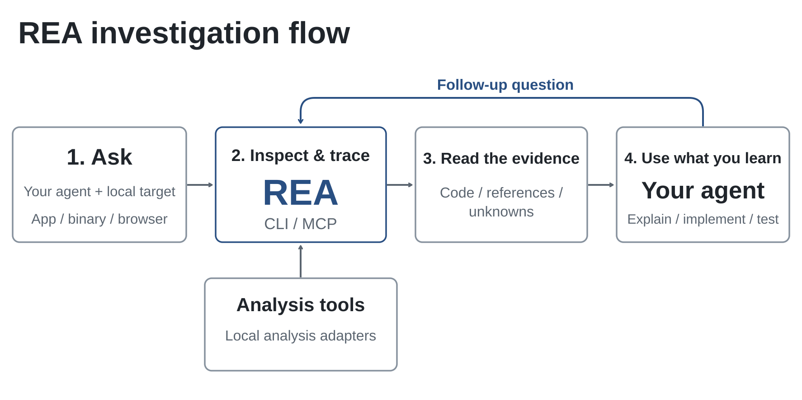
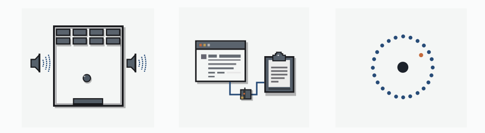

<div align="center">

[English](../../README.md) · [简体中文](README_zh.md) · [繁體中文](README_zh-TW.md) · [日本語](README_ja.md) · [한국어](README_ko.md) · [Türkçe](README_tr.md) · [Русский](README_ru.md) · [Tiếng Việt](README_vi.md) · [ไทย](README_th.md) · [Deutsch](README_de.md) · [Español](README_es.md) · [Français](README_fr.md) · [Українська](README_uk.md) · [Polski](README_pl.md) · [Português (Brasil)](README_pt-BR.md) · [العربية](README_ar.md) · [فارسی](README_fa.md) · [Bahasa Indonesia](README_id.md) · [Italiano](README_it.md)
· [Ελληνικά](README_el.md) · [മലയാളം](README_ml.md) · [Roman Urdu](README_ur-Latn.md) · [Română](README_ro.md) · **ગુજરાતી**

# REA: Reverse Engineer Anything

### બાઇનરી, એપ્લિકેશન અને રનટાઇમ વર્તન પર રિવર્સ એન્જિનિયરિંગ માટે એક જ MCP.

**તમને ગમતી કોઈ સુવિધા દેખાય? સમજો તે કેવી રીતે કામ કરે છે, બાઇનરી સ્તર સુધી.**

[](https://www.npmjs.com/package/rea-agents)
[](../mcp-contracts.md#generated-catalog)
[](#તમે-શું-વિશ્લેષણ-કરી-શકો-છો)
[](https://skills.sh/morluto/rea/reverse-engineer-anything)
[](../../LICENSE)
[](https://discord.gg/GkcryMnJDM)

<a href="https://trendshift.io/repositories/82054?utm_source=repository-badge&amp;utm_medium=badge&amp;utm_campaign=badge-repository-82054" target="_blank" rel="noopener noreferrer"></a>

**[વેબસાઇટ](https://rea.tools/) · [માર્ગદર્શિકાઓ](https://rea.tools/guides/) · [કેસ સ્ટડી](https://rea.tools/showcase/)**

<a href="https://discord.com/invite/GkcryMnJDM"></a>

[ઝડપી શરૂઆત](#ઝડપી-શરૂઆત) · [REA કેવી રીતે કામ કરે છે](#rea-કેવી-રીતે-કામ-કરે-છે) · [તમે શું વિશ્લેષણ કરી શકો છો](#તમે-શું-વિશ્લેષણ-કરી-શકો-છો) · [કેસ સ્ટડી](#કેસ-સ્ટડી) · [RL એન્વાયર્નમેન્ટ બનાવો](#rl-એન્વાયર્નમેન્ટ-બનાવો) · [વારંવાર પુછાતા પ્રશ્નો](#વારંવાર-પુછાતા-પ્રશ્નો) · [દસ્તાવેજીકરણ](#દસ્તાવેજીકરણ)

<code>npx rea-agents setup</code>

</div>

> [!IMPORTANT]
> REA ને [morluto/rea](https://github.com/morluto/rea), [rea.tools](https://rea.tools/)
> અથવા [npm પરના rea-agents પૅકેજ](https://www.npmjs.com/package/rea-agents) પરથી મેળવો.
> ઇન્સ્ટોલેશન અને રિલીઝની લિંક આ અધિકૃત સ્રોતો પરથી જ અનુસરો. સમાન નામ ધરાવતી
> રિપોઝિટરી અથવા નકલ કરેલું README એ પુરવાર કરતું નથી કે કોઈ ડાઉનલોડ અધિકૃત છે.

<div align="center">

<br />


<br /><br />

<table aria-label="REA સમુદાય">
<tr>
<td align="center" width="360">
  <a href="https://discord.gg/GkcryMnJDM">
    <br />
    <strong>રિવર્સ એન્જિનિયરિંગ સમુદાયમાં જોડાઓ</strong>
  </a><br />
  <sub>Discord · પ્રશ્નોત્તરી · Show and Tell</sub>
</td>
</tr>
</table>

<br />

</div>

---

કોઈ એપમાં એવી સુવિધા જોઈ જે તમે તમારા પ્રોડક્ટમાં ઇચ્છો છો? તમારા એજન્ટને REA સાથે તેની તપાસ કરવા કહો. તે એપનો સોર્સ કોડ વિના જ નિરીક્ષણ કરી શકે છે, સુવિધા કેવી રીતે કામ કરે છે તે સમજાવી શકે છે, પુરાવા દર્શાવી શકે છે અને તમારા પ્રોજેક્ટ માટે તેની એક આવૃત્તિ બનાવી શકે છે.

REA તમારા એજન્ટને નેટિવ બાઇનરી, JavaScript અને Electron એપ્લિકેશન, .NET એસેમ્બલી તથા વેબસાઇટનું નિરીક્ષણ કરવા માટેનાં સાધનો સાથે જોડે છે. આ જ સાધનો તમે ટર્મિનલમાંથી પણ વાપરી શકો છો. વિશ્લેષણ સ્થાનિક રીતે ચાલે છે, અને પરિણામોમાં દરેક નિષ્કર્ષ પાછળના પુરાવા અને મર્યાદાઓ સામેલ હોય છે.

સેટઅપ તમારા એજન્ટ સાથે REA ની નોંધણી કરે છે અને તેને અનુરૂપ વર્કફ્લો સૂચનાઓ ઇન્સ્ટોલ કરે છે. નેટિવ વિશ્લેષણ Hopper, Ghidra, IDA અથવા Kuna ના હાલના ઇન્સ્ટોલેશનનો ઉપયોગ કરી શકે છે; સેટઅપ તમારી મંજૂરી સાથે Hopper ને વૈકલ્પિક રીતે ઇન્સ્ટોલ કરી શકે છે. સ્ટેટિક JavaScript વિશ્લેષણ માટે કોઈ નેટિવ વિશ્લેષણ એન્જિનની જરૂર નથી.

> **[REA વેબસાઇટની મુલાકાત લો](https://rea.tools/)** — સેટઅપ સૂચનાઓ, સચિત્ર માર્ગદર્શિકાઓ અને વાસ્તવિક કેસ સ્ટડી માટે.

## ઝડપી શરૂઆત

Linux પર, Ghidra, JADX, ફર્મવેર સાધનોના લૉન્ચ અને સ્ટેટિક JavaScript/Electron વિશ્લેષણ માટે પ્રોસેસની માલિકી ચકાસવા REA ના `PATH` પર procps-સુસંગત `ps` જરૂરી છે. પુનઃપ્રાપ્તિનાં પગલાં `docs/installation.md` માં "Linux owned-process prerequisite" હેઠળ આપેલાં છે.

### તમારા એજન્ટને સેટ કરો

Node.js અને npm ઇન્સ્ટોલ કર્યા પછી, ચલાવો:

```bash
npx rea-agents setup
```

તમારા એજન્ટ પસંદ કરો, પ્રસ્તાવિત ફેરફારોની સમીક્ષા કરો અને તેમને મંજૂરી આપો. સેટઅપ REA નો MCP સર્વર અને તેને અનુરૂપ વર્કફ્લો સૂચનાઓ ઉમેરે છે, અને હાલના કૉન્ફિગરેશનનો બૅકઅપ રાખે છે. પછી તમારા એજન્ટને પુનઃપ્રારંભ કરો. સેટઅપ પસંદ કરેલ રનટાઇમ અને REA ની એન્ટ્રી સ્ક્રિપ્ટ સીધી નોંધે છે. જો તે પૅકેજ રનર મારફતે મેળવાયું હોય, તો તેની કૅશ એન્ટ્રી ઉપલબ્ધ રાખો. પૅકેજ મેળવવાનું કામ લક્ષ્ય પ્રોજેક્ટની બહારની વિશ્વસનીય ડિરેક્ટરીમાંથી ચલાવો. ઇન્સ્ટોલેશન અને પુનઃપ્રાપ્તિની વિગતો નીચેની સેટઅપ માર્ગદર્શિકામાં છે.

સેટઅપ Claude Code, Codex, Cursor, Gemini CLI, Grok Build અને [અન્ય એજન્ટો](../installation.md#supported-agents) ને સમર્થન આપે છે. પ્રોવાઇડર કૉન્ફિગરેશન, મૅન્યુઅલ MCP નોંધણી અને Claude Code/Codex પ્લગઇન ઇન્સ્ટોલેશન માટે [ઇન્સ્ટોલેશન અને સેટઅપ](../installation.md) જુઓ.

સંદર્ભનો ભાર ઘટાડવા MCP મૂળભૂત રીતે સઘન ઇનપુટ સ્કીમા વાપરે છે. જ્યારે તમને જાહેર કરેલું સંપૂર્ણ ફીલ્ડ માર્ગદર્શન અને નેસ્ટેડ માન્યતાની વિગતો જોઈએ, ત્યારે તમારી MCP નોંધણીમાં `REA_MCP_INPUT_SCHEMA_PROFILE=full` સેટ કરો. બંને પ્રોફાઇલ સંપૂર્ણ ટૂલ સેટ અને કૅનોનિકલ સર્વર માન્યતા જાળવી રાખે છે. MCP કરાર માર્ગદર્શિકામાં "Compact input schema profile" જુઓ.

મૂળભૂત રીતે સંપૂર્ણ આઉટપુટ સ્કીમા જાહેર કરવામાં આવે છે. જો તમારો ક્લાયન્ટ સંપૂર્ણ `tools/list` ફ્રેમ પર મર્યાદા મૂકતો હોય, તો દરેક જાહેર કરેલ આઉટપુટ સ્કીમાને સીમિત કરવા `REA_MCP_OUTPUT_SCHEMA_PROFILE=compact` સેટ કરો, અથવા આઉટપુટ સ્કીમા સંપૂર્ણપણે છોડી દેવા `off` સેટ કરો. બંને સેટિંગ કૅનોનિકલ સર્વર-બાજુની માન્યતા અને સંપૂર્ણ સંરચિત પરિણામો જાળવી રાખે છે. MCP કરાર માર્ગદર્શિકામાં "Output schemas" જુઓ.

### તમારા એજન્ટને પૂછો

```text
Notes એપમાં શોધ કેવી રીતે કામ કરે છે તે સમજો, મને પુરાવા દર્શાવો અને મારા
પ્રોજેક્ટ માટે એવી જ સુવિધા બનાવો.
```

Notes ની જગ્યાએ તમારી લક્ષ્ય એપ અને તમે સમજવા ઇચ્છતા હો તે સુવિધા મૂકો.

### ટર્મિનલનો ઉપયોગ કરો

એક્સટ્રેક્ટ કરેલી JavaScript/Electron એપ ડિરેક્ટરી અથવા ASAR નું નિરીક્ષણ કરો:

```bash
npx -y rea-agents@latest analyze-javascript-application /absolute/path/to/app --json
```

પરિણામમાં મોડ્યુલ્સ, ઇમ્પોર્ટ્સ, Electron સીમાઓ અને તેમના પુરાવા સામેલ હોય છે. પાથની જગ્યાએ તમારું લક્ષ્ય મૂકો, જેમ કે Windows પર `"D:/apps/example"`.

નિયમિત ઉપયોગ માટે `rea` કમાન્ડ ઇન્સ્ટોલ કરવા:

```bash
npm install --global rea-agents
rea --help
```

નેટિવ વિશ્લેષણ માટે પહેલાં એક પ્રોવાઇડર કૉન્ફિગર કરો. નેટિવ કમાન્ડ્સ, પ્રોવાઇડરની પસંદગી, સ્નૅપશૉટ અને સ્ક્રિપ્ટિંગ માટે [CLI અને Evidence માર્ગદર્શિકા](../cli.md) જુઓ.

### REA અપડેટ કરો

REA ઝડપથી બદલાય છે, અને નવી રિલીઝમાં વારંવાર બગ ફિક્સ સામેલ હોય છે. તમારું ઇન્સ્ટોલેશન અદ્યતન રાખો.

`npm install --global` અથવા `bun add --global` વડે ઇન્સ્ટોલ કરેલી CLI માટે:

```bash
rea update
```

`rea --update` એ આ ચકાસાયેલા વર્કફ્લોનું ઉપનામ છે અને તે એ જ ગ્લોબલ આઉટપુટ ફ્લૅગ સ્વીકારે છે. અન્ય કમાન્ડ નિયંત્રણો સાથે જોડતી વખતે `rea update` વાપરો.

અપડેટર કમાન્ડ stdout અને stderr મળીને વધુમાં વધુ 4 MiB જાળવે છે. કદ કરતાં મોટા મેટાડેટા પ્રતિસાદો કમાન્ડ પૂરો થયા પછી નકારવામાં આવે છે; વિગતવાર ઇન્સ્ટોલ સીમિત નિદાન સાથે ચાલુ રહે છે. માનવ-વાચ્ય પ્રગતિ આઉટપુટ ટર્મિનલના બૅકપ્રેશરનું પાલન કરે છે અને સબમિટ થયેલાં લખાણો પૂરાં થવાની રાહ જુએ છે.

Bun સાથેના ગ્લોબલ અપડેટ માટે Bun 1.2.17 અથવા તેથી નવી આવૃત્તિ જરૂરી છે. જૂની આવૃત્તિ હોય તો `rea update` ચલાવતા પહેલાં Bun ને મૅન્યુઅલી અપગ્રેડ કરો.

તમારા એજન્ટની નોંધણીઓ અને skill તાજી કરવા માટે, અપડેટ દ્વારા દર્શાવવામાં આવતો સેટઅપ કમાન્ડ ચલાવો.

જો તમે `npx` વાપરતા હો, તો તમારા એજન્ટનું સેટઅપ આ રીતે અપડેટ કરો:

```bash
npx rea-agents@latest setup
```

સેટઅપના ફેરફારોની સમીક્ષા કરો અને તમારા એજન્ટને પુનઃપ્રારંભ કરો. એક-વખતના CLI કમાન્ડ માટે `npx rea-agents@latest` પછી કમાન્ડ લખો. Bun સાથે, `npx rea-agents@latest` ની જગ્યાએ `bunx rea-agents@latest` વાપરો.

## REA કેવી રીતે કામ કરે છે

તમારો એજન્ટ લક્ષ્યનું નિરીક્ષણ કરવા અને સંબંધિત કોડને અનુસરવા MCP મારફતે REA ને કૉલ કરે છે. REA તેના પુરાવા સાથે તારણો પરત કરે છે. એજન્ટ તેમનો ઉપયોગ વધુ પ્રશ્નો પૂછવા, વર્તન સમજાવવા, અથવા અમલીકરણ લખવા અને તેનું પરીક્ષણ કરવા માટે કરે છે. CLI કમાન્ડ પણ એ જ વર્કફ્લો વાપરે છે.



[પૂર્ણ-આકારની આકૃતિ ખોલો](../../website/public/assets/figures/rea-investigation-flow.svg).

<a id="current-status"></a>

## તમે શું વિશ્લેષણ કરી શકો છો

REA ને Node.js 22.x (>=22.23.4), 24.x (>=24.22.1), અથવા 26.12.1+ તથા npm જરૂરી છે. વધારાનાં સાધનો અને હોસ્ટ સમર્થન લક્ષ્ય પર આધાર રાખે છે:

| લક્ષ્ય                  | REA શું પરત કરે છે                                                             | આવશ્યકતાઓ અને માર્ગદર્શિકા                                                                                                          |
| --------------------- | -------------------------------------------------------------------------- | ------------------------------------------------------------------------------------------------------------------------------- |
| ડેસ્કટૉપ ઇન્સ્ટોલેશન       | રનટાઇમ ઉમેદવારો, સહાયક ફાઇલો, કૉમ્પોનન્ટ માર્કર અને આગળની તપાસ                  | બિલ્ટ-ઇન સીમિત ડિરેક્ટરી/હેડર નિરીક્ષણ; [ડેસ્કટૉપ એપ્લિકેશન](../desktop-applications.md)                                                 |
| નેટિવ બાઇનરી           | સ્યુડોકોડ, એસેમ્બલી, સ્ટ્રિંગ્સ, સિમ્બોલ્સ, કૉલ્સ અને સંદર્ભો                            | Hopper, Ghidra, IDA અથવા Kuna; [નેટિવ વિશ્લેષણ](../native-investigation.md)                                                        |
| ઑફલાઇન ELF લેઆઉટ       | વિભાગો, સેગમેન્ટ્સ, મૂળ સિમ્બોલ્સ/રિલોકેશન અને સ્ટેટિક મિટિગેશન ઉમેદવારો                | કૉલર દ્વારા પૂરું પાડેલ pwntools (Linux x64); [બાઇનરી ડાયગ્નોસ્ટિક્સ](../binary-diagnostics.md)                                         |
| Go બાઇનરી             | એમ્બેડેડ કમ્પાઇલર આવૃત્તિ, મોડ્યુલ્સ, રિપ્લેસમેન્ટ અને બિલ્ડ સેટિંગ્સ                        | બિલ્ટ-ઇન સ્ટેટિક ELF/PE/thin Mach-O નિરીક્ષણ; Go ઇન્સ્ટોલેશન જરૂરી નથી                                                                  |
| GPU કોડ ઑબ્જેક્ટ         | CUDA/HIP લક્ષ્યો, પસંદ કરેલા કર્નલ પૅરામીટર અને સંસાધનો, જાળવેલું PTX ટેક્સ્ટ            | બિલ્ટ-ઇન સ્ટેટિક ELF/PE/fatbin/CUBIN/PTX નિરીક્ષણ; [GPU કોડ ઑબ્જેક્ટ](../gpu-code-objects.md)                                          |
| મૉડેલ આર્ટિફૅક્ટ          | GGUF / safetensors મેટાડેટા, ટેન્સર ઘોષણાઓ અને તારવેલા સરવાળા                    | બિલ્ટ-ઇન હેડર નિરીક્ષણ; વૈકલ્પિક સંપૂર્ણ-ફાઇલ હૅશ; [મૉડેલ ફાઇલો](../model-artifacts.md)                                                   |
| IL2CPP મેટાડેટા         | Unity global-metadata.dat એસેમ્બલી ઇમેજ, ટાઇપ અને મેથડ નામો અને ઇન્ડેક્સ શ્રેણીઓ      | આવૃત્તિ 24, 27, 29, 31 અને 39 નું બિલ્ટ-ઇન સ્ટેટિક ડિકોડિંગ; Unity જરૂરી નથી                                                              |
| Godot PCK             | આર્કાઇવ યાદી અને એક્સટ્રેક્શન, મૂળ હેડર/ડિરેક્ટરી માહિતી અને પસંદ કરેલી સામગ્રીની ઓળખ    | બિલ્ટ-ઇન સ્ટેટિક ફોર્મેટ 2, 3 અને 4; Godot જરૂરી નથી                                                                                   |
| Rust બાઇનરી           | એમ્બેડેડ cargo-auditable ક્રેટ નામો, આવૃત્તિઓ, સ્રોતો અને ડિપેન્ડન્સી સંબંધો             | બિલ્ટ-ઇન સ્ટેટિક ELF/PE/thin Mach-O નિરીક્ષણ; [Rust બાઇનરી](../rust-binaries.md)                                                    |
| PE પ્રમાણપત્રો          | Authenticode WIN_CERTIFICATE નોંધો અને PKCS#7 સહી કરનાર/X.509 ઓળખ ફીલ્ડ       | બિલ્ટ-ઇન સ્ટેટિક PE નિરીક્ષણ; [PE પ્રમાણપત્રો](../pe-certificates.md)                                                                 |
| PE ઇમ્પોર્ટ્સ            | ઇમ્પોર્ટ અને delay-load DLL નામો, ઑર્ડિનલ, IAT RVA અને pefile ઇમ્પોર્ટ હૅશ         | બિલ્ટ-ઇન સ્ટેટિક PE નિરીક્ષણ; [PE ઇમ્પોર્ટ્સ](../pe-imports.md)                                                                        |
| ELF નોંધ               | PT_NOTE/SHT_NOTE માલિકો, પ્રકારો, GNU build-id અને ABI-tag ફીલ્ડ              | બિલ્ટ-ઇન સ્ટેટિક ELF નિરીક્ષણ; [ELF નોંધ](../elf-notes.md)                                                                           |
| Apple IPS ક્રૅશ         | .ips મેટાડેટા, થ્રેડ, ઇમેજ, રજિસ્ટર અને દસ્તાવેજીકૃત ક્રૅશ વર્ગો                        | બિલ્ટ-ઇન સ્ટેટિક JSON નિરીક્ષણ; [Apple IPS](../apple-ips.md)                                                                        |
| Linux કર્નલ મોડ્યુલ      | .modinfo કી, __versions CRC, this_module ની હાજરી અને સહી ટ્રેલર              | બિલ્ટ-ઇન સ્ટેટિક ELF નિરીક્ષણ; [કર્નલ મોડ્યુલ](../kernel-modules.md)                                                                   |
| Erlang BEAM           | IFF ચંક, ઍટમ, એક્સપોર્ટ, ઇમ્પોર્ટ, લૅમ્બ્ડા અને Code હેડર                            | બિલ્ટ-ઇન સ્ટેટિક BEAM નિરીક્ષણ; [Erlang BEAM](../erlang-beam.md)                                                                    |
| WASM આર્ટિફૅક્ટ          | માન્યતા, વિભાગો, ચોક્કસ ઇમ્પોર્ટ/એક્સપોર્ટ WAT સ્વરૂપો અને ડિકોડ કરેલું WAT            | કૉલર દ્વારા પૂરું પાડેલ WABT 1.0.42; `inspect_wasm_artifact`                                                                         |
| EVM બાઇટકોડ           | ડિસ્પૅચ સિલેક્ટર્સ, બાઇટ ઑફસેટ, અનુમાનિત દલીલો અને મ્યુટેબિલિટી                       | Linux x64 પર સ્થાનિક raw/hex કૅરિયર; [ઑફલાઇન EVM માર્ગદર્શિકા](../evm-bytecode.md)                                                  |
| SQLite ડેટાબેઝ          | કોષ્ટકો, કૉલમ, ઇન્ડેક્સ, વ્યૂ, ટ્રિગર અને પસંદ કરેલી સામાન્ય કોષ્ટક પંક્તિઓ              | સ્થાનિક ડેટાબેઝ/WAL સ્નૅપશૉટ; નેટિવ SQLite મર્યાદાઓ સાથે Node.js 24.x >=24.15 અથવા 26+                                                  |
| નોંધાયેલ Linux ક્રૅશ      | કાચી નોંધ, દરેક નોંધાયેલ થ્રેડના રજિસ્ટર/સિગ્નલ અને વૈકલ્પિક મૅપિંગ ઉમેદવારો             | કૉલર દ્વારા પૂરું પાડેલ pwntools (Linux x64); વૈકલ્પિક GDB/pwndbg; [નોંધાયેલ ક્રૅશ](../recorded-crashes.md)                                |
| JavaScript / Electron | મોડ્યુલ્સ, ઇમ્પોર્ટ્સ, સોર્સ મૅપ, રૂટ, IPC અને નેટિવ ઍડ-ઑન સંબંધો                       | Node.js અને npm; Linux: procps-સુસંગત `ps`; [એપ્લિકેશન વિશ્લેષણ](../javascript-application-workflows.md)                               |
| વેબસાઇટ                | પેજ રચના, સ્ક્રિપ્ટ, નેટવર્ક અવલોકનો અને માગેલા સ્ક્રીનશૉટ                           | Chrome-કુળનું બ્રાઉઝર; [બ્રાઉઝર વિશ્લેષણ](../browser-observation.md)                                                                   |
| સાચવેલા નેટવર્ક કૅપ્ચર     | વિનંતીઓ, પ્રતિસાદો, ખુલ્લા પેલોડ અને સોર્સ સ્થાનો                                  | HAR અથવા Fiddler Everywhere SAZ; નેટિવ mitmproxy માટે Linux પર mitmdump; [કૅપ્ચર માર્ગદર્શિકા](../web-network-captures.md)            |
| .NET એસેમ્બલી           | મેટાડેટા, CIL સૂચનાઓ, ઘોષિત નેટિવ ડિપેન્ડન્સી અને બિલ્ડ સરખામણીઓ                    | કંઈ નહીં (ફક્ત સ્ટેટિક); [મૅનેજ્ડ-કોડ માર્ગદર્શિકા](../managed-code-analysis.md)                                                          |
| Android APK           | મેનિફેસ્ટ ઘોષણાઓ, ક્લાસ, ડિકમ્પાઇલ કરેલી મેથડ અને સંદર્ભો                            | Linux/macOS/Windows x64 પર હેડલેસ JADX અને સંપૂર્ણ JDK; [Android માર્ગદર્શિકા](../android-analysis.md)                                  |
| APK સહીઓ              | v1/v2/v3/v3.1 સહી કરનારા, પ્રમાણપત્ર ફિંગરપ્રિન્ટ, કી રોટેશન અને ડાઇજેસ્ટ સ્વ-સુસંગતતા | કંઈ નહીં (ફક્ત સ્ટેટિક); `inspect_apk_signature`                                                                                     |
| Android ઉપકરણો        | ઉપકરણો, પૅકેજ, પ્રોસેસ, લૉગ, ડમ્પ, સ્ક્રીન કૅપ્ચર અને APK/ફાઇલ ટ્રાન્સફર               | કૉલર દ્વારા પૂરું પાડેલ adb (એમ્યુલેટર કે હાર્ડવેર); [ADB માર્ગદર્શિકા](../adb-device-analysis.md)                                           |
| JEB પ્રોજેક્ટ            | એન્જિન-આધારિત પ્રોજેક્ટ યુનિટ, આર્ટિફૅક્ટ ડાઇજેસ્ટ અને ટાઇપ/મેથડ સ્યુડો-કોડ              | કૉલર દ્વારા શરૂ કરેલ JEB ક્લાયન્ટ જે MCP પૂરું પાડે છે, REA_JEB_MCP_URL વડે પસંદ કરાય છે; [JEB માર્ગદર્શિકા](../jeb-analysis.md)                |
| Android સંસાધનો        | ડિકોડ કરેલ મેનિફેસ્ટ, સ્ટ્રિંગ ટેબલ, લોકેલ અને આવૃત્તિ માહિતી                          | કૉલર દ્વારા પૂરું પાડેલ Apktool લૉન્ચર; [સંસાધન માર્ગદર્શિકા](../apktool-resource-analysis.md)                                           |
| Flutter એપ            | Dart સ્નૅપશૉટ હૅશ, પ્રતિ-ABI લાઇબ્રેરી ડાઇજેસ્ટ અને એન્જિન બિલ્ડ ઉત્પત્તિ               | કંઈ નહીં (સ્ટેટિક APK પાર્સિંગ); [Flutter માર્ગદર્શિકા](../flutter-analysis.md)                                                         |
| ફર્મવેર                 | પ્રદેશો, એક્સટ્રેક્શન પરિણામો અને નેટિવ-વિશ્લેષણ હૅન્ડઑફ                               | Linux પર Binwalk / Unblob; [ફર્મવેર માર્ગદર્શિકા](../firmware-analysis.md)                                                          |
| નોંધાયેલ પૅકેટ            | પસંદ કરેલાં ફીલ્ડ, પુનરાવર્તિત મૂલ્યો, ફિલ્ટર અને decode-as નિયમો                    | Linux: TShark 4.x + prlimit; [કૅપ્ચર માર્ગદર્શિકા](../packet-captures.md)                                                           |
| પૅકેટ સારાંશ             | એન્ડપૉઇન્ટ, DNS, TLS SNI, પ્રોટોકોલ વિતરણ અને HTTP વિનંતીઓ                      | કૉલર દ્વારા પૂરાં પાડેલ tshark અને capinfos (Linux પર ચકાસાયેલ); [pcap માર્ગદર્શિકા](../pcap-analysis.md)                               |
| નોંધાયેલ લૉજિક સિગ્નલ    | ડિકોડર ટિપ્પણીઓ, નમૂના શ્રેણીઓ અને ડાયગ્નોસ્ટિક્સ                                  | Linux: sigrok-cli 0.7.2 + prlimit; [સિગ્નલ રેકોર્ડિંગ](../signal-recordings.md)                                                     |
| પૅકેજ અને સંસાધનો         | ફાઇલ યાદીઓ, ડાઇજેસ્ટ, plist, Apple બંડલ રચના અને એક્સટ્રેક્ટ કરેલાં સંસાધનો           | [આર્ટિફૅક્ટ અને JavaScript માર્ગદર્શિકા](../javascript-artifact-reconstruction.md), [Apple એપ્લિકેશન](../apple-application-analysis.md) |
| પ્રોસેસ વર્તન            | ટર્મિનલ આઉટપુટ, ક્રિયાપ્રતિક્રિયાઓ, એક્ઝિટ અને ફાઇલસિસ્ટમ અવલોકનો, તથા રન સરખામણીઓ | નેટિવ PTY સાથે Linux/macOS; [પ્રોસેસ કૅપ્ચર](../process-capture.md)                                                                   |
| PyInstaller એક્ઝિક્યુટેબલ | CArchive સભ્યો, Python આવૃત્તિ, એન્ટ્રી સ્ક્રિપ્ટ અને એક્સટ્રેક્ટ કરેલો બાઇટકોડ          | કંઈ નહીં (ફક્ત સ્ટેટિક); [Python પૅકેજ્ડ એપ્લિકેશન](../python-packaged-applications.md)                                                   |

સ્ટેટિક JavaScript અને .NET નિરીક્ષણ એપ્લિકેશન ચલાવ્યા વિના જ પૂરી પાડેલી ફાઇલો વાંચે છે. રનટાઇમ કૅપ્ચર તમારા વપરાશકર્તા પરવાનગીઓ વડે પસંદ કરેલ લક્ષ્યને ચલાવે છે અથવા તેની સાથે ક્રિયાપ્રતિક્રિયા કરે છે; દરેક રનટાઇમ માર્ગદર્શિકા તેની અસરો વર્ણવે છે.

ઑફલાઇન નેટિવ-બાઇનરી નિરીક્ષણ માટે, REA કૉલર દ્વારા પૂરાં પાડેલ GNU objdump અને Rizin ને પણ સમર્થન આપે છે. પ્રોવાઇડર સેટઅપ, CLI કમાન્ડ અને Evidence મર્યાદાઓ માટે [રિવર્સ એન્જિનિયરિંગ સાધનોની માર્ગદર્શિકા](../reverse-engineering-tools.md) જુઓ. REA આ બેમાંથી કોઈ પ્રોવાઇડરને ઇન્સ્ટોલ કે અપડેટ કરતું નથી.

<a id="choosing-a-deep-analysis-provider"></a>

નેટિવ ફોર્મેટ અને હોસ્ટ સમર્થન પ્રોવાઇડર પ્રમાણે બદલાય છે. [Hopper અને Ghidra સેટઅપ](../installation.md#hopper), [IDA માર્ગદર્શિકા](../ida-provider.md) (વૈકલ્પિક નેટિવ MCP બ્રિજ સહિત), [Kuna ડિકમ્પાઇલર માર્ગદર્શિકા](../kuna-provider.md) અને [પ્રયોગાત્મક Windows Ghidra સમર્થન](../windows-ghidra-p0.md) જુઓ. Ghidra [16-બિટ DOS વિશ્લેષણ](../ghidra-dos.md) ને પણ સમર્થન આપે છે. મોટી બાઇનરી માટે, `REA_GHIDRA_STARTUP_TIMEOUT_MS` અથવા `REA_HOPPER_STARTUP_TIMEOUT_MS` વડે પ્રોવાઇડરની શરૂઆતની સમયમર્યાદા વધારો. પ્રોવાઇડરની પસંદગી માટે [CLI માર્ગદર્શિકા](../cli.md#choose-a-provider) જુઓ. નવીનતમ npm રિલીઝ પછી ઉમેરાયેલી સુવિધાઓ માટે [રિલીઝ ઉપલબ્ધતા](../installation.md#released-package-and-main) તપાસો.

## કેસ સ્ટડી

<a href="https://rea.tools/showcase/">
  <picture>
    <source media="(prefers-color-scheme: dark)" srcset="../assets/rea-showcases-dark.svg" />
    
  </picture>
</a>

### DX-Ball: સાઉન્ડ-પૅન ગણતરીનું પુનર્નિર્માણ

એક સાઉન્ડ કૉલને તેના position-to-pan હેલ્પર સુધી અનુસરો, સૂચનાઓનું નિરીક્ષણ કરો અને અપૂર્ણ સ્યુડોકોડને C માં રૂપાંતરિત કરો. આ પુનર્નિર્માણ મૂળ x86 ના 3,205 કેસ પાસ કરે છે અને કમ્પાઇલ થયેલા ફંક્શનના બધા 63 બાઇટ ફરીથી ઉત્પન્ન કરે છે.

[કેસ સ્ટડી વાંચો](https://rea.tools/showcase/dx-ball/) · [પુનર્નિર્માણ રિપોઝિટરી](https://github.com/N0zoM1z0/dx-ball)

### Notion: Electron ક્લિપબોર્ડ બ્રિજને અનુસરો

રેન્ડરરનું ક્લિપબોર્ડ API શોધો, તેને preload અને IPC મારફતે મુખ્ય પ્રોસેસ સુધી અનુસરો, અને રિચ ક્લિપબોર્ડ ફોર્મેટનું નિરીક્ષણ કરો.

[કેસ સ્ટડી વાંચો](https://rea.tools/showcase/notion/)

### TH04: DOS બુલેટ-રિંગ ગણતરી પુનઃપ્રાપ્ત કરો

મૂળ PC-98 ગેમની 16-બિટ સૂચનાઓનું નિરીક્ષણ કરો, સ્થિર અને લક્ષિત કોણની ગણતરીઓ પુનઃપ્રાપ્ત કરો, અને પુનર્નિર્મિત C++ ને તત્કાલીન કમ્પાઇલરના આઉટપુટ સાથે સરખાવો.

[કેસ સ્ટડી વાંચો](https://rea.tools/showcase/th04/) · [પુનર્નિર્માણ રિપોઝિટરી](https://github.com/N0zoM1z0/th04)

### REA વડે RL એન્વાયર્નમેન્ટ બનાવો

વેબ એપનું સેશન રેકોર્ડ કરો, તેના API ને સાધનોમાં ફેરવો, અને AI એજન્ટ વાપરી શકે તેવું એન્વાયર્નમેન્ટ એક્સપોર્ટ કરો. તેને AgentEnv વડે ચલાવો, પછી RL તાલીમ કે મૂલ્યાંકન માટે કામ અને રિવૉર્ડ ચેક ઉમેરો.

[માર્ગદર્શિકા વાંચો](https://rea.tools/guides/rl-environments/) · [વિડિયો જુઓ](https://x.com/reatools/status/2112574822584918075?s=20)

જો તમે REA નો ઉપયોગ કોઈ રસપ્રદ વસ્તુ પર કર્યો હોય, તો અમને તે જોવું ગમશે. તમારો કેસ [issue](https://github.com/morluto/rea/issues) અથવા [pull request](https://github.com/morluto/rea/pulls) માં શેર કરો — લક્ષ્ય, તમારો પ્રશ્ન, REA કેવી રીતે મદદરૂપ થયું અને તમે શું શોધ્યું તે સહિત.

## RL એન્વાયર્નમેન્ટ બનાવો

મૂળ એપ ચલાવ્યા વિના, AI એજન્ટને સ્થાનિક એન્વાયર્નમેન્ટ આપો જેમાં તે issue શોધવા કે ફોલ્ડર બનાવવા જેવાં કામનો અભ્યાસ કરી શકે. તેનો ઉપયોગ રિઇન્ફોર્સમેન્ટ લર્નિંગ (RL) માટે અથવા એજન્ટ કામ કેટલી સારી રીતે પૂરું કરે છે તે ચકાસવા કરો.

REA નોંધાયેલી API વિનંતીઓ અને પ્રતિસાદોને એજન્ટ કૉલ કરી શકે તેવાં સાધનોમાં ફેરવે છે. એન્વાયર્નમેન્ટ નોંધાયેલા ડેટાનો ઉપયોગ કરે છે અને ફેરફારોને ત્યારે જ સમર્થન આપે છે જ્યારે રેકોર્ડિંગ તેમની અસરોની પુષ્ટિ કરે.

તમારા એજન્ટમાં REA સેટ કર્યા પછી, નીચેના ઉદાહરણના URL અને ફોલ્ડર કામોને તમારા પોતાના વડે બદલો:

```text
Use REA to build an RL environment from my test web app at
http://127.0.0.1:3000.
Cover listing, creating, renaming, and deleting folders. You may create and
remove test folders. Leave existing data unchanged.
Save it in a folder named my-env. Check which operations work and tell me
how to run it.
```

<details>
<summary>તેના બદલે કમાન્ડ લાઇન વાપરો</summary>

જો તમારી પાસે એપની નોંધાયેલી બ્રાઉઝર વિનંતીઓ અને પ્રતિસાદો ધરાવતી ફાઇલ પહેલેથી હોય તો આ કમાન્ડ વાપરો. પરિણામ ચલાવવા માટે AgentEnv અને Docker પણ જરૂરી છે.

```sh
rea environment-build ./session.har ./my-env --name my-env --json
agent-env run ./my-env
```

</details>

REA ચલાવી શકાય તેવું એન્વાયર્નમેન્ટ એક્સપોર્ટ કરે છે, સાથે એક પાયાની કસોટી જે ચકાસે છે કે તે શરૂ થાય છે અને પ્રતિસાદ આપે છે. કામનાં લક્ષ્યો વ્યાખ્યાયિત કરવા, રિવૉર્ડ ચેક ઉમેરવા અને તાલીમ ચલાવવા તેનો ઉપયોગ તમારા RL ફ્રેમવર્ક સાથે કરો.

[એન્વાયર્નમેન્ટ બનાવો](https://rea.tools/guides/rl-environments/) · [એન્વાયર્નમેન્ટ સંદર્ભ](../agent-environments.md) · [X પર ડેમો જુઓ](https://x.com/reatools/status/2112574822584918075?s=20)

## વારંવાર પુછાતા પ્રશ્નો

<details>
<summary><strong>કયા એજન્ટ REA વાપરી શકે છે?</strong></summary>

સ્થાનિક MCP સર્વરને સમર્થન આપતો કોઈપણ એજન્ટ. સેટઅપ [સમર્થિત એજન્ટો](../installation.md#supported-agents) ને કૉન્ફિગર કરે છે; અન્ય ક્લાયન્ટ [મૅન્યુઅલ MCP નોંધણી](../installation.md#mcp-registry) વાપરી શકે છે.

</details>

<details>
<summary><strong>મને નેટિવ વિશ્લેષણ એન્જિનની જરૂર છે?</strong></summary>

ઊંડું નેટિવ વિશ્લેષણ લક્ષ્ય અને કામગીરીના આધારે Hopper, Ghidra, IDA અથવા Kuna વાપરે છે. સ્ટેટિક JavaScript અને .NET નિરીક્ષણ નેટિવ વિશ્લેષણ એન્જિન વિના કામ કરે છે. સેટઅપ મંજૂરી પછી Hopper ઇન્સ્ટોલ કરી શકે છે; Ghidra, IDA અને Kuna તમારાં હાલનાં ઇન્સ્ટોલેશન વાપરે છે. વિકલ્પો અને તેમનાં સમર્થિત લક્ષ્યો માટે [પ્રોવાઇડર સેટઅપ](../installation.md#hopper) જુઓ.

</details>

<details>
<summary><strong>મારે પહેલાં Hopper શરૂ કરવું પડે?</strong></summary>

જ્યારે કોઈ કામગીરીને જરૂર પડે ત્યારે REA Hopper શરૂ કરે છે. macOS પર, પહેલી વખત ચાલે ત્યારે એક ડાયલૉગ ડેમો મોડ પસંદ કરવા અથવા તમારું લાઇસન્સ સક્રિય કરવા કહી શકે છે. તમારી પહેલી CLI/MCP કામગીરી અથવા દેખરેખ વિનાના કામ પહેલાં એ જ વપરાશકર્તા સત્રમાં આ પ્રૉમ્પ્ટ પૂર્ણ કરો. જરૂર પડે તો Hopper મૅન્યુઅલી ખોલો. [Hopper શરૂઆત અને સમસ્યા નિવારણ](../installation.md#launcher-paths-and-troubleshooting) જુઓ.

</details>

<details>
<summary><strong>skills.sh પરથી skill ઇન્સ્ટોલ કરવાથી શું થાય છે?</strong></summary>

Skill તમારા એજન્ટ માટે તપાસ સૂચનાઓ પૂરી પાડે છે. REA નો MCP સર્વર નોંધવા અને તેને અનુરૂપ સૂચનાઓ ઇન્સ્ટોલ કરવા `npx rea-agents setup` વાપરો, પછી તમારા એજન્ટને પુનઃપ્રારંભ કરો. [ફક્ત-skill ઇન્સ્ટોલેશન](../installation.md#skill-only-installation) જુઓ.

</details>

<details>
<summary><strong>REA કેવો કોડ પરત કરે છે?</strong></summary>

નેટિવ વિશ્લેષણ સ્યુડોકોડ અને એસેમ્બલી પરત કરે છે. JavaScript/Electron વિશ્લેષણ મોડ્યુલ્સ અને તેમના સંબંધો પુનઃપ્રાપ્ત કરે છે. તમારો એજન્ટ આ તારણોનો ઉપયોગ અમલીકરણ લખવા અને તેનું પરીક્ષણ કરવા માટે કરે છે; [કેસ સ્ટડી](#કેસ-સ્ટડી) માં સંપૂર્ણ ઉદાહરણો છે.

</details>

<details>
<summary><strong>REA મારી એપ અપલોડ કરે છે?</strong></summary>

REA લક્ષ્યોનું વિશ્લેષણ સ્થાનિક રીતે કરે છે. તમારો એજન્ટ ટૂલનાં પરિણામો મેળવે છે, અને તેના મૉડેલ પ્રોવાઇડરની પોતાની ડેટા નીતિ હોય છે.

</details>

<details>
<summary><strong>બગ મળે તો મારે શું કરવું?</strong></summary>

પહેલાં અપડેટ કરો; તાજેતરની રિલીઝમાં તે પહેલેથી ઠીક થયું હોઈ શકે.

`npm install --global` અથવા `bun add --global` વડે ઇન્સ્ટોલ કરેલી CLI માટે:

```bash
rea update
```

`npx` મારફતે એજન્ટ સેટઅપ માટે:

```bash
npx rea-agents@latest setup
```

જો તમે એજન્ટ વાપરતા હો, તો [સેટઅપ રિફ્રેશ](#rea-અપડેટ-કરો) પૂર્ણ કરો અને તેને પુનઃપ્રારંભ કરો. એ જ કામ ફરી કરી જુઓ. સમસ્યા ચાલુ રહે તો તમારી REA આવૃત્તિ, લક્ષ્યનો પ્રકાર, પુનઃઉત્પાદનનાં પગલાં અને એરર આઉટપુટ સાથે [issue ખોલો](https://github.com/morluto/rea/issues).

</details>

## દસ્તાવેજીકરણ

વેબસાઇટની [વ્યવહારુ માર્ગદર્શિકાઓ](https://rea.tools/guides/) થી શરૂ કરો. ચોક્કસ વિકલ્પો, પૂર્વશરતો અને પરિણામ કરારો માટે:

- [ઇન્સ્ટોલેશન અને સેટઅપ](../installation.md): એજન્ટ નોંધણી, પ્રોવાઇડર કૉન્ફિગરેશન, અપડેટ અને અનઇન્સ્ટોલ.
- [તૈયારી અને સમસ્યા નિવારણ](../installation.md#check-readiness-for-your-task): એક એજન્ટ અથવા વિશ્લેષણ એન્જિનનું નિદાન.
- [CLI અને Evidence](../cli.md): કમાન્ડ, પ્રોવાઇડરની પસંદગી, સ્નૅપશૉટ, ઇમ્પોર્ટ/એક્સપોર્ટ અને એક્ઝિટ સ્ટેટસ.
- [MCP કરારો](../mcp-contracts.md) અને [એજન્ટ પ્રૉમ્પ્ટ](../mcp-prompts.md): ટૂલ પરિણામો, સત્રો અને માર્ગદર્શિત તપાસ.
- [ટૂલ કૅટલૉગ](../mcp-contracts.md#generated-catalog): ટૂલ, પ્રોવાઇડર અને CLI કમાન્ડની સ્વયં-નિર્મિત યાદી.
- [રોડમૅપ](../roadmap.md): આયોજિત કામ અને ક્ષમતા ટ્રૅકર.

નબળાઈઓની જાણ [SECURITY.md](../../SECURITY.md) મારફતે કરો.

## સ્ટાર ઇતિહાસ

🎉 **GitHub પર 4,00,000 સ્ટાર — આભાર!**

REA વાપરનારા, બગની જાણ કરનારા, સુવિધાઓની માગણી કરનારા, બિલ્ડનું પરીક્ષણ કરનારા અને ફિક્સમાં યોગદાન આપનારા સૌનો આભાર.

<a href="https://www.star-history.com/?repos=morluto%2Frea&amp;type=date">
  <picture>
    <source media="(prefers-color-scheme: dark)" srcset="https://api.star-history.com/chart?repos=morluto/rea&amp;type=date&amp;theme=dark&amp;legend=top-left" />
    <source media="(prefers-color-scheme: light)" srcset="https://api.star-history.com/chart?repos=morluto/rea&amp;type=date" />
    
  </picture>
</a>

## અસ્વીકરણ

જવાબદાર ઉપયોગના માર્ગદર્શન માટે [DISCLAIMER.md](../../DISCLAIMER.md) જુઓ.

ગેરકાયદેસર અથવા અનધિકૃત ઉપયોગ અંગેનું પ્રોજેક્ટનું વલણ REA ની બધી આવૃત્તિઓ, વિતરણ ચૅનલો અને પ્લૅટફૉર્મ પર લાગુ પડે છે; દરેક નકલ તેને લાગુ પડતાં લાઇસન્સ જાળવી રાખે છે.

REA કાયદેસર સંશોધન, શિક્ષણ, આંતર-કાર્યક્ષમતા, સૉફ્ટવેર જાળવણી, અને તમારી માલિકીના અથવા જેની તપાસ કરવા તમે અધિકૃત હો તેવા સૉફ્ટવેરના વિશ્લેષણ માટે છે.

## યોગદાન

REA માં તમારી મદદ અમને ખૂબ ગમશે! બગની જાણ કરવા અથવા સુવિધા સૂચવવા [issue ખોલો](https://github.com/morluto/rea/issues), અથવા કોડ કે દસ્તાવેજો સુધારવા [pull request મોકલો](https://github.com/morluto/rea/pulls).

ડેવલપમેન્ટ સેટઅપ અને ચેક માટે [CONTRIBUTING.md](../../CONTRIBUTING.md), ચકાસણી લેન માટે [ટેસ્ટિંગ](../testing.md), અને પસંદ કરેલા સ્તરો અને ડિપેન્ડન્સી પાથ માટે [આર્કિટેક્ચર મૅપ](../architecture.mermaid) જુઓ.

## લાઇસન્સ

[MIT](../../LICENSE)

REA દ્વારા લખાયેલો કોડ MIT હેઠળ લાઇસન્સ થયેલો છે. તૃતીય-પક્ષ સામગ્રી તેનાં પોતાનાં લાઇસન્સ અને કૉપિરાઇટ સૂચનાઓ જાળવી રાખે છે; ડિપેન્ડન્સી યાદી, જાળવેલાં લાઇસન્સ ટેક્સ્ટ અને બાહ્ય-ટૂલની શરતો માટે [તૃતીય-પક્ષ સૂચનાઓ](../../THIRD_PARTY_NOTICES.md) જુઓ.

**તમારે વ્યાવસાયિક સાધનો કાયદેસર રીતે મેળવવાં અને તેમને વાપરવા અધિકૃત હોવું આવશ્યક છે**, જેમાં IDA Pro / Hex-Rays ડિકમ્પાઇલર, Hopper અને JEB તેમનાં લાગુ પડતાં લાઇસન્સ હેઠળ સામેલ છે. REA કોઈ ટૂલ લાઇસન્સ, કી અથવા સક્રિયકરણ હક આપતું નથી. ટ્રાયલ અને ડેમો વિક્રેતાની શરતોને આધીન રહે છે, જેમાં વપરાશકર્તા, સુવિધા, ઑટોમેશન અને આઉટપુટ શેરિંગ પરનાં નિયંત્રણો સામેલ છે. ક્રૅક કરેલી નકલો, ચોરાયેલી કી, અનધિકૃત કી શેરિંગ અને લાઇસન્સ નિયંત્રણો ટાળવાં અધિકૃત નથી. આ માર્ગદર્શન MIT અથવા તૃતીય-પક્ષ લાઇસન્સમાં સુધારો કરતું નથી.
