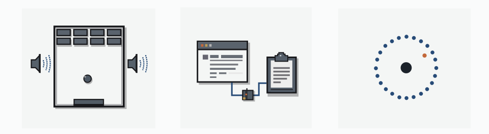

<div align="center">

[English](../../README.md) · [简体中文](README_zh.md) · [繁體中文](README_zh-TW.md) · [日本語](README_ja.md) · [한국어](README_ko.md) · [Türkçe](README_tr.md) · [Русский](README_ru.md) · [Tiếng Việt](README_vi.md) · [ไทย](README_th.md) · [Deutsch](README_de.md) · [Español](README_es.md) · [Français](README_fr.md) · [Українська](README_uk.md) · [Polski](README_pl.md) · **Português (Brasil)** · [العربية](README_ar.md) · [فارسی](README_fa.md) · [Bahasa Indonesia](README_id.md) · [Italiano](README_it.md)
· [Ελληνικά](README_el.md) · [മലയാളം](README_ml.md) · [Roman Urdu](README_ur-Latn.md) · [Română](README_ro.md)

# REA: Faça engenharia reversa de qualquer coisa

### Um único MCP para engenharia reversa de binários, aplicativos e comportamento em execução.

**Viu uma funcionalidade de que gostou? Entenda como ela funciona, até o nível binário.**

[](https://www.npmjs.com/package/rea-agents)
[](../mcp-contracts.md#generated-catalog)
[](#current-status)
[](https://skills.sh/morluto/rea/reverse-engineer-anything)
[](../../LICENSE)
[](https://discord.gg/GkcryMnJDM)

<a href="https://trendshift.io/repositories/82054?utm_source=repository-badge&amp;utm_medium=badge&amp;utm_campaign=badge-repository-82054" target="_blank" rel="noopener noreferrer"></a>

**[Site](https://rea.tools/pt-BR/) · [Guias](https://rea.tools/pt-BR/guides/) · [Casos de uso](https://rea.tools/pt-BR/showcase/)**

[Início rápido](#início-rápido) · [Como o REA funciona](#como-o-rea-funciona) · [O que você pode analisar](#o-que-você-pode-analisar) · [Casos de uso](#casos-de-uso) · [Criar ambientes de RL](#build-rl-environments) · [Perguntas frequentes](#perguntas-frequentes) · [Documentação](#documentação)

<code>npx rea-agents setup</code>

</div>

> [!IMPORTANT]
> Fontes oficiais do REA: [morluto/rea](https://github.com/morluto/rea), [rea.tools](https://rea.tools/), [rea-agents](https://www.npmjs.com/package/rea-agents) (npm).
> Use os links de instalação e de versões dessas fontes oficiais. Um nome de repositório parecido ou um README copiado não comprova que um download seja oficial.

<div align="center">

<br />


<br /><br />

<table aria-label="Comunidade REA">
<tr>
<td align="center" width="360">
  <a href="https://discord.gg/GkcryMnJDM">
    <br />
    <strong>Participe da comunidade de engenharia reversa</strong>
  </a><br />
  <sub>Discord · Perguntas e respostas · Compartilhe seus resultados</sub>
</td>
</tr>
</table>

<br />

</div>

---

Viu uma funcionalidade em um aplicativo que gostaria de ter no seu próprio produto? Peça ao seu agente para investigá-la com o REA. Ele pode inspecionar o aplicativo sem o código-fonte, explicar como a funcionalidade funciona, apresentar as evidências e criar uma versão para o seu projeto.

O REA conecta seu agente a ferramentas para inspecionar binários nativos, aplicativos JavaScript e Electron, assemblies .NET e sites. Você também pode usar as mesmas ferramentas pelo terminal. A análise acontece localmente, e os resultados incluem as evidências e limitações por trás de cada conclusão.

A configuração registra o REA no seu agente e instala as instruções de trabalho correspondentes. A análise nativa pode usar Hopper, Ghidra, IDA ou Kuna já instalados; o Hopper pode ser instalado após sua aprovação. A análise estática de JavaScript não precisa de um mecanismo de análise nativa.

> **[Visite o site do REA](https://rea.tools/pt-BR/)** para instruções de configuração, guias ilustrados e estudos de caso reais.

## Início rápido

No Linux, iniciar Ghidra, JADX e ferramentas de firmware e analisar JavaScript/Electron estaticamente exige um `ps` compatível com procps no `PATH` do REA para verificar a propriedade dos processos. Veja o pré-requisito do Linux.

### Configure seu agente

Com Node.js e npm instalados, execute:

```bash
npx rea-agents setup
```

Escolha seus agentes, revise as alterações propostas e aprove-as. A configuração adiciona o servidor MCP do REA e as instruções de fluxo de trabalho correspondentes, com backups das configurações existentes. Reinicie seu agente depois.

A configuração oferece suporte ao Claude Code, Codex, Cursor, Gemini CLI, Grok Build e [outros agentes](../installation.md#supported-agents). Consulte [instalação e configuração](../installation.md) para configurar provedores e registrar o MCP manualmente.

O MCP usa esquemas de entrada compactos por padrão. Para obter todas as orientações de campos e validação aninhada, defina `REA_MCP_INPUT_SCHEMA_PROFILE=full` no registro MCP. Ambos os perfis mantêm todas as ferramentas e a mesma validação canônica do servidor; veja o guia dos contratos MCP.

### Peça ao seu agente

```text
Investigue como a busca funciona no aplicativo Notes, mostre as evidências e crie uma funcionalidade semelhante para o meu projeto.
```

Substitua Notes pelo aplicativo alvo e indique a funcionalidade que deseja entender.

### Use o terminal

Inspecione um diretório extraído de um aplicativo JavaScript/Electron ou um arquivo ASAR:

```bash
npx -y rea-agents@latest analyze-javascript-application /absolute/path/to/app --json
```

O resultado inclui módulos, importações, limites do Electron e suas evidências. Substitua o caminho pelo do seu alvo, como `"D:/apps/example"` no Windows.

Para instalar o comando `rea` e usá-lo regularmente:

```bash
npm install --global rea-agents
rea --help
```

Para análise nativa, configure primeiro um provedor. Consulte o [guia de CLI e Evidence](../cli.md) para comandos nativos, seleção de provedores, snapshots e uso em scripts.

### Atualize o REA

O REA muda rapidamente, e novas versões incluem correções frequentes de bugs. Mantenha sua instalação atualizada.

Para uma CLI instalada pelo `npm install --global` / `bun add --global`:

```bash
rea update
```

`rea --update` é um alias de `rea update` com as mesmas opções globais de saída. Os comandos de atualização guardam no máximo 4 MiB de stdout/stderr combinados. Metadados grandes demais são rejeitados após a saída; instalações detalhadas mantêm diagnósticos limitados. O progresso respeita a contrapressão do terminal e espera as gravações enviadas.

Atualizações globais com Bun exigem Bun 1.2.17 ou posterior. Atualize versões antigas manualmente antes de executar `rea update`.

Para atualizar os registros dos agentes e a skill, execute o comando de configuração exibido pela atualização.

Se você usa `npx`, atualize a configuração do agente com:

```bash
npx rea-agents@latest setup
```

Revise as alterações de configuração e reinicie seu agente. Para comandos avulsos da CLI, use `npx rea-agents@latest` seguido do comando.

Com Bun, use `bunx rea-agents@latest` no lugar de `npx rea-agents@latest`.

## Como o REA funciona

Seu agente chama o REA por MCP para inspecionar o alvo e rastrear o código relevante. O REA retorna os resultados com suas evidências. O agente usa esses resultados para fazer novas perguntas, explicar o comportamento ou escrever e testar uma implementação. Os comandos da CLI usam os mesmos fluxos de trabalho.


[Abra a figura em tamanho completo](../../website/public/assets/figures/rea-investigation-flow.svg).

<a id="current-status"></a>

## O que você pode analisar

O REA requer Node.js 22.x (>=22.23.4), 24.x (>=24.22.1) ou 26+ (>=26.12.1), além do npm. As ferramentas adicionais e os sistemas anfitriões compatíveis dependem do alvo:

| Alvo                        | O que o REA retorna                                                                                                     | Requisitos e guia                                                                                                                            |
| --------------------------- | ----------------------------------------------------------------------------------------------------------------------- | -------------------------------------------------------------------------------------------------------------------------------------------- |
| Binários nativos            | Pseudocódigo, assembly, strings, símbolos, chamadas e referências                                                       | Hopper, Ghidra, IDA ou Kuna; [análise nativa](../native-investigation.md)                                                                    |
| Estrutura ELF sem execução  | Seções, segmentos, símbolos/relocações originais e possíveis mecanismos de mitigação identificados por análise estática | pwntools fornecido pelo chamador no Linux x64; [diagnóstico de binários](../binary-diagnostics.md)                                           |
| PE certificates             | Authenticode WIN_CERTIFICATE entries and PKCS#7 signer/X.509 identity fields                                            | Built-in static PE inspection; [PE certificates](../pe-certificates.md)                                                                      |
| PE imports                  | Import and delay-load DLL names, ordinals, IAT RVAs and pefile import hash                                              | Built-in static PE inspection; [PE imports](../pe-imports.md)                                                                                |
| Bytecode EVM                | Seletores de despacho, offsets de bytes, argumentos inferidos e mutabilidade                                            | Entrada local com bytes brutos ou representação hexadecimal no Linux x64; [guia de EVM sem execução](../evm-bytecode.md)                     |
| Rust binaries               | Embedded cargo-auditable dependency list                                                                                | [Rust binaries](../rust-binaries.md)                                                                                                         |
| ELF notes                   | PT_NOTE/SHT_NOTE owners, types, GNU build-id and ABI-tag fields                                                         | Built-in static ELF inspection; [ELF notes](../elf-notes.md)                                                                                 |
| Linux kernel modules        | .modinfo keys, __versions CRCs, this_module presence, and signature trailer                                             | Built-in static ELF inspection; [kernel modules](../kernel-modules.md)                                                                       |
| Erlang BEAM                 | IFF chunks, atoms, exports, and tables                                                                                  | Built-in static BEAM inspection; [Erlang BEAM](../erlang-beam.md)                                                                            |
| Apple IPS crashes           | .ips metadata, threads, images, registers and crash classes                                                             | Built-in static JSON inspection; [Apple IPS](../apple-ips.md)                                                                                |
| Falhas do Linux registradas | Registros note brutos, registradores/sinais de cada thread registrada e candidatos opcionais a mapeamentos              | pwntools fornecido pelo chamador no Linux x64; GDB/pwndbg opcionais; [falhas registradas](../recorded-crashes.md)                            |
| Instalações desktop         | Ambientes candidatos, arquivos de evidência, componentes e próximos passos                                              | Inspeção limitada de diretórios e cabeçalhos；[Aplicações desktop](../desktop-applications.md)                                               |
| JavaScript / Electron       | Módulos, importações, source maps, rotas, IPC e relações com complementos nativos                                       | Node.js e npm; [análise de aplicativos](../javascript-application-workflows.md); Linux: procps `ps`                                          |
| Sites                       | Estrutura da página, scripts, observações de rede e capturas de tela solicitadas                                        | Um navegador da família Chrome; [análise do navegador](../browser-observation.md)                                                            |
| Capturas de rede salvas     | Requisições, respostas, payloads acessíveis e localizações de origem                                                    | HAR / Fiddler Everywhere SAZ; mitmdump no Linux para capturas no formato nativo do mitmproxy; [guia de capturas](../web-network-captures.md) |
| Capturas de pacotes         | Endpoints, DNS, TLS SNI, distribuição de protocolos e requisições HTTP                                                  | tshark e capinfos fornecidos pelo chamador; [guia pcap](../pcap-analysis.md)                                                                 |
| Assemblies .NET             | Metadados, instruções CIL, dependências nativas declaradas e comparações de builds                                      | Inspeção estática; [guia de código gerenciado](../managed-code-analysis.md)                                                                  |
| PyInstaller                 | CArchive, PYZ, Python bytecode                                                                                          | Static inspection; [Python packaged applications](../python-packaged-applications.md)                                                        |
| APKs Android                | Declarações do manifesto, classes, métodos descompilados e referências                                                  | JADX sem interface gráfica e um JDK completo no Linux/macOS/Windows x64; [guia de Android](../android-analysis.md)                           |
| Dispositivos Android        | Dispositivos, pacotes, processos, logs, despejos, capturas de tela e transferências de APK/arquivos                     | adb fornecido pelo chamador (emulador ou aparelho); [guia de ADB](../adb-device-analysis.md)                                                 |
| Projetos JEB                | Unidades de projeto do motor, hashes de artefatos e pseudocódigo de tipos/métodos                                       | Um cliente JEB iniciado pelo chamador servindo MCP, selecionado com REA_JEB_MCP_URL; [guia de JEB](../jeb-analysis.md)                       |
| Recursos do Android         | Manifesto decodificado, tabelas de strings, idiomas e fatos de versão                                                   | Lançador do Apktool fornecido pelo chamador; [guia de recursos](../apktool-resource-analysis.md)                                             |
| Aplicativos Flutter         | Hash de snapshot Dart, hashes de bibliotecas por ABI e procedência de build do motor                                    | Nenhuma (análise estática de APK); [guia Flutter](../flutter-analysis.md)                                                                    |
| Firmware                    | Regiões, resultados de extração e encaminhamentos à análise nativa                                                      | Binwalk / Unblob no Linux; [guia de firmware](../firmware-analysis.md)                                                                       |
| Pacotes gravados            | Campos selecionados, valores repetidos, filtros e regras de decodificação                                               | Linux: TShark 4.x + prlimit; [guia de capturas](../packet-captures.md)                                                                       |
| Sinais lógicos gravados     | Anotações do decodificador, intervalos de amostras e diagnósticos                                                       | Linux: sigrok-cli 0.7.2 + prlimit; [guia de sinais](../signal-recordings.md)                                                                 |
| Pacotes e recursos          | Inventários de arquivos, digests, plists, estrutura de bundles Apple e recursos extraídos                               | [Guia de artefatos e JavaScript](../javascript-artifact-reconstruction.md), [aplicativos Apple](../apple-application-analysis.md)            |
| Comportamento de processos  | Saída do terminal, interações, observações de encerramento e do sistema de arquivos, e comparações entre execuções      | Linux/macOS com PTY nativo; [captura de processos](../process-capture.md)                                                                    |
| Binários Go                 | Versão do compilador embutida, módulos, substituições e configurações de compilação                                     | Inspeção estática integrada ELF/PE/thin Mach-O; Não precisa instalar Go                                                                      |
| Bancos SQLite               | Tabelas, colunas, índices, views, gatilhos e linhas selecionadas de tabelas comuns                                      | Snapshot local do banco/WAL; Node.js 24.x >=24.15 ou 26+ com limites nativos do SQLite                                                       |
| Objetos de código GPU       | Alvos CUDA/HIP, parâmetros e recursos de kernels selecionados, texto PTX preservado                                     | Inspeção estática integrada ELF/PE/fatbin/CUBIN/PTX; [GPU](../gpu-code-objects.md)                                                           |
| Arquivos de modelos         | Metadados GGUF / safetensors, declarações de tensores e totais derivados                                                | Inspeção de cabeçalhos; hash completo opcional; [GGUF / safetensors](../model-artifacts.md)                                                  |
| Metadados IL2CPP            | Imagens de assemblies Unity global-metadata.dat, nomes de tipos/métodos e intervalos de índices                         | Decodificação estática das versões 24, 27, 29, 31, 39; sem Unity                                                                             |
| Godot PCK                   | Inventário e extração, cabeçalhos/diretórios originais e identidade do conteúdo selecionado                             | Formatos estáticos 2, 3, 4; sem Godot                                                                                                        |
| Artefatos WASM              | Validação, seções, formas WAT exatas de importação/exportação e WAT decodificado                                        | Fornecido pelo usuário WABT 1.0.42; `inspect_wasm_artifact`                                                                                  |
| Assinaturas APK             | Signatários v1/v2/v3/v3.1, impressões digitais de certificados, rotação de chaves e consistência interna dos resumos    | Inspeção estática integrada; `inspect_apk_signature`                                                                                         |

A inspeção estática de JavaScript e .NET lê os arquivos fornecidos sem executar o aplicativo. A captura em execução inicia o alvo selecionado ou interage com ele usando as permissões do seu usuário; cada guia descreve seus efeitos.

Para inspecionar binários nativos offline, o REA também oferece suporte ao GNU objdump e ao Rizin, que você deve fornecer por conta própria. O [guia de ferramentas de engenharia reversa](../reverse-engineering-tools.md) descreve a configuração dos provedores, os comandos da CLI e as limitações de Evidence. O REA não instala nem atualiza nenhum desses provedores.

<a id="choosing-a-deep-analysis-provider"></a>

Para binários grandes, aumente o prazo de inicialização com `REA_GHIDRA_STARTUP_TIMEOUT_MS` ou `REA_HOPPER_STARTUP_TIMEOUT_MS`.

Os formatos nativos e os sistemas anfitriões compatíveis variam por provedor. Consulte [configuração do Hopper e Ghidra](../installation.md#hopper), o [guia do IDA](../ida-provider.md), [Kuna](../kuna-provider.md) e o [suporte experimental ao Ghidra no Windows](../windows-ghidra-p0.md). O Ghidra também oferece [análise de DOS de 16 bits](../ghidra-dos.md). Para selecionar um provedor, consulte o [guia da CLI](../cli.md#choose-a-provider). Verifique a [disponibilidade nas versões](../installation.md#released-package-and-main) das funcionalidades adicionadas após a versão mais recente no npm.

## Casos de uso

<a href="https://rea.tools/pt-BR/showcase/">
  <picture>
    <source media="(prefers-color-scheme: dark)" srcset="../assets/rea-showcases-dark.svg" />
    
  </picture>
</a>

### DX-Ball: reconstruir um cálculo de panorâmica de áudio

Siga uma chamada de áudio até a função auxiliar que converte posição em panorâmica, inspecione as instruções e transforme pseudocódigo incompleto em C. A reconstrução passa em 3.205 casos com o x86 original e reproduz todos os 63 bytes da função compilada.

[Leia o estudo de caso](https://rea.tools/pt-BR/showcase/dx-ball/) · [Repositório da reconstrução](https://github.com/N0zoM1z0/dx-ball)

### Notion: rastrear a ponte da área de transferência do Electron

Encontre a API da área de transferência do renderizador, siga-a por preload e IPC até o processo principal e inspecione o formato da área de transferência com seus dados de formatação.

[Leia o estudo de caso](https://rea.tools/pt-BR/showcase/notion/)

### TH04: recuperar o cálculo de um anel de projéteis no DOS

Inspecione as instruções de 16 bits do jogo original para PC-98, recupere os cálculos de ângulos fixos e direcionados e compare o C++ reconstruído com a saída do compilador da época.

[Leia o estudo de caso](https://rea.tools/pt-BR/showcase/th04/) · [Repositório da reconstrução](https://github.com/N0zoM1z0/th04)

### Criar ambientes de RL com o REA

Grave uma sessão de aplicativo web, transforme sua API em ferramentas e exporte um ambiente que um agente de IA possa usar. Execute com o AgentEnv e adicione tarefas e verificações de recompensa para treinamento RL ou avaliação.

[Guia para criar um ambiente](https://rea.tools/guides/rl-environments/) ·
[Veja a demonstração no X](https://x.com/reatools/status/2112574822584918075?s=20)

Se você usou o REA em algo interessante, gostaríamos de conhecer. Compartilhe seu caso em uma [issue](https://github.com/morluto/rea/issues) ou um [pull request](https://github.com/morluto/rea/pulls), incluindo o alvo, sua pergunta, como o REA ajudou e o que descobriu.

<a id="build-rl-environments"></a>

## Criar ambientes de RL

Crie um ambiente local onde um agente de IA possa praticar tarefas como encontrar uma issue ou criar uma pasta, sem executar o aplicativo original. Use para aprendizado por reforço (RL) ou para testar como o agente conclui tarefas.

O REA transforma requisições e respostas de API gravadas em ferramentas que o agente pode chamar. O ambiente usa os dados gravados e só aceita alterações cujos efeitos sejam confirmados pela gravação.

Configure o REA no agente e substitua a URL e as tarefas de pastas do exemplo pelas suas:

```text
Use o REA para criar um ambiente de RL a partir do meu aplicativo web de teste em
http://127.0.0.1:3000.
Inclua listar, criar, renomear e excluir pastas. Pode criar e remover
pastas de teste, mas não altere os dados existentes.
Salve em uma pasta chamada my-env, verifique quais operações funcionam e diga como executar.
```

<details>
<summary>Usar a linha de comando</summary>

Use estes comandos se já tiver um arquivo com as requisições e respostas do aplicativo gravadas no navegador. Para executar o resultado, você também precisa do AgentEnv e do Docker.

```sh
rea environment-build ./session.har ./my-env --name my-env --json
agent-env run ./my-env
```

</details>

O REA exporta um ambiente executável com um teste básico para verificar se ele inicia e responde. Use com seu framework de RL para definir objetivos, adicionar verificações de recompensa e executar o treinamento.

[Guia para criar um ambiente](https://rea.tools/guides/rl-environments/) ·
[Referência de ambientes](../agent-environments.md) ·
[Veja a demonstração no X](https://x.com/reatools/status/2112574822584918075?s=20)

## Perguntas frequentes

<details>
<summary><strong>Quais agentes podem usar o REA?</strong></summary>

Qualquer agente que ofereça suporte a servidores MCP locais. A configuração prepara os [agentes compatíveis](../installation.md#supported-agents); outros clientes podem usar o [registro manual do MCP](../installation.md#mcp-registry).

</details>

<details>
<summary><strong>Preciso do Hopper, Ghidra, IDA ou Kuna?</strong></summary>

A análise nativa aprofundada usa um desses motores. A inspeção estática de JavaScript e .NET funciona sem um motor de análise nativa. A configuração pode instalar o Hopper após aprovação; Ghidra, IDA e Kuna usam as instalações existentes. Consulte [configuração dos provedores](../installation.md#hopper).

</details>

<details>
<summary><strong>Preciso iniciar o Hopper antes?</strong></summary>

O REA inicia o Hopper quando uma operação precisa dele. No macOS, um diálogo na primeira execução pode pedir que você escolha o modo de demonstração ou ative a licença. Consulte [inicialização do Hopper e solução de problemas](../installation.md#launcher-paths-and-troubleshooting).

</details>

<details>
<summary><strong>O que faz a instalação da skill pelo skills.sh?</strong></summary>

A skill fornece instruções de investigação ao seu agente. Use `npx rea-agents setup` para registrar o servidor MCP do REA e instalar as instruções correspondentes, depois reinicie seu agente. Consulte [instalação apenas da skill](../installation.md#skill-only-installation).

</details>

<details>
<summary><strong>Que código o REA retorna?</strong></summary>

A análise nativa retorna pseudocódigo e assembly. A análise de JavaScript/Electron recupera módulos e suas relações. Seu agente usa esses resultados para escrever e testar uma implementação; os [casos de uso](#casos-de-uso) apresentam exemplos completos.

</details>

<details>
<summary><strong>O REA envia meu aplicativo para algum servidor?</strong></summary>

O REA analisa os alvos localmente. Seu agente recebe os resultados das ferramentas, e o provedor do modelo tem sua própria política de dados.

</details>

<details>
<summary><strong>O que devo fazer se encontrar um bug?</strong></summary>

Atualize primeiro; uma versão recente pode já ter corrigido o problema.

Para uma CLI instalada pelo npm:

```bash
rea update
```

Para configurar o agente por `npx`:

```bash
npx rea-agents@latest setup
```

Se você usa um agente, conclua a [atualização da configuração](#atualize-o-rea) e reinicie-o. Tente executar a mesma tarefa novamente. Se o problema persistir, [abra uma issue](https://github.com/morluto/rea/issues) com sua versão do REA, o tipo de alvo, os passos para reproduzir e a saída do erro.

</details>

## Documentação

Comece pelos [guias práticos](https://rea.tools/pt-BR/guides/) do site. Para opções exatas, pré-requisitos e contratos dos resultados:

- [Instalação e configuração](../installation.md): registro de agentes, configuração de provedores, atualizações e desinstalação.
- [Prontidão e solução de problemas](../installation.md#check-readiness-for-your-task): diagnóstico de um agente ou motor de análise específico.
- [CLI e Evidence](../cli.md): comandos, seleção de provedores, snapshots, importação/exportação e status de saída.
- [Contratos MCP](../mcp-contracts.md) e [prompts para agentes](../mcp-prompts.md): resultados das ferramentas, sessões e investigações guiadas.
- [Catálogo de ferramentas](../mcp-contracts.md#generated-catalog): inventário de ferramentas, provedores e comandos da CLI gerado durante o build.
- [Roadmap](../roadmap.md): trabalho planejado e acompanhamento das capacidades.

Relate vulnerabilidades conforme [SECURITY.md](../../SECURITY.md).

## Histórico de estrelas

🎉 **400.000 estrelas no GitHub — muito obrigado!**

Obrigado a todos que usam o REA, relatam bugs, sugerem funcionalidades, testam builds e contribuem com correções.

<a href="https://www.star-history.com/?repos=morluto%2Frea&amp;type=date">
  <picture>
    <source media="(prefers-color-scheme: dark)" srcset="https://api.star-history.com/chart?repos=morluto/rea&amp;type=date&amp;theme=dark&amp;legend=top-left" />
    <source media="(prefers-color-scheme: light)" srcset="https://api.star-history.com/chart?repos=morluto/rea&amp;type=date" />
    
  </picture>
</a>

## Aviso legal

Consulte [DISCLAIMER.md](../../DISCLAIMER.md) para orientações sobre o uso responsável.

O REA destina-se à pesquisa, à educação, à interoperabilidade, à preservação de software e à análise de software que você possui ou está autorizado a examinar, dentro da lei.

The project's position on illegal or unauthorized use covers all REA
versions, distribution channels, and platforms; each copy retains its
applicable licenses.

## Contribuir

Sua ajuda com o REA é bem-vinda! [Abra uma issue](https://github.com/morluto/rea/issues) para relatar um bug ou sugerir uma funcionalidade, ou [envie um pull request](https://github.com/morluto/rea/pulls) para melhorar o código ou a documentação.

Consulte [CONTRIBUTING.md](../../CONTRIBUTING.md) para configurar o ambiente de desenvolvimento e as verificações, o [guia de testes](../testing.md) para os fluxos de verificação e o [mapa da arquitetura](../architecture.mermaid) para a estrutura do projeto.

## Licença

[MIT](../../LICENSE)

REA-authored code is licensed under MIT. Third-party material retains its own
licenses and copyright notices; see [Third-party notices](../../THIRD_PARTY_NOTICES.md)
for the dependency inventory, preserved license texts, and external-tool terms.

**You must legally obtain and be authorized to use commercial tools**, including
IDA Pro / Hex-Rays decompilers, Hopper, and JEB, under their applicable licenses.
REA grants no tool license, key, or activation entitlement. Trials and demos
remain subject to vendor terms, including user, feature, automation, and output
sharing restrictions. Cracked copies, stolen keys, unauthorized key sharing,
and bypassing license restrictions are not authorized. This guidance does not
amend MIT or third-party licenses.
