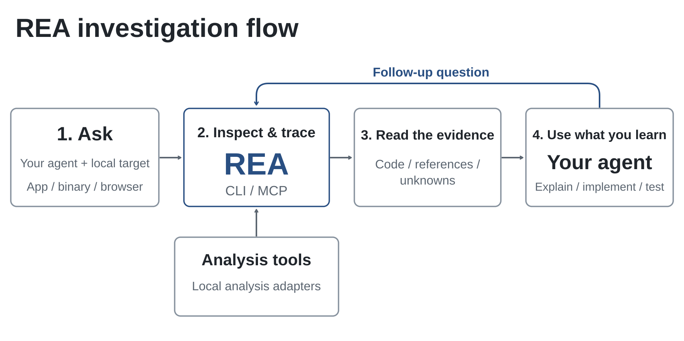
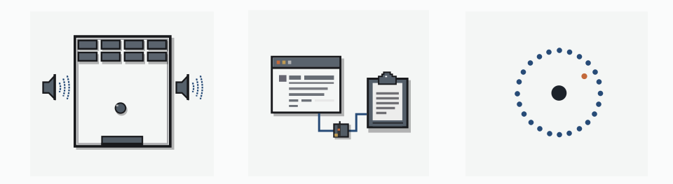

<div align="center">

[English](../../README.md) · [简体中文](README_zh.md) · [繁體中文](README_zh-TW.md) · [日本語](README_ja.md) · [한국어](README_ko.md) · [Türkçe](README_tr.md) · [Русский](README_ru.md) · [Tiếng Việt](README_vi.md) · [ไทย](README_th.md) · [Deutsch](README_de.md) · [Español](README_es.md) · [Français](README_fr.md) · [Українська](README_uk.md) · [Polski](README_pl.md) · [Português (Brasil)](README_pt-BR.md) · [العربية](README_ar.md) · [فارسی](README_fa.md) · [Bahasa Indonesia](README_id.md) · [Italiano](README_it.md) · [Ελληνικά](README_el.md) · [മലയാളം](README_ml.md) · [Roman Urdu](README_ur-Latn.md) · [Română](README_ro.md) · **Shqip**

# REA: Reverse Engineer Anything

### Një MCP për inxhinierinë e kundërt të skedarëve binarë, aplikacioneve dhe sjelljes gjatë ekzekutimit.

**Shikoni një veçori që ju pëlqen. Kuptoni se si funksionon, deri në nivelin binar.**

[](https://www.npmjs.com/package/rea-agents)
[](../mcp-contracts.md#generated-catalog)
[](#çfarë-mund-të-analizoni)
[](https://skills.sh/morluto/rea/reverse-engineer-anything)
[](../../LICENSE)
[](https://discord.gg/GkcryMnJDM)

<a href="https://trendshift.io/repositories/82054?utm_source=repository-badge&amp;utm_medium=badge&amp;utm_campaign=badge-repository-82054" target="_blank" rel="noopener noreferrer"></a>

**[Uebsajti](https://rea.tools/sq/) · [Udhëzues](https://rea.tools/sq/guides/) · [Vitrinë](https://rea.tools/sq/showcase/)**

<a href="https://discord.com/invite/GkcryMnJDM"></a>

[Fillimi i shpejtë](#fillimi-i-shpejtë) · [Si funksionon REA](#si-funksionon-rea) · [Çfarë mund të analizoni](#çfarë-mund-të-analizoni) · [Shembuj praktikë](#shembuj-praktikë) · [Ndërtoni mjedise RL](#build-rl-environments) · [Pyetje të shpeshta](#pyetje-të-shpeshta) · [Dokumentacioni](#dokumentacioni)

<code>npx rea-agents setup</code>

</div>

> [!IMPORTANT]
> Merreni REA nga [morluto/rea](https://github.com/morluto/rea),
> [rea.tools](https://rea.tools/) ose [paketa npm rea-agents](https://www.npmjs.com/package/rea-agents).
> Ndiqni lidhjet e instalimit dhe publikimit nga këto burime zyrtare. Një emër i ngjashëm
> depoje ose një README i kopjuar nuk dëshmon se shkarkimi është zyrtar.

<div align="center">

<br />


<br /><br />

<table aria-label="Komuniteti REA">
<tr>
<td align="center" width="360">
  <a href="https://discord.gg/GkcryMnJDM">
<br />
<strong>Bashkohu në komunitetin e inxhinierisë së kundërt</strong>
</a><br />
<sub>Discord · Pyetje dhe përgjigje · Shfaq dhe trego</sub>
</td>
</tr>
</table>

<br />

</div>

---

Shihni një veçori në një aplikacion që dëshironi në produktin tuaj? Kërkojini agjentit tuaj ta hetojë atë me REA. Ai mund të inspektojë aplikacionin pa kodin e tij burimor, të shpjegojë se si funksionon funksioni, të tregojë provat dhe të ndërtojë një version për projektin tuaj.

REA e lidh agjentin tuaj me mjete për inspektimin e skedarëve binarë me kod makine, aplikacioneve JavaScript dhe Electron, asambleve .NET dhe faqeve të internetit. Të njëjtat mjete mund t'i përdorni edhe nga terminali. Analiza kryhet lokalisht dhe rezultatet përfshijnë provat dhe kufizimet mbi të cilat mbështetet çdo përfundim.

Konfigurimi regjistron REA tek agjenti juaj dhe instalon udhëzimet përkatëse të punës. Analiza e kodit të makinës mund të përdorë një instalim ekzistues të Hopper, Ghidra, IDA ose Kuna; me miratimin tuaj, konfigurimi mund të instalojë edhe Hopper. Analiza statike e JavaScript nuk kërkon një motor analize të kodit të makinës.

> **[Vizitoni faqen e internetit të REA](https://rea.tools/sq/)** për udhëzimet e konfigurimit, udhëzuesit e ilustruar dhe studimet e rasteve reale.

## Fillimi i shpejtë

Në Linux, Ghidra, JADX, nisja e mjeteve të firmware-it dhe analiza statike
JavaScript/Electron kërkojnë një `ps` të përputhshëm me procps në `PATH` të REA
për kontrollin e pronësisë së proceseve. Hapat e rikuperimit gjenden në
`docs/installation.md`, te seksioni "Linux owned-process prerequisite".

### Vendosni agjentin tuaj

Me Node.js dhe npm të instaluara, ekzekutoni:

```bash
npx rea-agents setup
```

Zgjidhni agjentët tuaj, shqyrtoni ndryshimet e propozuara dhe miratojini. Konfigurimi shton serverin MCP të REA dhe udhëzimet përkatëse të punës, duke ruajtur kopje rezervë të konfigurimit ekzistues. Më pas rinisni agjentin.
Konfigurimi regjistron drejtpërdrejt runtime-in e zgjedhur dhe skriptin hyrës të REA.
Nëse është marrë përmes një ekzekutuesi paketash, mbajeni hyrjen e tij në cache të
disponueshme. Ekzekutojeni marrjen e paketës nga një direktori e besuar jashtë projektit
objektiv. Detajet e instalimit dhe të rikuperimit gjenden në udhëzuesin e konfigurimit më poshtë.

Konfigurimi mbështet Claude Code, Codex, Cursor, Gemini CLI, Grok Build dhe
[agjentë të tjerë](../installation.md#supported-agents). Shihni
[instalimi dhe konfigurimi](../installation.md) për konfigurimin e ofruesit dhe
regjistrimin manual MCP dhe instalimin e shtojcës për Claude Code/Codex.

MCP përdor si parazgjedhje skema hyrjeje kompakte për të ulur ngarkesën e kontekstit.
Vendosni `REA_MCP_INPUT_SCHEMA_PROFILE=full` në regjistrimin tuaj MCP kur ju duhen udhëzimet
e plota të fushave dhe detajet e validimit të ndërthurur. Të dy profilet ruajnë grupin e plotë
të mjeteve dhe validimin kanonik të serverit. Shihni "Compact input schema profile" në
udhëzuesin e kontratave MCP.

Skemat e plota të daljes reklamohen si parazgjedhje. Nëse klienti juaj kufizon kuadrin e plotë
`tools/list`, vendosni `REA_MCP_OUTPUT_SCHEMA_PROFILE=compact` për të kufizuar çdo skemë dalje
të reklamuar, ose `off` për t'i hequr fare. Të dyja cilësimet ruajnë validimin kanonik nga
serveri dhe rezultatet e plota të strukturuara. Shihni "Output schemas" në udhëzuesin e
kontratave MCP.

### Pyetni agjentin tuaj

```text
Kuptoni si funksionon kërkimi në aplikacionin Notes, më tregoni provat dhe
ndërtoni një veçori të ngjashme për projektin tim.
```

Zëvendësoni Notes me aplikacionin që doni të analizoni dhe veçorinë që doni të kuptoni.

### Përdor terminalin

Inspektoni një direktori aplikacioni të nxjerrë JavaScript/Electron ose ASAR:

```bash
npx -y rea-agents@latest analyze-javascript-application /absolute/path/to/app --json
```

Rezultati përfshin modulet, importet, kufijtë Electron dhe dëshmitë e tyre.
Zëvendësoni shtegun me objektivin tuaj, si p.sh. `"D:/apps/example"` në Windows.

Për të instaluar komandën `rea` për përdorim të rregullt:

```bash
npm install --global rea-agents
rea --help
```

Për analizën e kodit të makinës, fillimisht konfiguroni një ofrues. Shihni [udhëzuesin për CLI dhe Evidence](../cli.md) për komandat, zgjedhjen e ofruesit, pamjet e ruajtura të gjendjes dhe përdorimin në skripte.

### Përditëso REA

REA ndryshon shpejt dhe versionet e reja përfshijnë rregullime të shpeshta të gabimeve. Mbajeni instalimin tuaj të përditësuar.

Për një CLI të instaluar me `npm install --global` ose `bun add --global`:

```bash
rea update
```

`rea --update` është një alias për këtë rrjedhë pune të verifikuar dhe pranon të njëjtat opsione
globale të daljes. Përdorni `rea update` kur e kombinoni me kontrolle të tjera të komandës.

Komandat e përditësimit mbajnë së bashku jo më shumë se 4 MiB stdout dhe stderr. Përgjigjet e
tepërta të metadata-ve refuzohen pasi komanda përfundon; instalimet e detajuara vazhdojnë me
diagnostikim të kufizuar. Dalja e progresit për njerëzit respekton presionin e kundërt të
terminalit dhe pret që shkrimet e dërguara të përfundojnë.

Përditësimet globale të Bun kërkojnë Bun 1.2.17 ose më vonë. Me një version më të vjetër Bun,
përditësoje Bun manualisht përpara se të ekzekutosh `rea update`.

Për të rifreskuar regjistrimet e agjentëve dhe udhëzimet e aftësisë, ekzekutoni komandën e konfigurimit që shfaq përditësimi.

Nëse përdorni `npx`, përditësoni konfigurimin e agjentit tuaj me:

```bash
npx rea-agents@latest setup
```

Rishikoni ndryshimet e konfigurimit dhe rinisni agjentin tuaj. Për komandat e njëhershme CLI,
përdorni `npx rea-agents@latest` e ndjekur nga komanda. Me Bun, përdor
`bunx rea-agents@latest` në vend të `npx rea-agents@latest`.

## Si funksionon REA

Agjenti juaj thërret REA përmes MCP për të inspektuar objektivin dhe për të gjurmuar kodin përkatës. REA kthen gjetjet së bashku me provat e tyre. Agjenti i përdor për të bërë pyetje të mëtejshme, për të shpjeguar sjelljen ose për të shkruar dhe testuar një zbatim. Komandat CLI përdorin të njëjtat rrjedha pune.



[Hap figurën në madhësi të plotë](../../website/public/assets/figures/rea-investigation-flow.svg).

<a id="current-status"></a>

## Çfarë mund të analizoni

REA kërkon Node.js 22.x (>=22.23.4), 24.x (>=24.22.1) ose 26.12.1+, plus npm.
Mjetet shtesë dhe mbështetja e hostit varen nga objektivi:

| Synimi                               | Çfarë kthen REA                                                                                                           | Kërkesat dhe udhëzuesi                                                                                                                      |
| ------------------------------------ | ------------------------------------------------------------------------------------------------------------------------- | ------------------------------------------------------------------------------------------------------------------------------------------- |
| Instalime desktop                    | Kandidatë për runtime, skedarë mbështetës, shënues përbërësish dhe sondat e radhës                                        | Inspektim i integruar i kufizuar i direktorive/kokave; [aplikacionet desktop](../desktop-applications.md)                                   |
| Skedarë binarë me kod makine         | Pseudokod, instruksione assembly, vargje teksti, simbole, thirrje dhe referenca                                           | Hopper, Ghidra, IDA ose Kuna; [analiza e kodit të makinës](../native-investigation.md)                                                      |
| Struktura ELF jashtë linje           | Seksione, segmente, simbole/rivendosje origjinale dhe mekanizma të mundshëm mbrojtës të identifikuar statikisht           | pwntools i siguruar nga thirrësi në Linux x64; [diagnostikimi binar](../binary-diagnostics.md)                                              |
| Skedarë binarë Go                    | Versioni i integruar i përpiluesit, modulet, zëvendësimet dhe cilësimet e ndërtimit                                       | Inspektim statik i integruar për ELF/PE/Mach-O me një arkitekturë; nuk kërkohet instalimi i Go                                              |
| Objekte kodi GPU                     | Objektiva CUDA/HIP, parametra dhe burime të zgjedhura të kernel-eve, tekst PTX i ruajtur                                  | Inspektim statik i integruar ELF/PE/fatbin/CUBIN/PTX; [objektet e kodit GPU](../gpu-code-objects.md)                                        |
| Artefakte modelesh                   | Metadata GGUF / safetensors, deklarata tensorësh dhe totale të nxjerra                                                    | Inspektim i integruar i kokave; hash opsional i skedarit të plotë; [skedarët e modeleve](../model-artifacts.md)                             |
| Metadata IL2CPP                      | Imazhe asamblesh Unity global-metadata.dat, emra tipesh dhe metodash dhe diapazone indeksesh                              | Dekodim statik i integruar i versioneve 24, 27, 29, 31 dhe 39; nuk kërkohet Unity                                                           |
| Godot PCK                            | Inventari dhe nxjerrja e arkivit, faktet origjinale të kokës/direktorisë dhe identitetet e përmbajtjes së zgjedhur        | Formate statike të integruara 2, 3 dhe 4; nuk kërkohet Godot                                                                                |
| Skedarë binarë Rust                  | Emrat, versionet, burimet dhe lidhjet e varësive të crate-ve të integruara cargo-auditable                                | Inspektim statik i integruar për ELF/PE/Mach-O me një arkitekturë; [skedarët binarë Rust](../rust-binaries.md)                              |
| Certifikata PE                       | Hyrjet Authenticode WIN_CERTIFICATE dhe fushat e identitetit të nënshkruesit PKCS#7/X.509                                 | Inspektim statik i integruar i PE; [certifikatat PE](../pe-certificates.md)                                                                 |
| Importet PE                          | Emrat e DLL-ve të importit dhe delay-load, ordinalët, RVA-të e IAT dhe hash-i i importit të pefile                        | Inspektim statik i integruar i PE; [importet PE](../pe-imports.md)                                                                          |
| Shënimet ELF                         | Pronarët, tipet, GNU build-id dhe fushat ABI-tag të PT_NOTE/SHT_NOTE                                                      | Inspektim statik i integruar i ELF; [shënimet ELF](../elf-notes.md)                                                                         |
| Rrëzime Apple IPS                    | Metadata .ips, fije, imazhe, regjistra dhe klasa të dokumentuara rrëzimesh                                                | Inspektim statik i integruar i JSON; [Apple IPS](../apple-ips.md)                                                                           |
| Module të kernelit Linux             | Çelësat .modinfo, CRC-të __versions, prania e this_module dhe bishti i nënshkrimit                                        | Inspektim statik i integruar i ELF; [modulet e kernelit](../kernel-modules.md)                                                              |
| Erlang BEAM                          | Pjesë IFF, atome, eksporte, importe, lambda dhe koka Code                                                                 | Inspektim statik i integruar i BEAM; [Erlang BEAM](../erlang-beam.md)                                                                       |
| Artefakte WASM                       | Validimi, seksionet, format e sakta WAT të importeve/eksporteve dhe WAT i dekoduar                                        | WABT 1.0.42 i siguruar nga thirrësi; `inspect_wasm_artifact`                                                                                |
| Bajtkod EVM                          | Selektorët e drejtimit të thirrjeve, pozicionet e bajteve, argumentet dhe ndryshueshmëria e nxjerrë me arsyetim           | Skedar lokal me bajte të papërpunuara ose heksadecimalë në Linux x64; [udhëzuesi EVM jashtë linje](../evm-bytecode.md)                      |
| SQLite bazat e të dhënave            | Tabelat, kolonat, indekset, pamjet, aktivizuesit dhe rreshtat e zgjedhur të zakonshëm të tabelës                          | Baza e të dhënave lokale/fotografia e WAL; Node.js 24.x >=24.15 ose 26+ me kufijtë vendas SQLite                                            |
| Rrëzime të regjistruara në Linux     | Shënime të papërpunuara, regjistrat/sinjalet e çdo filli të regjistruar dhe përputhje të mundshme opsionale të hartëzimit | pwntools i siguruar nga thirrësi në Linux x64; GDB/pwndbg sipas dëshirës; [rrëzimet e regjistruara](../recorded-crashes.md)                 |
| JavaScript / Electron                | Modulet, importet, hartat burimore, rrugët, IPC dhe lidhjet me shtesat me kod makine                                      | Node.js dhe npm; Linux: `ps` i përputhshëm me procps; [analiza e aplikacioneve](../javascript-application-workflows.md)                     |
| Faqet e internetit                   | Struktura e faqes, skriptet, vëzhgimet e rrjetit dhe pamjet e kërkuara të ekranit                                         | Një shfletues i familjes Chrome; [analiza e shfletuesit](../browser-observation.md)                                                         |
| Regjistrime të ruajtura të rrjetit   | Kërkesa, përgjigje, përmbajtje të ekspozuara dhe vendndodhje në burim                                                     | HAR ose Fiddler Everywhere SAZ; mitmdump në Linux për formatin origjinal mitmproxy; [udhëzuesi i regjistrimeve](../web-network-captures.md) |
| Asamble .NET                         | Metadata, instruksione CIL, varësi të deklaruara nga kodi i makinës dhe krahasime ndërtimesh                              | Asnjë (vetëm analizë statike); [udhëzuesi i kodit të menaxhuar](../managed-code-analysis.md)                                                |
| APK Android                          | Deklaratat e manifestit, klasat, metodat e dekompiluara dhe referencat                                                    | JADX pa ndërfaqe grafike dhe një JDK e plotë në Linux/macOS/Windows x64; [udhëzuesi Android](../android-analysis.md)                        |
| Nënshkrime APK                       | Nënshkrues v1/v2/v3/v3.1, shenja gishtash certifikatash, rrotullimi i çelësave dhe vetëkonsistenca e digest-eve           | Asnjë (vetëm analizë statike); `inspect_apk_signature`                                                                                      |
| Android pajisje                      | Pajisjet, paketat, proceset, regjistrat, deponimet, kapjet e ekranit dhe transferimet APK/skedari                         | adb e furnizuar nga thirrësi (emulator ose harduer); [Udhëzues ADB](../adb-device-analysis.md)                                              |
| Projekte JEB                         | Njësitë e projektit të analizuara nga motori, hash-et e artefakteve dhe pseudokodi i tipeve/metodave                      | Një klient JEB i nisur nga thirrësi që ofron MCP, i zgjedhur me REA_JEB_MCP_URL; [udhëzuesi JEB](../jeb-analysis.md)                        |
| burimet Android                      | Manifesti i deshifruar, tabelat e vargjeve, lokalet dhe faktet e versionit                                                | Lëshues Apktool i furnizuar nga thirrësi; [udhëzues burimesh](../apktool-resource-analysis.md)                                              |
| Aplikacione Flutter                  | Hash-i i pamjes së ruajtur Dart, hash-et e bibliotekave për çdo ABI dhe prejardhja e ndërtimit të motorit                 | Asnjë (analizë statike e APK); [udhëzuesi Flutter](../flutter-analysis.md)                                                                  |
| Firmware                             | Rajonet, rezultatet e nxjerrjes dhe dorëzimet e analizës vendase                                                          | Binwalk / Unblob në Linux; [udhëzues firmware](../firmware-analysis.md)                                                                     |
| Paketat e regjistruara               | Fushat e zgjedhura, vlerat e përsëritura, filtrat dhe rregullat e deshifrimit                                             | Linux: TShark 4.x + prlimit; [udhëzuesi i kapjes](../packet-captures.md)                                                                    |
| Përmbledhje paketash                 | Pikat fundore, DNS, TLS SNI, shpërndarja e protokolleve dhe kërkesat HTTP                                                 | tshark dhe capinfos të siguruara nga thirrësi (të verifikuara në Linux); [udhëzuesi pcap](../pcap-analysis.md)                              |
| Sinjalet logjike të regjistruara     | Shënimet e dekoderit, diapazoni i mostrave dhe diagnostikimi                                                              | Linux: sigrok-cli 0.7.2 + prlimit; [regjistrimet e sinjalit](../signal-recordings.md)                                                       |
| Paketa dhe burime                    | Inventarët e skedarëve, hash-et, plist-et, struktura e paketave Apple dhe burimet e nxjerra                               | [Udhëzuesi i artefakteve dhe JavaScript](../javascript-artifact-reconstruction.md), [aplikacionet Apple](../apple-application-analysis.md)  |
| Sjellja e procesit                   | Dalja e terminalit, ndërveprimet, përfundimi i procesit, vëzhgimet e sistemit të skedarëve dhe krahasimet e ekzekutimeve  | Linux/macOS me PTY native; [regjistrimi i proceseve](../process-capture.md)                                                                 |
| Skedarë të ekzekutueshëm PyInstaller | Anëtarë CArchive, versioni i Python, skriptet hyrëse dhe bajtkodi i nxjerrë                                               | Asnjë (vetëm analizë statike); [aplikacione Python të paketuara](../python-packaged-applications.md)                                        |

Inspektimi statik i JavaScript dhe .NET lexon skedarët e dhënë pa ekzekutuar aplikacionin. Regjistrimi gjatë ekzekutimit e nis objektivin e zgjedhur ose ndërvepron me të duke përdorur lejet tuaja të përdoruesit; çdo udhëzues përkatës përshkruan efektet e tij.

<a id="choosing-a-deep-analysis-provider"></a>

Për inspektimin jashtë linje të skedarëve binarë me kod makine, REA mbështet edhe
GNU objdump dhe Rizin të siguruara nga thirrësi. Shihni [udhëzuesin e mjeteve të
inxhinierisë së kundërt](../reverse-engineering-tools.md) për konfigurimin e ofruesve,
komandat CLI dhe kufizimet e Evidence. REA nuk instalon dhe nuk përditëson asnjërin ofrues.

Formatet e kodit të makinës dhe sistemet operative të mbështetura ndryshojnë sipas ofruesit. Shihni
[Hopper dhe Ghidra konfigurimi](../installation.md#hopper),
[udhëzuesin IDA](../ida-provider.md) (përfshirë një urë opsionale native MCP),
[udhëzuesin e dekompiluesit Kuna](../kuna-provider.md), dhe
[përkrahje eksperimentale Windows Ghidra](../windows-ghidra-p0.md).
Ghidra mbështet edhe [analizën DOS 16-bit](../ghidra-dos.md).
Për binarët e mëdhenj, rrisni afatin e fillimit të ofruesit me
`REA_GHIDRA_STARTUP_TIMEOUT_MS` ose `REA_HOPPER_STARTUP_TIMEOUT_MS`.
Për zgjedhjen e ofruesit, shihni [udhëzuesin CLI](../cli.md#choose-a-provider).
Kontrolloni [disponueshmërinë në versionin e publikuar](../installation.md#released-package-and-main)
për veçoritë e shtuara që nga publikimi më i fundit i npm.

## Shembuj praktikë

<a href="https://rea.tools/sq/showcase/">
  <picture>
    <source media="(prefers-color-scheme: dark)" srcset="../assets/rea-showcases-dark.svg" />
    
  </picture>
</a>

### DX-Ball: rindërtoni llogaritjen e panoramimit të zërit

Ndiqni një thirrje zanore deri te funksioni ndihmës që shndërron pozicionin në panoramim, inspektoni instruksionet dhe shndërroni pseudokodin e paplotë në C. Rindërtimi kalon 3,205 raste të kodit origjinal x86 dhe riprodhon të 63 bajtet e funksionit të përpiluar.

[Lexoni studimin e rastit](https://rea.tools/sq/showcase/dx-ball/) ·
[Depoja e rindërtimit](https://github.com/N0zoM1z0/dx-ball)

### Notion: gjurmoni urën e kujtesës Electron

Gjeni API-në e clipboard-it të procesit të paraqitjes, ndiqeni përmes preload dhe IPC deri te procesi kryesor dhe inspektoni formatin e pasur të clipboard-it.

[Lexo studimin e rastit](https://rea.tools/sq/showcase/notion/)

### TH04: rikuperoni llogaritjen e një unaze predhash në DOS

Inspektoni instruksionet 16-bit të lojës origjinale PC-98, rikuperoni llogaritjet e këndeve fikse dhe të drejtuara drejt objektivit dhe krahasoni kodin C++ të rindërtuar me rezultatin e përpiluesit historik.

[Lexoni studimin e rastit](https://rea.tools/sq/showcase/th04/) ·
[Depoja e rindërtimit](https://github.com/N0zoM1z0/th04)

### Ndërtoni mjedise RL me REA

Regjistroni një seancë të një aplikacioni web, shndërroni API-n e tij në mjete dhe eksportoni një mjedis që mund ta përdorë një agjent IA. Ekzekutojeni me AgentEnv, pastaj shtoni detyra dhe kontrolle shpërblimi për trajnim ose vlerësim RL.

[Lexoni udhëzuesin](https://rea.tools/sq/guides/rl-environments/) ·
[Shikoni videon](https://x.com/reatools/status/2112574822584918075?s=20)

Nëse e keni përdorur REA për diçka interesante, do të donim ta shihnim. Ndajeni rastin tuaj në një [issue](https://github.com/morluto/rea/issues) ose [pull request](https://github.com/morluto/rea/pulls), duke përfshirë objektivin, pyetjen tuaj, si ju ndihmoi REA dhe çfarë zbuluat.

<a id="build-rl-environments"></a>

## Ndërtoni mjedise RL

Jepini një agjenti IA një mjedis lokal ku të ushtrohet në detyra si gjetja e një problemi ose krijimi i një dosjeje, pa ekzekutuar aplikacionin origjinal. Përdoreni për mësim përforcues (RL) ose për të testuar sa mirë i përfundon agjenti detyrat.

REA shndërron kërkesat dhe përgjigjet e regjistruara të API-t në mjete që agjenti mund t'i thërrasë. Mjedisi përdor të dhënat e regjistruara dhe mbështet ndryshime vetëm kur regjistrimi konfirmon efektet e tyre.

Me REA të konfiguruar te agjenti juaj, zëvendësoni URL-në dhe detyrat e dosjeve në shembullin më poshtë me të tuajat:

```text
Përdor REA për të ndërtuar një mjedis RL nga aplikacioni im web i testimit te
http://127.0.0.1:3000.
Mbuloji listimin, krijimin, riemërtimin dhe fshirjen e dosjeve. Mund të krijosh dhe të
heqësh dosje testimi. Mos i ndrysho të dhënat ekzistuese.
Ruaje në një dosje me emrin my-env. Kontrollo cilat veprime funksionojnë dhe më trego
si ekzekutohet.
```

<details>
<summary>Përdorni në vend të kësaj vijën e komandës</summary>

Përdorni këto komanda nëse keni tashmë një skedar me kërkesat dhe përgjigjet e regjistruara të shfletuesit për aplikacionin. Ekzekutimi i rezultatit kërkon gjithashtu AgentEnv dhe Docker.

```sh
rea environment-build ./session.har ./my-env --name my-env --json
agent-env run ./my-env
```

</details>

REA eksporton një mjedis të ekzekutueshëm me një test bazë që kontrollon nëse niset dhe përgjigjet. Përdoreni me kornizën tuaj RL për të përcaktuar objektivat e detyrave, për të shtuar kontrolle shpërblimi dhe për të ekzekutuar trajnimin.

[Ndërtoni një mjedis](https://rea.tools/sq/guides/rl-environments/) ·
[Referenca e mjedisit](../agent-environments.md) ·
[Shikoni demonstrimin në X](https://x.com/reatools/status/2112574822584918075?s=20)

## Pyetje të shpeshta

<details>
<summary><strong>Cilët agjentë mund të përdorin REA?</strong></summary>

Çdo agjent që mbështet serverët lokalë MCP. Konfigurimi konfiguron
[agjentët e mbështetur](../installation.md#supported-agents); klientët e tjerë mund të përdorin
[regjistrimi manual MCP](../installation.md#mcp-registry).

</details>

<details>
<summary><strong>A më duhet një motor analize i kodit të makinës?</strong></summary>

Analiza e thellë e kodit të makinës përdor Hopper, Ghidra, IDA ose Kuna, sipas objektivit dhe operacionit. Inspektimi statik i JavaScript dhe .NET funksionon pa një motor analize të kodit të makinës. Konfigurimi mund të instalojë Hopper pas miratimit; Ghidra, IDA dhe Kuna përdorin instalimet tuaja ekzistuese. Shihni [konfigurimin e ofruesit](../installation.md#hopper) për opsionet dhe objektivat e tyre të mbështetur.

</details>

<details>
<summary><strong>A duhet të filloj fillimisht Hopper?</strong></summary>

REA e nis Hopper kur një operacion ka nevojë për të. Në macOS, një dialog gjatë nisjes së parë mund t'ju kërkojë të zgjidhni modalitetin demonstrues ose të aktivizoni licencën. Përfundojeni këtë hap në të njëjtin sesion përdoruesi përpara operacionit të parë CLI/MCP ose një pune të pambikëqyrur. Hapeni Hopper manualisht nëse është e nevojshme. Shihni
[Hopper nisja dhe zgjidhja e problemeve](../installation.md#launcher-paths-and-troubleshooting).

</details>

<details>
<summary><strong>Çfarë bën instalimi i aftësisë nga skills.sh?</strong></summary>

Aftësia i jep agjentit tuaj udhëzime për hetimin. Përdorni `npx rea-agents setup` për të regjistruar serverin MCP të REA dhe për të instaluar udhëzimet përkatëse, pastaj rinisni agjentin. Shihni [instalimin vetëm të aftësisë](../installation.md#skill-only-installation).

</details>

<details>
<summary><strong>Çfarë kodi kthen REA?</strong></summary>

Analiza e kodit të makinës kthen pseudokod dhe instruksione assembly. Analiza JavaScript/Electron rikuperon modulet dhe marrëdhëniet e tyre. Agjenti juaj i përdor këto gjetje për të shkruar dhe testuar një zbatim; [shembujt praktikë](#shembuj-praktikë) e ilustrojnë këtë proces.

</details>

<details>
<summary><strong>A e ngarkon REA aplikacionin tim?</strong></summary>

REA i analizon objektivat lokalisht. Agjenti juaj merr rezultatet e mjeteve dhe ofruesi i modelit të tij ka politikën e vet për të dhënat.

</details>

<details>
<summary><strong>Çfarë duhet të bëj nëse has një gabim?</strong></summary>

Përditëso së pari; një version i fundit tashmë mund ta rregullojë atë.

Për një CLI të instaluar me `npm install --global` ose `bun add --global`:

```bash
rea update
```

Për konfigurimin e agjentit përmes `npx`:

```bash
npx rea-agents@latest setup
```

Nëse jeni duke përdorur një agjent, plotësoni [rifreskimin e konfigurimit](#përditëso-rea) dhe rinisni
atë. Provo sërish të njëjtën detyrë. Nëse problemi vazhdon, [hap një problem](https://github.com/morluto/rea/issues)
me versionin tuaj të REA, llojin e synuar, hapat për të riprodhuar dhe daljen e gabimit.

</details>

## Dokumentacioni

Filloni me [udhëzuesit praktikë](https://rea.tools/sq/guides/) të faqes.
Për opsionet e sakta, kushtet paraprake dhe kontratat e rezultateve:

- [Instalimi dhe konfigurimi](../installation.md): regjistrimi i agjentit, konfigurimi i ofruesit, përditësimet dhe çinstalimi.
- [Gatishmëria dhe zgjidhja e problemeve](../installation.md#check-readiness-for-your-task): diagnostikoni një agjent ose motor analize.
- [CLI dhe Evidence](../cli.md): komandat, përzgjedhja e ofruesit, fotografitë, statuset e importit/eksportit dhe daljes.
- [MCP kontrata](../mcp-contracts.md) dhe [kërkesat e agjentit](../mcp-prompts.md): rezultatet e veglave, seancat dhe hetimet e drejtuara.
- [Katalogu i veglave](../mcp-contracts.md#generated-catalog): inventar i krijuar i mjeteve, ofruesve dhe komandave CLI.
- [Udhërrëfyesi](../roadmap.md): punë e planifikuar dhe gjurmues aftësish.

Raportoni dobësitë përmes [SECURITY.md](../../SECURITY.md).

## Historia e yjeve

🎉 **400,000 yje GitHub — faleminderit!**

Faleminderit të gjithëve që përdorin REA, duke raportuar defekte, duke kërkuar veçori, duke testuar ndërtime dhe duke kontribuar në rregullime.

<a href="https://www.star-history.com/?repos=morluto%2Frea&amp;type=date">
  <picture>
    <source media="(prefers-color-scheme: dark)" srcset="https://api.star-history.com/chart?repos=morluto/rea&amp;type=date&amp;theme=dark&amp;legend=top-left" />
    <source media="(prefers-color-scheme: light)" srcset="https://api.star-history.com/chart?repos=morluto/rea&amp;type=date" />
    
  </picture>
</a>

## Mohim përgjegjësie

Shih [DISCLAIMER.md](../../DISCLAIMER.md) për udhëzime për përdorim të përgjegjshëm.

Pozicioni i projektit për përdorimin e paligjshëm ose të paautorizuar mbulon të gjitha versionet e REA,
kanalet dhe platformat e shpërndarjes; çdo kopje ruan licencat e saj të zbatueshme.

REA është për kërkime të ligjshme, edukim, ndërveprueshmëri, ruajtje të softuerit,
dhe analiza e softuerit që zotëroni ose jeni të autorizuar ta ekzaminoni.

## Kontributi

Ndihma juaj për REA është e mirëpritur! [Hapni një issue](https://github.com/morluto/rea/issues) për të raportuar një gabim ose për të sugjeruar një veçori, ose [dërgoni një pull request](https://github.com/morluto/rea/pulls) për të përmirësuar kodin ose dokumentacionin.

Shiko [CONTRIBUTING.md](../../CONTRIBUTING.md) për konfigurimin dhe kontrollet e zhvillimit,
[testimi](../testing.md) për korsitë e verifikimit dhe
[harta e arkitekturës](../architecture.mermaid) për shtresat e zgjedhura dhe shtigjet e varësive.

## Licencë

[MIT](../../LICENSE)

Kodi i shkruar nga REA licencohet sipas MIT. Materialet e palëve të treta ruajnë licencat dhe njoftimet e tyre për të drejtat e autorit; shihni
[Njoftimet e palëve të treta](../../THIRD_PARTY_NOTICES.md) për inventarin e varësisë,
tekstet e ruajtura të licencës dhe termat e veglave të jashtme.

**Mjetet komerciale duhet t'i siguroni ligjërisht dhe të keni autorizim për përdorimin e tyre**, përfshirë IDA Pro / dekompiluesit Hex-Rays, Hopper dhe JEB, sipas licencave përkatëse. REA nuk jep asnjë licencë mjeti, çelës apo të drejtë aktivizimi. Versionet provë dhe demonstrimet u nënshtrohen kushteve të furnizuesit, përfshirë kufizimet për përdoruesit, veçoritë, automatizimin dhe ndarjen e rezultateve. Kopjet e thyera, çelësat e vjedhur, ndarja e paautorizuar e çelësave dhe anashkalimi i kufizimeve të licencës nuk janë të autorizuara. Ky udhëzim nuk ndryshon MIT apo licencat e palëve të treta.
