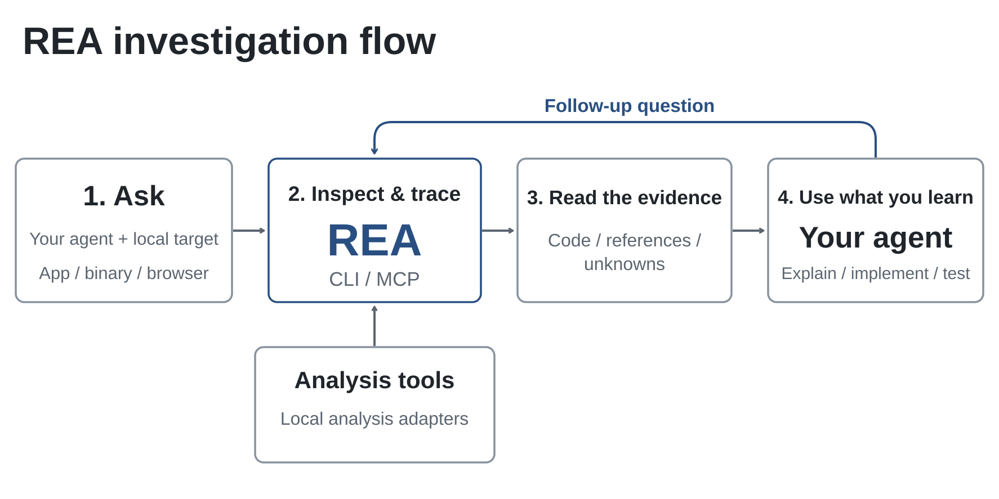

<div align="center">

[English](../../README.md) · [简体中文](README_zh.md) · [繁體中文](README_zh-TW.md) · [日本語](README_ja.md) · [한국어](README_ko.md) · [Türkçe](README_tr.md) · [Русский](README_ru.md) · [Tiếng Việt](README_vi.md) · **ไทย** · [Deutsch](README_de.md) · [Español](README_es.md) · [Français](README_fr.md) · [Українська](README_uk.md) · [Polski](README_pl.md) · [Português (Brasil)](README_pt-BR.md) · [العربية](README_ar.md) · [فارسی](README_fa.md) · [Bahasa Indonesia](README_id.md) · [Italiano](README_it.md)
· [Ελληνικά](README_el.md) · [മലയാളം](README_ml.md) · [Roman Urdu](README_ur-Latn.md) · [Română](README_ro.md) · [Български](README_bg.md) · [हिन्दी](README_hi.md)

# REA: Reverse Engineer Anything

### MCP เดียวสำหรับวิศวกรรมย้อนกลับ ทั้งไบนารี แอปพลิเคชัน และพฤติกรรมขณะทำงาน

**เห็นฟีเจอร์ที่ชอบแล้วอยากรู้ว่าทำงานอย่างไร? เข้าใจได้ลึกถึงระดับไบนารี**

[](https://github.com/morluto/rea/stargazers)
[](https://www.npmjs.com/package/rea-agents)
[](../../LICENSE)
[](https://discord.gg/GkcryMnJDM)
[](https://x.com/reatools)
[](../getting-started/installation.md)
[](https://skills.sh/morluto/rea/reverse-engineer-anything)

**[เว็บไซต์](https://rea.tools/th/) · [คู่มือ](https://rea.tools/th/guides/) · [ตัวอย่างการใช้งาน](https://rea.tools/th/showcase/)**

<a href="https://discord.com/invite/GkcryMnJDM"></a>

[เริ่มต้นอย่างรวดเร็ว](#เริ่มต้นอย่างรวดเร็ว) · [ตัวอย่างการใช้งาน](#ตัวอย่างการใช้งาน) · [REA ทำงานอย่างไร](#rea-ทำงานอย่างไร) · [สิ่งที่วิเคราะห์ได้](#สิ่งที่วิเคราะห์ได้) · [สร้างสภาพแวดล้อม RL](#build-rl-environments) · [คำถามที่พบบ่อย](#คำถามที่พบบ่อย) · [เอกสาร](#เอกสาร)

<code>npx rea-agents setup</code>

</div>

> [!IMPORTANT]
> แหล่งทางการของ REA: [morluto/rea](https://github.com/morluto/rea), [rea.tools](https://rea.tools/), [rea-agents](https://www.npmjs.com/package/rea-agents) (npm).
> โปรดใช้ลิงก์ติดตั้งและรุ่นเผยแพร่จากแหล่งทางการเหล่านี้ ชื่อที่เก็บโค้ดที่คล้ายกันหรือ README ที่คัดลอกมาไม่ได้ยืนยันว่าไฟล์ดาวน์โหลดเป็นของทางการ

<div align="center">

<br />


<br /><br />

<table aria-label="ชุมชน REA">
<tr>
<td align="center" width="360">
  <a href="https://discord.gg/GkcryMnJDM">
    <br />
    <strong>เข้าร่วมชุมชนวิศวกรรมย้อนกลับ</strong>
  </a><br />
  <sub>Discord · ถามตอบ · แบ่งปันผลงาน</sub>
</td>
</tr>
</table>

<br />

</div>

---

เห็นฟีเจอร์ในแอปที่อยากนำมาใช้ในผลิตภัณฑ์ของคุณเองหรือไม่? ขอให้เอเจนต์ของคุณตรวจสอบด้วย REA เอเจนต์สามารถวิเคราะห์แอปโดยไม่ต้องมีซอร์สโค้ด อธิบายการทำงานของฟีเจอร์ แสดงหลักฐาน และสร้างเวอร์ชันสำหรับโปรเจกต์ของคุณได้

REA เชื่อมเอเจนต์ของคุณกับเครื่องมือสำหรับตรวจสอบไบนารีเนทีฟ แอป JavaScript และ Electron แอสเซมบลี .NET และเว็บไซต์ คุณใช้เครื่องมือเดียวกันจากเทอร์มินัลได้ การวิเคราะห์ทำงานบนเครื่องของคุณ และผลลัพธ์มีทั้งหลักฐานและข้อจำกัดที่ประกอบแต่ละข้อสรุป

การตั้งค่าลงทะเบียน REA กับเอเจนต์และติดตั้งคำแนะนำการทำงานที่ตรงกัน การวิเคราะห์เนทีฟใช้ Hopper, Ghidra, IDA หรือ Kuna ที่มีอยู่ได้ และติดตั้ง Hopper ได้เมื่อคุณอนุมัติ การวิเคราะห์ JavaScript แบบสแตติกไม่ต้องใช้เอนจินวิเคราะห์เนทีฟ

## เริ่มต้นอย่างรวดเร็ว

**[เริ่มต้นอย่างรวดเร็ว · rea.tools](https://rea.tools/th/get-started/)**

### ตั้งค่าเอเจนต์ (MCP)

เมื่อติดตั้ง [Node.js และ npm](../reference/supported-targets.md) แล้ว ให้รันคำสั่งนี้จากไดเรกทอรีที่เชื่อถือได้ภายนอกโครงการที่ต้องการวิเคราะห์

```bash
npx rea-agents setup
```

เลือกเอเจนต์ ตรวจสอบการเปลี่ยนแปลงที่เสนอ แล้วอนุมัติ ขั้นตอนตั้งค่าจะเพิ่มเซิร์ฟเวอร์ MCP ของ REA และคำแนะนำการทำงานที่ตรงกัน พร้อมสำรองการตั้งค่าที่มีอยู่ จากนั้นเริ่มเอเจนต์ใหม่

[การติดตั้งและตั้งค่า](../getting-started/installation.md)

ถามเอเจนต์:

```text
ตรวจสอบว่าการค้นหาในแอป Notes ทำงานอย่างไร แสดงหลักฐานให้ฉันดู และสร้างฟีเจอร์ที่คล้ายกันสำหรับโปรเจกต์ของฉัน
```

แทนที่ Notes ด้วยแอปเป้าหมายและฟีเจอร์ที่คุณต้องการเข้าใจ

### ใช้เทอร์มินัล (CLI)

ตรวจสอบไดเรกทอรีแอป JavaScript/Electron ที่แตกไฟล์แล้ว หรือไฟล์ ASAR:

```bash
npx -y rea-agents@latest analyze-javascript-application /absolute/path/to/app --json
```

ผลลัพธ์ประกอบด้วยโมดูล การนำเข้า ขอบเขตของ Electron และหลักฐาน แทนที่พาธด้วยเป้าหมายของคุณ เช่น `"D:/apps/example"` บน Windows

หากต้องการติดตั้งคำสั่ง `rea` สำหรับใช้งานเป็นประจำ:

```bash
npm install --global rea-agents
rea --help
```

สำหรับการวิเคราะห์เนทีฟ ให้ตั้งค่าผู้ให้บริการวิเคราะห์ก่อน ดู[คู่มือ CLI และ Evidence](../getting-started/cli.md) สำหรับคำสั่งเนทีฟ การเลือกผู้ให้บริการ สแนปช็อต และการใช้งานในสคริปต์

[ข้อกำหนดสำหรับ Linux](../getting-started/installation.md#linux-owned-process-prerequisite)

### อัปเดต REA

สำหรับ CLI ที่ติดตั้งผ่าน `npm install --global` / `bun add --global`:

```bash
rea update
```

หากใช้ `npx` ให้อัปเดตการตั้งค่าเอเจนต์ด้วย:

```bash
npx rea-agents@latest setup
```

[อัปเดตและถอนการติดตั้ง](../getting-started/installation.md#diagnose-update-and-remove)

## ตัวอย่างการใช้งาน

<a href="https://rea.tools/th/showcase/">
  <picture>
    <source media="(prefers-color-scheme: dark)" srcset="../assets/rea-showcases-dark.svg" />
    
  </picture>
</a>

<table>
<tbody>
<tr><td>
<h3>DX-Ball: สร้างการคำนวณแพนเสียงขึ้นใหม่</h3>
<p>ติดตามการเรียกเสียงไปยังฟังก์ชันช่วยแปลงตำแหน่งเป็นค่าแพน ตรวจสอบคำสั่ง และแปลงโค้ดเทียมที่ยังไม่สมบูรณ์เป็น C การสร้างขึ้นใหม่นี้ผ่านการทดสอบ 3,205 กรณีเทียบกับ x86 ต้นฉบับ และสร้างไบต์ทั้ง 63 ไบต์ของฟังก์ชันที่คอมไพล์แล้วได้ตรงกัน</p>
<p><a href="https://rea.tools/th/showcase/dx-ball/">อ่านกรณีศึกษา</a> · <a href="https://github.com/N0zoM1z0/dx-ball">รีโพซิทอรีการสร้างขึ้นใหม่</a></p>
</td></tr>
<tr><td>
<h3>Notion: ติดตามบริดจ์คลิปบอร์ดของ Electron</h3>
<p>ค้นหา API คลิปบอร์ดของ renderer ติดตามผ่าน preload และ IPC ไปยังโปรเซสหลัก แล้วตรวจสอบรูปแบบคลิปบอร์ดที่มีข้อมูลการจัดรูปแบบ</p>
<p><a href="https://rea.tools/th/showcase/notion/">อ่านกรณีศึกษา</a></p>
</td></tr>
<tr><td>
<h3>TH04: กู้คืนการคำนวณวงแหวนกระสุนของ DOS</h3>
<p>ตรวจสอบคำสั่ง 16 บิตของเกมต้นฉบับบน PC-98 กู้คืนการคำนวณมุมคงที่และมุมเล็งเป้าหมาย แล้วเปรียบเทียบ C++ ที่สร้างขึ้นใหม่กับผลลัพธ์จากคอมไพเลอร์ในยุคนั้น</p>
<p><a href="https://rea.tools/th/showcase/th04/">อ่านกรณีศึกษา</a> · <a href="https://github.com/N0zoM1z0/th04">รีโพซิทอรีการสร้างขึ้นใหม่</a></p>
</td></tr>
</tbody>
</table>

หากคุณใช้ REA กับสิ่งที่น่าสนใจ เราอยากเห็นผลงานของคุณ แบ่งปันกรณีของคุณผ่าน [issue](https://github.com/morluto/rea/issues) หรือ [pull request](https://github.com/morluto/rea/pulls) พร้อมระบุเป้าหมาย คำถามของคุณ REA ช่วยอย่างไร และสิ่งที่คุณค้นพบ

## REA ทำงานอย่างไร

เอเจนต์เรียก REA ผ่าน MCP เพื่อตรวจสอบเป้าหมายและติดตามโค้ดที่เกี่ยวข้อง REA ส่งข้อค้นพบกลับมาพร้อมหลักฐาน เอเจนต์ใช้ข้อมูลนี้เพื่อถามคำถามต่อ อธิบายพฤติกรรม หรือเขียนและทดสอบการนำไปใช้งาน คำสั่ง CLI ใช้กระบวนการเดียวกัน



[เปิดภาพขนาดเต็ม](../../website/public/assets/figures/rea-investigation-flow.svg)

<a id="current-status"></a>

## สิ่งที่วิเคราะห์ได้

ไบนารีเนทีฟ · JavaScript / Electron · เว็บไซต์ · แอสเซมบลี .NET · APK ของ Android · เฟิร์มแวร์ · พฤติกรรมของโปรเซส

[รูปแบบที่รองรับและข้อกำหนด](../reference/supported-targets.md)

<a id="choosing-a-deep-analysis-provider"></a>

[เลือกเครื่องมือวิเคราะห์](../reference/supported-targets.md#choosing-a-deep-analysis-provider)

<a id="build-rl-environments"></a>

## สร้างสภาพแวดล้อม RL

สร้างสภาพแวดล้อมในเครื่องจากเซสชันเว็บที่บันทึกไว้หรือแอปเดสก์ท็อป Linux เพื่อให้เอเจนต์ฝึกทำงานและตรวจสอบผลลัพธ์ได้

[สร้างสภาพแวดล้อม RL](https://rea.tools/guides/rl-environments/)

## คำถามที่พบบ่อย

<details>
<summary><strong>เอเจนต์ใดใช้ REA ได้บ้าง?</strong></summary>

เอเจนต์ใดก็ตามที่รองรับเซิร์ฟเวอร์ MCP บนเครื่อง ขั้นตอนตั้งค่าจะกำหนดค่าให้กับ[เอเจนต์ที่รองรับ](../getting-started/installation.md#supported-agents) ส่วนไคลเอนต์อื่นใช้[การลงทะเบียน MCP ด้วยตนเอง](../getting-started/installation.md#mcp-registry) ได้

</details>

<details>
<summary><strong>จำเป็นต้องมี Hopper, Ghidra, IDA หรือ Kuna หรือไม่?</strong></summary>

การวิเคราะห์เนทีฟเชิงลึกต้องใช้หนึ่งในเครื่องมือเหล่านี้ การตรวจสอบ JavaScript และ .NET แบบสถิตทำงานได้โดยไม่มีเอนจินวิเคราะห์เนทีฟ ขั้นตอนตั้งค่าสามารถติดตั้ง Hopper หลังได้รับอนุมัติ ส่วน Ghidra, IDA และ Kuna ใช้การติดตั้งที่คุณมีอยู่แล้ว ดู[การตั้งค่าผู้ให้บริการวิเคราะห์](../getting-started/installation.md#hopper)

</details>

<details>
<summary><strong>ต้องเริ่ม Hopper ก่อนหรือไม่?</strong></summary>

REA เริ่ม Hopper เมื่อการดำเนินการต้องใช้ บน macOS อาจมีหน้าต่างเมื่อรันครั้งแรกให้เลือกโหมดทดลองหรือเปิดใช้ใบอนุญาต ดู[การเริ่ม Hopper และการแก้ไขปัญหา](../getting-started/installation.md#launcher-paths-and-troubleshooting)

</details>

<details>
<summary><strong>การติดตั้งสกิลจาก skills.sh ทำอะไร?</strong></summary>

สกิลให้คำแนะนำการตรวจสอบแก่เอเจนต์ ใช้ `npx rea-agents setup` เพื่อลงทะเบียนเซิร์ฟเวอร์ MCP ของ REA และติดตั้งคำแนะนำที่ตรงกัน แล้วเริ่มเอเจนต์ใหม่ ดู[การติดตั้งเฉพาะสกิล](../getting-started/installation.md#skill-only-installation)

</details>

<details>
<summary><strong>REA ส่งกลับโค้ดแบบใด?</strong></summary>

การวิเคราะห์เนทีฟส่งกลับโค้ดเทียมและแอสเซมบลี การวิเคราะห์ JavaScript/Electron กู้คืนโมดูลและความสัมพันธ์ระหว่างโมดูล เอเจนต์ใช้ข้อค้นพบเหล่านี้เพื่อเขียนและทดสอบการนำไปใช้งาน ดูตัวอย่างที่ทำจริงใน[ตัวอย่างการใช้งาน](#ตัวอย่างการใช้งาน)

</details>

<details>
<summary><strong>REA อัปโหลดแอปของฉันหรือไม่?</strong></summary>

REA วิเคราะห์เป้าหมายบนเครื่องของคุณ เอเจนต์ได้รับผลลัพธ์ของเครื่องมือ และผู้ให้บริการโมเดลของเอเจนต์มีนโยบายข้อมูลของตนเอง

</details>

<details>
<summary><strong>ควรทำอย่างไรเมื่อพบข้อผิดพลาด?</strong></summary>

อัปเดตก่อน รุ่นล่าสุดอาจแก้ไขปัญหานี้แล้ว

สำหรับ CLI ที่ติดตั้งผ่าน npm:

```bash
rea update
```

สำหรับการตั้งค่าเอเจนต์ผ่าน `npx`:

```bash
npx rea-agents@latest setup
```

หากใช้เอเจนต์ ให้ทำ[การปรับปรุงการตั้งค่า](#อัปเดต-rea) ให้เสร็จแล้วเริ่มเอเจนต์ใหม่ ลองงานเดิมอีกครั้ง หากยังพบปัญหา ให้[เปิด issue](https://github.com/morluto/rea/issues) พร้อมระบุรุ่น REA ประเภทเป้าหมาย ขั้นตอนทำให้เกิดปัญหา และข้อความข้อผิดพลาด

</details>

## เอกสาร

เริ่มจาก[คู่มือพร้อมตัวอย่าง](https://rea.tools/th/guides/) บนเว็บไซต์ สำหรับตัวเลือก ข้อกำหนดเบื้องต้น และสัญญาผลลัพธ์ที่แน่นอน:

- [การติดตั้งและตั้งค่า](../getting-started/installation.md): การลงทะเบียนเอเจนต์ การตั้งค่าผู้ให้บริการ การอัปเดต และการถอนการติดตั้ง
- [ความพร้อมใช้งานและการแก้ไขปัญหา](../getting-started/installation.md#check-readiness-for-your-task): ตรวจวินิจฉัยเอเจนต์หรือเอนจินวิเคราะห์หนึ่งตัว
- [CLI และ Evidence](../getting-started/cli.md): คำสั่ง การเลือกผู้ให้บริการ สแนปช็อต การนำเข้า/ส่งออก และรหัสการสิ้นสุด
- [สัญญา MCP](../reference/mcp-contracts.md) และ[พรอมป์ต์สำหรับเอเจนต์](../getting-started/mcp-prompts.md): ผลลัพธ์เครื่องมือ เซสชัน และการตรวจสอบตามคำแนะนำ
- [แค็ตตาล็อกเครื่องมือ](../reference/mcp-contracts.md#generated-catalog): รายการเครื่องมือ ผู้ให้บริการ และคำสั่ง CLI ที่สร้างระหว่างการบิลด์

รายงานช่องโหว่ผ่าน [SECURITY.md](../../SECURITY.md)

## ชุมชนและการสนับสนุน

- **Discord** — ร่วมถามคำถามและแบ่งปันสิ่งที่คุณกำลังศึกษากับชุมชนนักวิศวกรรมย้อนกลับและนักสร้างสรรค์กว่า 50,000 คน! [](https://discord.gg/GkcryMnJDM)
- **Twitter / X** — ติดตาม [@reatools](https://x.com/reatools) เพื่อรับข่าวสารและประกาศ
- **ข้อเสนอแนะ** — อยากได้ฟีเจอร์ใหม่หรือต้องการให้รองรับไฟล์รูปแบบใด บอกเราได้ทาง [GitHub](https://github.com/morluto/rea/issues) หรือ [Discord](https://discord.gg/GkcryMnJDM)

## ประวัติดาว

🎉 **400,000 ดาวบน GitHub — ขอบคุณทุกคน!**

ขอบคุณทุกคนที่ใช้ REA รายงานบั๊ก เสนอฟีเจอร์ ทดสอบบิลด์ และช่วยแก้ไข

<a href="https://rea.tools/th/contributors/">
  
</a>

<a href="https://www.star-history.com/?repos=morluto%2Frea&amp;type=date">
  <picture>
    <source media="(prefers-color-scheme: dark)" srcset="https://api.star-history.com/chart?repos=morluto/rea&amp;type=date&amp;theme=dark&amp;legend=top-left" />
    <source media="(prefers-color-scheme: light)" srcset="https://api.star-history.com/chart?repos=morluto/rea&amp;type=date" />
    
  </picture>
</a>

## การมีส่วนร่วม

เรายินดีรับความช่วยเหลือในการพัฒนา REA! [เปิด issue](https://github.com/morluto/rea/issues) เพื่อรายงานบั๊กหรือเสนอฟีเจอร์ หรือ[ส่ง pull request](https://github.com/morluto/rea/pulls) เพื่อปรับปรุงโค้ดหรือเอกสาร

ดู [CONTRIBUTING.md](../../CONTRIBUTING.md) สำหรับการตั้งค่าสภาพแวดล้อมพัฒนาและการตรวจสอบ ดู[การทดสอบ](../development/testing.md) สำหรับแนวทางการตรวจยืนยัน

## ข้อสงวนสิทธิ์

ดูแนวทางการใช้งานอย่างรับผิดชอบใน [DISCLAIMER.md](../../DISCLAIMER.md)

REA มีไว้สำหรับการวิจัย การศึกษา การทำงานร่วมกัน การอนุรักษ์ซอฟต์แวร์ และการวิเคราะห์ซอฟต์แวร์ที่คุณเป็นเจ้าของหรือได้รับอนุญาตให้ตรวจสอบ โดยปฏิบัติตามกฎหมาย

The project's position on illegal or unauthorized use covers all REA
versions, distribution channels, and platforms; each copy retains its
applicable licenses.

## สัญญาอนุญาต

[MIT](../../LICENSE)

REA-authored code is licensed under MIT. Third-party material retains its own
licenses and copyright notices; see [Third-party notices](../../THIRD_PARTY_NOTICES.md)
for the dependency inventory, preserved license texts, and external-tool terms.

**You must legally obtain and be authorized to use commercial tools**, including
IDA Pro / Hex-Rays decompilers, Hopper, and JEB, under their applicable licenses.
REA grants no tool license, key, or activation entitlement. Trials and demos
remain subject to vendor terms, including user, feature, automation, and output
sharing restrictions. Cracked copies, stolen keys, unauthorized key sharing,
and bypassing license restrictions are not authorized. This guidance does not
amend MIT or third-party licenses.
