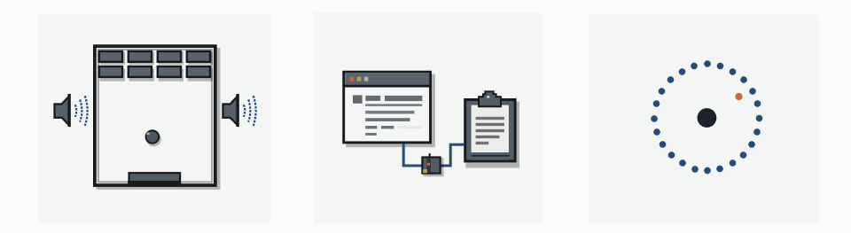

<div align="center">

[English](../../README.md) · [简体中文](README_zh.md) · [繁體中文](README_zh-TW.md) · [日本語](README_ja.md) · [한국어](README_ko.md) · [Türkçe](README_tr.md) · [Русский](README_ru.md) · [Tiếng Việt](README_vi.md) · [ไทย](README_th.md) · [Deutsch](README_de.md) · [Español](README_es.md) · [Français](README_fr.md) · **Українська** · [Polski](README_pl.md) · [Português (Brasil)](README_pt-BR.md) · [العربية](README_ar.md) · [فارسی](README_fa.md) · [Bahasa Indonesia](README_id.md) · [Italiano](README_it.md)
· [Ελληνικά](README_el.md) · [മലയാളം](README_ml.md) · [Roman Urdu](README_ur-Latn.md) · [Română](README_ro.md) · [Български](README_bg.md)

# REA: Реверс-інжиніринг будь-чого

### Один MCP для реверс-інжинірингу бінарних файлів, застосунків і поведінки під час виконання.

**Побачили цікаву функцію? Зрозумійте, як вона працює, аж до рівня двійкового коду.**

[](https://github.com/morluto/rea/stargazers)
[](https://www.npmjs.com/package/rea-agents)
[](../../LICENSE)
[](https://discord.gg/GkcryMnJDM)
[](https://x.com/reatools)
[](../getting-started/installation.md)
[](https://skills.sh/morluto/rea/reverse-engineer-anything)

**[Сайт](https://rea.tools/uk/) · [Посібники](https://rea.tools/uk/guides/) · [Приклади](https://rea.tools/uk/showcase/)**

<a href="https://discord.com/invite/GkcryMnJDM"></a>

[Швидкий старт](#швидкий-старт) · [Приклади](#приклади) · [Як працює REA](#як-працює-rea) · [Що можна аналізувати](#що-можна-аналізувати) · [Створення RL-середовищ](#build-rl-environments) · [Поширені запитання](#поширені-запитання) · [Документація](#документація)

<code>npx rea-agents setup</code>

</div>

> [!IMPORTANT]
> Офіційні джерела REA: [morluto/rea](https://github.com/morluto/rea), [rea.tools](https://rea.tools/), [rea-agents](https://www.npmjs.com/package/rea-agents) (npm).
> Користуйтеся посиланнями на встановлення та випуски з цих офіційних джерел. Схожа назва репозиторію або скопійований README не підтверджують, що завантажуваний файл є офіційним.

<div align="center">

<br />


<br /><br />

<table aria-label="Спільнота REA">
<tr>
<td align="center" width="360">
  <a href="https://discord.gg/GkcryMnJDM">
    <br />
    <strong>Приєднуйтеся до спільноти реверс-інжинірингу</strong>
  </a><br />
  <sub>Discord · Запитання й відповіді · Обмін результатами</sub>
</td>
</tr>
</table>

<br />

</div>

---

Побачили в застосунку функцію, яку хочете додати до свого продукту? Попросіть агента дослідити її за допомогою REA. Він може перевірити застосунок без вихідного коду, пояснити роботу функції, показати підтвердження та створити реалізацію для вашого проєкту.

REA підключає вашого агента до інструментів дослідження нативних бінарних файлів, застосунків JavaScript і Electron, збірок .NET та сайтів. Ті самі інструменти можна використовувати з термінала. Аналіз виконується локально, а результати містять підтвердження й обмеження, на яких ґрунтується кожен висновок.

Налаштування реєструє REA в агенті та встановлює відповідні інструкції. Нативний аналіз використовує наявний Hopper, Ghidra, IDA або Kuna; Hopper можна встановити після схвалення. Статичний аналіз JavaScript не потребує нативного рушія.

## Швидкий старт

**[Швидкий старт · rea.tools](https://rea.tools/uk/get-started/)**

### Налаштуйте агента (MCP)

Установіть [Node.js і npm](../reference/supported-targets.md) і виконайте команду в довіреному каталозі поза досліджуваним проєктом.

```bash
npx rea-agents setup
```

Виберіть агентів, перевірте запропоновані зміни та схваліть їх. Налаштування додає MCP-сервер REA та відповідні інструкції робочих процесів, створюючи резервні копії наявної конфігурації. Після цього перезапустіть агента.

[встановлення й налаштування](../getting-started/installation.md)

Запитайте агента:

```text
Досліди, як працює пошук у застосунку Notes, покажи підтвердження й створи подібну функцію для мого проєкту.
```

Замініть Notes цільовим застосунком і вкажіть функцію, яку хочете зрозуміти.

### Використовуйте термінал (CLI)

Перевірте розпакований каталог застосунку JavaScript/Electron або файл ASAR:

```bash
npx -y rea-agents@latest analyze-javascript-application /absolute/path/to/app --json
```

Результат містить модулі, імпорти, межі Electron і підтвердження для них. Замініть шлях своїм, наприклад `"D:/apps/example"` у Windows.

Для регулярного використання встановіть команду `rea`:

```bash
npm install --global rea-agents
rea --help
```

Для нативного аналізу спочатку налаштуйте провайдера. Нативні команди, вибір провайдера, знімки та використання у скриптах описує [посібник CLI та Evidence](../getting-started/cli.md).

[Вимоги для Linux](../getting-started/installation.md#linux-owned-process-prerequisite)

### Оновіть REA

Для CLI, встановленого через `npm install --global` / `bun add --global`:

```bash
rea update
```

Якщо використовуєте `npx`, оновіть налаштування агента командою:

```bash
npx rea-agents@latest setup
```

[Оновлення й видалення](../getting-started/installation.md#diagnose-update-and-remove)

## Приклади

<a href="https://rea.tools/uk/showcase/">
  <picture>
    <source media="(prefers-color-scheme: dark)" srcset="../assets/rea-showcases-dark.svg" />
    
  </picture>
</a>

<table>
<tbody>
<tr><td>
<h3>DX-Ball: відновлення розрахунку звукової панорами</h3>
<p>Простежте звуковий виклик до допоміжної функції, що перетворює координату на панорамування, перевірте інструкції та перетворіть неповний псевдокод на C. Відновлена реалізація проходить 3 205 тестів з оригінальним x86-кодом і відтворює всі 63 байти скомпільованої функції.</p>
<p><a href="https://rea.tools/uk/showcase/dx-ball/">Прочитати дослідження</a> · <a href="https://github.com/N0zoM1z0/dx-ball">Репозиторій реконструкції</a></p>
</td></tr>
<tr><td>
<h3>Notion: відстеження мосту буфера обміну Electron</h3>
<p>Знайдіть API буфера обміну в процесі рендерингу, простежте його через preload та IPC до головного процесу й перевірте формат буфера обміну з даними форматування.</p>
<p><a href="https://rea.tools/uk/showcase/notion/">Прочитати дослідження</a></p>
</td></tr>
<tr><td>
<h3>TH04: відновлення розрахунку кільця куль у DOS</h3>
<p>Перевірте 16-бітні інструкції оригінальної гри для PC-98, відновіть розрахунки фіксованих і прицільних кутів та порівняйте відновлений C++ із виводом тогочасного компілятора.</p>
<p><a href="https://rea.tools/uk/showcase/th04/">Прочитати дослідження</a> · <a href="https://github.com/N0zoM1z0/th04">Репозиторій реконструкції</a></p>
</td></tr>
</tbody>
</table>

Якщо ви дослідили з REA щось цікаве, поділіться результатом. Створіть [issue](https://github.com/morluto/rea/issues) або [pull request](https://github.com/morluto/rea/pulls) і вкажіть ціль, ваше запитання, як допоміг REA та що ви з'ясували.

## Як працює REA

Агент викликає REA через MCP, щоб перевірити ціль і простежити пов'язаний код. REA повертає знахідки разом із підтвердженнями. Агент використовує їх для уточнювальних запитань, пояснення поведінки або написання й тестування реалізації. Команди CLI використовують ті самі робочі процеси.


[Відкрити зображення в повному розмірі](../../website/public/assets/figures/rea-investigation-flow.svg).

<a id="current-status"></a>

## Що можна аналізувати

Нативні бінарні файли · JavaScript / Electron · Сайти · Збірки .NET · Android APK · Прошивки · Поведінка процесів

[Підтримувані формати й вимоги](../reference/supported-targets.md)

<a id="choosing-a-deep-analysis-provider"></a>

[Вибір засобу аналізу](../reference/supported-targets.md#choosing-a-deep-analysis-provider)

<a id="build-rl-environments"></a>

## Створення RL-середовищ

Створіть локальне середовище із записаного вебсеансу або настільного застосунку Linux, щоб агент міг відпрацьовувати завдання й перевіряти результат.

[Створення RL-середовищ](https://rea.tools/guides/rl-environments/)

## Поширені запитання

<details>
<summary><strong>Які агенти можуть використовувати REA?</strong></summary>

Будь-який агент, що підтримує локальні MCP-сервери. Налаштування конфігурує [підтримуваних агентів](../getting-started/installation.md#supported-agents); інші клієнти можуть використати [ручну реєстрацію MCP](../getting-started/installation.md#mcp-registry).

</details>

<details>
<summary><strong>Чи потрібні мені Hopper, Ghidra, IDA або Kuna?</strong></summary>

Поглиблений нативний аналіз використовує один із цих інструментів. Статична перевірка JavaScript і .NET працює без рушія нативного аналізу. Налаштування може встановити Hopper після схвалення; Ghidra, IDA й Kuna використовують наявні встановлення. Дивіться [налаштування провайдерів](../getting-started/installation.md#hopper).

</details>

<details>
<summary><strong>Чи потрібно спочатку запускати Hopper?</strong></summary>

REA запускає Hopper, коли він потрібен для операції. У macOS під час першого запуску може з'явитися діалог вибору деморежиму або активації ліцензії. Дивіться [запуск Hopper та усунення неполадок](../getting-started/installation.md#launcher-paths-and-troubleshooting).

</details>

<details>
<summary><strong>Що дає встановлення skill із skills.sh?</strong></summary>

Skill надає агенту інструкції дослідження. Використовуйте `npx rea-agents setup`, щоб зареєструвати MCP-сервер REA та встановити відповідні інструкції, а потім перезапустіть агента. Дивіться [встановлення лише skill](../getting-started/installation.md#skill-only-installation).

</details>

<details>
<summary><strong>Який код повертає REA?</strong></summary>

Нативний аналіз повертає псевдокод і асемблерний код. Аналіз JavaScript/Electron відновлює модулі та їхні зв'язки. Агент використовує ці результати, щоб написати й протестувати реалізацію; [приклади](#приклади) містять практичні дослідження.

</details>

<details>
<summary><strong>Чи завантажує REA мій застосунок на сервер?</strong></summary>

REA аналізує цілі локально. Ваш агент отримує результати інструментів, а постачальник його моделі має власну політику даних.

</details>

<details>
<summary><strong>Що робити, якщо я зіткнувся з помилкою?</strong></summary>

Спочатку оновіться: нещодавній випуск уже міг виправити помилку.

Для CLI, встановленого через npm:

```bash
rea update
```

Для налаштування агента через `npx`:

```bash
npx rea-agents@latest setup
```

Якщо використовуєте агента, завершіть [оновлення налаштувань](#оновіть-rea) і перезапустіть його. Повторіть те саме завдання. Якщо проблема залишається, [відкрийте issue](https://github.com/morluto/rea/issues) із версією REA, типом цілі, кроками відтворення та виводом помилки.

</details>

## Документація

Почніть із [практичних посібників](https://rea.tools/uk/guides/) на сайті. Точні параметри, передумови й контракти результатів описано тут:

- [Встановлення й налаштування](../getting-started/installation.md): реєстрація агентів, конфігурація провайдерів, оновлення та видалення.
- [Готовність та усунення неполадок](../getting-started/installation.md#check-readiness-for-your-task): діагностика конкретного агента або рушія аналізу.
- [CLI та Evidence](../getting-started/cli.md): команди, вибір провайдера, знімки, імпорт/експорт і статуси завершення.
- [Контракти MCP](../reference/mcp-contracts.md) і [промпти агентів](../getting-started/mcp-prompts.md): результати інструментів, сеанси й керовані дослідження.
- [Каталог інструментів](../reference/mcp-contracts.md#generated-catalog): створюваний під час збірки перелік інструментів, провайдерів і команд CLI.

Повідомляйте про вразливості згідно з [SECURITY.md](../../SECURITY.md).

## Спільнота й підтримка

- **Discord** — Ставте запитання й діліться знахідками в нашій спільноті: понад 50 000 учасників захоплюються зворотною інженерією та створюють власні проєкти! [](https://discord.gg/GkcryMnJDM)
- **Twitter / X** — Стежте за новинами в [@reatools](https://x.com/reatools).
- **Відгуки та ідеї** — Потрібна нова функція або підтримка формату файлів? Напишіть нам у [GitHub](https://github.com/morluto/rea/issues) або [Discord](https://discord.gg/GkcryMnJDM).

## Історія зірок

🎉 **400 000 зірок на GitHub — дякуємо!**

Дякуємо всім, хто використовує REA, повідомляє про помилки, пропонує нові функції, тестує збірки й допомагає з виправленнями.

<a href="https://rea.tools/uk/contributors/">
  
</a>

<a href="https://www.star-history.com/?repos=morluto%2Frea&amp;type=date">
  <picture>
    <source media="(prefers-color-scheme: dark)" srcset="https://api.star-history.com/chart?repos=morluto/rea&amp;type=date&amp;theme=dark&amp;legend=top-left" />
    <source media="(prefers-color-scheme: light)" srcset="https://api.star-history.com/chart?repos=morluto/rea&amp;type=date" />
    
  </picture>
</a>

## Участь у проєкті

Будемо раді вашій допомозі з REA! [Відкрийте issue](https://github.com/morluto/rea/issues), щоб повідомити про помилку чи запропонувати функцію, або [надішліть pull request](https://github.com/morluto/rea/pulls) з поліпшеннями коду чи документації.

Налаштування середовища розробки й перевірки описано в [CONTRIBUTING.md](../../CONTRIBUTING.md), шляхи верифікації — у [посібнику тестування](../development/testing.md).

## Відмова від відповідальності

Рекомендації щодо відповідального використання наведено в [DISCLAIMER.md](../../DISCLAIMER.md).

REA призначений для законних досліджень, навчання, забезпечення сумісності, збереження програмного забезпечення й аналізу програм, якими ви володієте або які маєте дозвіл досліджувати.

The project's position on illegal or unauthorized use covers all REA
versions, distribution channels, and platforms; each copy retains its
applicable licenses.

## Ліцензія

[MIT](../../LICENSE)

REA-authored code is licensed under MIT. Third-party material retains its own
licenses and copyright notices; see [Third-party notices](../../THIRD_PARTY_NOTICES.md)
for the dependency inventory, preserved license texts, and external-tool terms.

**You must legally obtain and be authorized to use commercial tools**, including
IDA Pro / Hex-Rays decompilers, Hopper, and JEB, under their applicable licenses.
REA grants no tool license, key, or activation entitlement. Trials and demos
remain subject to vendor terms, including user, feature, automation, and output
sharing restrictions. Cracked copies, stolen keys, unauthorized key sharing,
and bypassing license restrictions are not authorized. This guidance does not
amend MIT or third-party licenses.
